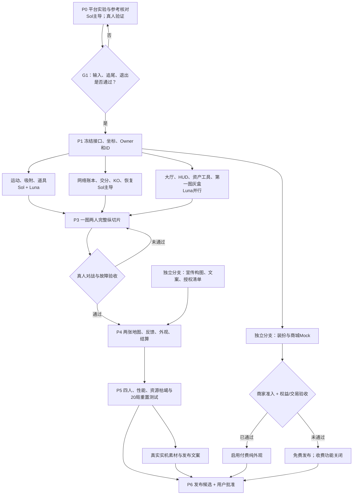
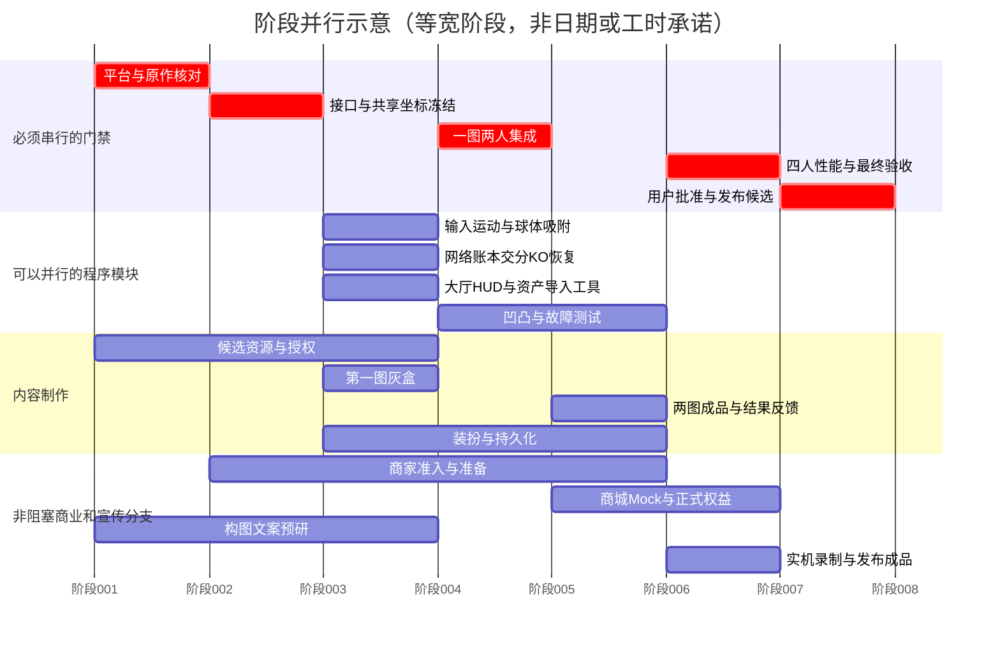

# 04 执行阶段与任务分工

所有阶段按依赖推进，不是工期承诺。甘特图以2000年日期作渲染占位，
每个等宽刻度代表一个抽象阶段；不能当作“某任务只需一天”的估算。

## 阶段总表
| 阶段 | 主要结果 | Sol工作 | Luna可并行工作 | 人工门禁 |
|---|---|---|---|---|
| P0 | 平台能工作、参考边界可证 | 最小Unity工程、Station/输入实验 | 原版规则核对、资源清单、宣传构图 | VR佩戴与安全退出 |
| P1 | 统一契约 | 坐标、状态、Owner、ID、协议 | 按契约准备模板 | 商家资格可同时办理 |
| P2 | 独立可测试模块 | 运动、形状、账本、事务 | B输入、UI、道具、资产工具、外观、地图灰盒 | 不用真人代替所有自动测试 |
| P3 | 一张图两人能完整玩 | 集成、故障恢复、规则修正 | 有边界的修复与测试工具 | 真正两客户端；决定凹凸物理范围 |
| P4 | 两图与内容成品 | 付费安全与关键审查 | 地图美术、反馈、结果板、持久化、商城Mock | 授权和平台准入 |
| P5 | 可发布候选 | 四人性能/耐久测试 | 真实宣传、剩余UI/本地化 | 四人体验、可选真实内购 |
| P6 | 批准上线 | 锁版本、回滚包 | 发布素材整理 | 用户明确批准 |
| P7 | 第三张夜市（可选） | 必要规则审查 | 复用流水线制作 | 重做地图/性能验收 |

## 真正关键路径
平台实测 → 契约 → 运动/资源/网络/交分 → 一图两人 → 故障与四人 → 发布。
资产候选、宣传草稿和商家申请可以早启动。
第二地图必须在首张纵切片验证后，才大规模做正式美术。
商城资格未通过时可免费发布；收费功能保持关闭，不让商家审批阻塞基本游戏。
参考原作未知值必须写成项目暂定值，不能因此假装“已还原”。

## 角色
SOL = GPT-6.1 Sol；LUNA = GPT-6 Luna；HUMAN = 用户/授权测试者。
每个任务都有写入边界、依赖、验收、来源和外部条件。
模型名称只是路由；实际调度应根据具体API/代理工具配置连接，不由本文件自动执行。

## 任务索引

| ID | 任务 | 阶段 | 执行 | 必须依赖 |
|---|---|---|---|---|
| T00 | 工程基线、版本锁定与最小测试场景 | P0 | SOL | 无 |
| T01 | 新版PVP参考规则与差异表 | P0 | LUNA | 无 |
| T02 | 资产候选、授权与风格清单 | P0 | LUNA | 无 |
| T03 | 主题风格与宣传前期分镜 | P0 | LUNA | 无 |
| T04 | Station、输入与缩放最小平台实验 | P0 | SOL | T00 |
| T05 | 真人VR平台与安全退出门禁G1 | P0 | HUMAN | T04 |
| T06 | 公共接口、世界尺度与数据版本冻结 | P1 | SOL | T01, T05 |
| T07 | VR A双控制器与校准 | P2 | SOL | T06 |
| T08 | VR B与Desktop输入适配 | P2 | LUNA | T06 |
| T09 | 球形运动、扫掠与追尾 | P2 | SOL | T06 |
| T10 | 成长与径向凹凸代理实验 | P2 | SOL | T09 |
| T11 | 静态物件注册与近邻拾取 | P2 | LUNA | T06 |
| T12 | 本地吸附与远端装饰重建 | P2 | LUNA | T09, T11 |
| T13 | 物件争抢与比赛权威账本 | P2 | SOL | T06 |
| T14 | 球核心状态同步与插值 | P2 | LUNA | T09, T13 |
| T15 | 快照、迟到加入与裁决迁移 | P2 | SOL | T13 |
| T16 | 磁铁与火箭单槽道具 | P2 | LUNA | T09, T11, T13 |
| T17 | 大厅加入区与回合状态机 | P2 | LUNA | T06, T13 |
| T18 | 交分、吞噬、KO及重生事务 | P2 | SOL | T09, T13 |
| T19 | HUD、设置及多语言 | P2 | LUNA | T06 |
| T20 | 资产导入与地图数据烘焙工具 | P2 | LUNA | T02, T06 |
| T21 | 第一图野餐灰盒与资源布置 | P2 | LUNA | T06, T20 |
| T22 | 支撑坠落、资源补货与掉落碎团 | P2 | LUNA | T11, T13, T21 |
| T23 | 分层音效、特效和振动 | P2 | LUNA | T06, T02 |
| T24 | 外观插槽、预览与免费切换 | P2 | LUNA | T06, T20 |
| T25 | 偏好和免费进度持久化 | P2 | LUNA | T06, T19 |
| T26 | 一图两人纵切片集成 | P3 | SOL | T07, T08, T09, T11, T12, T13, T14, T16, T17, T18, T19, T21 |
| T27 | 真人两人核心玩法门禁G3 | P3 | HUMAN | T26 |
| T28 | 断线/延迟/补货集成强化 | P3 | SOL | T15, T22, T27 |
| T29 | 凹凸代理是否参与物理的门禁 | P3 | HUMAN | T10, T27 |
| T30 | 野餐图美术完成 | P4 | LUNA | T20, T21, T27 |
| T31 | 玩具房灰盒与差异化路线 | P4 | LUNA | T20, T27 |
| T32 | 玩具房美术完成 | P4 | LUNA | T31, T20 |
| T33 | 结果板、领奖台和大厅成品 | P4 | LUNA | T17, T18, T24 |
| T34 | 商家准入与商品规划人工前置 | P1 | HUMAN | T00 |
| T35 | 商城mock与官方权益适配 | P4 | LUNA | T24, T25 |
| T36 | 正式权益绑定与安全审查 | P4 | SOL | T34, T35 |
| T37 | 最终资源授权与主题审核 | P4 | HUMAN | T02, T30, T32, T23 |
| T38 | 四人性能与回合耐久测试 | P5 | SOL | T28, T29, T30, T32, T33, T23, T25 |
| T39 | 四人地图公平与体验终验 | P5 | HUMAN | T38 |
| T40 | 真实宣传成品与多语言发布文案 | P5 | LUNA | T03, T30, T32, T39 |
| T41 | 内购真实交易与恢复人工验收 | P5 | HUMAN | T36, T37 |
| T42 | 发布候选集成、许可和回滚包 | P6 | SOL | T39, T40, T37；收费发布另需T41 |
| T43 | 用户批准公开发布 | P6 | HUMAN | T42 |
| T44 | 第三主题夜市（非首发阻塞） | P7-OPTIONAL | LUNA | T39, T20 |

## 逐任务执行卡

### T00 · 工程基线、版本锁定与最小测试场景
阶段：P0；执行：SOL；评审：Sol；优先级：P0。
依赖：无。
允许写入：`ProjectSettings/`, `Packages/`, `Assets/VRC_Katamari/Bootstrap/`。
步骤：
1. 读取本任务依赖的交付物与固定版本契约。
2. 检查官方Unity/SDK版本，在用户指定目录创建或使用隔离工程。
3. 锁定包版本与目录owner，创建空测试场景和版本记录。
4. 提交文件、实际测试证据及未测项，进入REVIEW；验收通过后才能DONE。
验收：
- 目标SDK编译成功。
- Build & Test可进入空场景；若无法运行必须标BLOCKED。
外部条件：用户提供工程目录；本地Unity/VRChat可用。
参考：[S17]。

### T01 · 新版PVP参考规则与差异表
阶段：P0；执行：LUNA；评审：Sol；优先级：P0。
依赖：无。
允许写入：`Research/ReferenceRules/`。
步骤：
1. 读取本任务依赖的交付物与固定版本契约。
2. 核对2025版正式玩法资料/获准实机记录。
3. 分别记录交分、吞噬、复活、道具、结束结算；每项附来源/时间点。
4. 未知项标unknown，建议规则另列，不补造原作数据。
5. 提交文件、实际测试证据及未测项，进入REVIEW；验收通过后才能DONE。
验收：
- 事实、未知、项目建议三列明确。
- 至少明确本项目如何处理所有unknown；由Sol批准。
参考：[S01] [S02] [S03] [S04]。

### T02 · 资产候选、授权与风格清单
阶段：P0；执行：LUNA；评审：Independent Luna; escalate to Sol；优先级：P1。
依赖：无。
允许写入：`AssetIntake/`, `Research/AssetManifest/`。
步骤：
1. 读取本任务依赖的交付物与固定版本契约。
2. 从作者候选包按第一图需求筛选，不批量无差别导入。
3. 保存页面和包内LICENSE、哈希及商业使用字段。
4. 隔离带脚本/授权不明资源，生成样例预览。
5. 提交文件、实际测试证据及未测项，进入REVIEW；验收通过后才能DONE。
验收：
- 20–40种首图基础物件有候选和用途。
- 无授权不明资源进入正式目录。
外部条件：下载仅使用获准账户与免费/已授权内容。
参考：[S24] [S25] [S26] [S27] [S28] [S29] [S30]。

### T03 · 主题风格与宣传前期分镜
阶段：P0；执行：LUNA；评审：Independent Luna; escalate to Sol；优先级：P1。
依赖：无。
允许写入：`Marketing/Preproduction/`。
步骤：
1. 读取本任务依赖的交付物与固定版本契约。
2. 拟独立滚球/甲虫主题与日英文案，不使用官方角色。
3. 设计封面构图和双手推球、交分、追逐四类镜头草图。
4. 标记哪些画面是概念图，哪些必须等待实机。
5. 提交文件、实际测试证据及未测项，进入REVIEW；验收通过后才能DONE。
验收：
- 可独立于程序推进。
- 没有未经实现的功能承诺或未授权品牌资产。
参考：[S36]。

### T04 · Station、输入与缩放最小平台实验
阶段：P0；执行：SOL；评审：Sol；优先级：P0。
依赖：T00。
允许写入：`Assets/VRC_Katamari/Prototypes/Platform/`。
步骤：
1. 读取本任务依赖的交付物与固定版本契约。
2. 做移动Station+独立FollowRig，排除Mesh滚动旋转。
3. 验证InputJump、Disable Station Exit、保存/恢复JumpImpulse及Respawn退出。
4. 记录A手追踪与B原生舒适转向设置的事件差异，测试眼高工作范围。
5. 提交文件、实际测试证据及未测项，进入REVIEW；验收通过后才能DONE。
验收：
- PC与VR实验步骤可复现。
- 能明确决定Station是否为主方案；未通过不扩正式模块。
参考：[S06] [S07] [S08] [S10]。

### T05 · 真人VR平台与安全退出门禁G1
阶段：P0；执行：HUMAN；评审：Human + Sol；优先级：P0。
依赖：T04。
允许写入：`Evidence/G1/`。
步骤：
1. 读取本任务依赖的交付物与固定版本契约。
2. 佩戴头显分别体验A/B候选，开关菜单和舒适转向。
3. 测试大/小Avatar、松手、退出、VRChat Respawn。
4. 批准方案或把失败退回T04，不把主观不适交给文本Agent判定。
5. 提交文件、实际测试证据及未测项，进入REVIEW；验收通过后才能DONE。
验收：
- Jump不退座且只触发一次。
- 能随时退出；头部不随球滚转。
- 实际舒适性、疲劳、未测控制器列清楚。
外部条件：实际头显、控制器和用户参与。

### T06 · 公共接口、世界尺度与数据版本冻结
阶段：P1；执行：SOL；评审：Sol；优先级：P0。
依赖：T01, T05。
允许写入：`Contracts/`, `Assets/VRC_Katamari/Core/Contracts/`。
步骤：
1. 读取本任务依赖的交付物与固定版本契约。
2. 冻结BallState、ItemDefinition/Instance、MatchState及资源价值单位。
3. 定义稳定ID、世代、请求幂等、Owner矩阵及事件边界。
4. 固定公共世界尺度，禁止私人独立地图缩放；发布contracts v1。
5. 提交文件、实际测试证据及未测项，进入REVIEW；验收通过后才能DONE。
验收：
- 所有跨模块字段有单位、写入者、读取者和默认值。
- 旧聊天矛盾在决策记录中被覆盖。
参考：[S11] [S12] [S13] [S14]。

### T07 · VR A双控制器与校准
阶段：P2；执行：SOL；评审：Sol；优先级：P0。
依赖：T06。
允许写入：`Assets/VRC_Katamari/Input/DualHand/`。
步骤：
1. 读取本任务依赖的交付物与固定版本契约。
2. 实现固定轮廓件、活动件、抓取偏移、平面投影、行程Clamp和回中。
3. 将位置归一化为forward/strafe/yaw，处理菜单释放与失去追踪。
4. 制作校准UI、输入诊断和专属测试Prefab。
5. 提交文件、实际测试证据及未测项，进入REVIEW；验收通过后才能DONE。
验收：
- 不依赖FBT/胸骨推断。
- 超出行程不增加速度；松手无残留驱动。
- 坐姿站姿都可手动调适而不分两套逻辑。
参考：[S06] [S10]。

### T08 · VR B与Desktop输入适配
阶段：P2；执行：LUNA；评审：Sol；优先级：P0。
依赖：T06。
允许写入：`Assets/VRC_Katamari/Input/Standard/`。
步骤：
1. 读取本任务依赖的交付物与固定版本契约。
2. 实现原生移动轴、观察参考和InputJump路由。
3. 输出与A相同ControlIntent，不在本模块直接移动玩家。
4. 提供模式切换和原生按键文字提示。
5. 提交文件、实际测试证据及未测项，进入REVIEW；验收通过后才能DONE。
验收：
- PC无必需特殊字母键。
- 与A相同限幅/速度能力；Jump只使用道具。
参考：[S06]。

### T09 · 球形运动、扫掠与追尾
阶段：P2；执行：SOL；评审：Sol；优先级：P0。
依赖：T06。
允许写入：`Assets/VRC_Katamari/Motion/`。
步骤：
1. 读取本任务依赖的交付物与固定版本契约。
2. 实现共享运动模型、加减速、转向、侧移和环境扫掠。
3. 实现独立FollowRig高度/方向过滤及卡住/出界恢复。
4. 把玩家胶囊排除玩法碰撞，分离姿态与球体自转。
5. 提交文件、实际测试证据及未测项，进入REVIEW；验收通过后才能DONE。
验收：
- 高速不穿薄墙，坡道/墙角/大球不卡死。
- A/B/Desktop输入进入同一运动代码。
- 镜头不继承球体roll/pitch。
参考：[S07] [S08]。

### T10 · 成长与径向凹凸代理实验
阶段：P2；执行：SOL；评审：Sol；优先级：P0。
依赖：T09。
允许写入：`Assets/VRC_Katamari/Shape/`, `Tests/Shape/`。
步骤：
1. 读取本任务依赖的交付物与固定版本契约。
2. 实现有效体积到半径和稀疏方向/长杆极值更新。
3. 测试同方向多物贡献、移除、核心吞没、交分重建。
4. 先只驱动视觉/音效；实际影响物理另设flag并记录比较。
5. 提交文件、实际测试证据及未测项，进入REVIEW；验收通过后才能DONE。
验收：
- 杆可以随贡献移除/核心长大回落。
- 没有无限突出、NaN或旧物件被一并放大。
- 明确可视代理与共享碰撞边界。
参考：[S05]。

### T11 · 静态物件注册与近邻拾取
阶段：P2；执行：LUNA；评审：Sol；优先级：P0。
依赖：T06。
允许写入：`Assets/VRC_Katamari/Collectibles/`。
步骤：
1. 读取本任务依赖的交付物与固定版本契约。
2. 实现定义/实例数组、区域索引、尺寸门槛和确认/预测分离。
3. 注册稳定spawnId与spawnGeneration。
4. 仅查询附近候选，提供批量申请队列接口。
5. 提交文件、实际测试证据及未测项，进入REVIEW；验收通过后才能DONE。
验收：
- 无全图每帧扫描。
- 同定义不同实例不混淆。
- 待确认物品不产生可交分收益。
参考：[S13] [S16]。

### T12 · 本地吸附与远端装饰重建
阶段：P2；执行：LUNA；评审：Independent Luna; escalate to Sol；优先级：P1。
依赖：T09, T11。
允许写入：`Assets/VRC_Katamari/Presentation/Ball/`。
步骤：
1. 读取本任务依赖的交付物与固定版本契约。
2. 实现世界位姿到局部吸附、池化和埋藏回收。
3. 远端按seed+实例/世代/序号生成少量装饰，不复制附着树。
4. 保留明确球界和头部安全区局部渐隐。
5. 提交文件、实际测试证据及未测项，进入REVIEW；验收通过后才能DONE。
验收：
- 球芯增长不放大已附着杯子。
- 同种物件多次收集不重叠在相同伪随机位置。
- 装饰不参与PVP判定。

### T13 · 物件争抢与比赛权威账本
阶段：P2；执行：SOL；评审：Sol；优先级：P0。
依赖：T06。
允许写入：`Assets/VRC_Katamari/Networking/Ledger/`。
步骤：
1. 读取本任务依赖的交付物与固定版本契约。
2. 实现Owner裁决、请求身份、批处理、幂等和唯一获胜者。
3. 有效尺寸来自确认账本，验证合理位置/速度/状态。
4. 持久确认写同步状态，事件只加速请求/展示。
5. 提交文件、实际测试证据及未测项，进入REVIEW；验收通过后才能DONE。
验收：
- 重复/乱序/竞争请求只确认一次。
- 旧世代请求不能抢新刷新物。
- 可输出可复现的裁决序列日志。
参考：[S11] [S12] [S13] [S14]。

### T14 · 球核心状态同步与插值
阶段：P2；执行：LUNA；评审：Sol；优先级：P0。
依赖：T09, T13。
允许写入：`Assets/VRC_Katamari/Networking/BallState/`。
步骤：
1. 读取本任务依赖的交付物与固定版本契约。
2. 同步位置、速度、判定半径、生命/道具/外观摘要。
3. 设计连续变换与手动业务状态分离，避免多写入者。
4. 记录实际更新频率、插值与拥塞，不假定固定60Hz。
5. 提交文件、实际测试证据及未测项，进入REVIEW；验收通过后才能DONE。
验收：
- 远端球体位置和判定半径可追溯。
- 不高频转移小物件Ownership。
- 网络拥塞时队列受限。
参考：[S12] [S13] [S14]。

### T15 · 快照、迟到加入与裁决迁移
阶段：P2；执行：SOL；评审：Sol；优先级：P0。
依赖：T13。
允许写入：`Assets/VRC_Katamari/Networking/Recovery/`。
步骤：
1. 读取本任务依赖的交付物与固定版本契约。
2. 建立完整版本快照及物件分块、commitSequence。
3. 实现新Owner接管epoch、未确认重试、迟到者加载。
4. 快照不完整时安全取消回合，禁止猜测比分。
5. 提交文件、实际测试证据及未测项，进入REVIEW；验收通过后才能DONE。
验收：
- 不同分块版本不混拼。
- Owner离场后恢复或明确取消。
- 迟到者不复活已被领取资源。
参考：[S11] [S12] [S13] [S14]。

### T16 · 磁铁与火箭单槽道具
阶段：P2；执行：LUNA；评审：Sol；优先级：P0。
依赖：T09, T11, T13。
允许写入：`Assets/VRC_Katamari/Powerups/`。
步骤：
1. 读取本任务依赖的交付物与固定版本契约。
2. 实现单槽及激活事务、公共速度曲线和结束清理。
3. 磁铁限定近邻/尺寸/遮挡并共用拾取裁决。
4. 实现Jump路由、KO/退出取消及可配置视觉回调。
5. 提交文件、实际测试证据及未测项，进入REVIEW；验收通过后才能DONE。
验收：
- 不穿墙吸、不越级吸。
- 长按/重复事件不能重复用。
- 火箭不改变HMD视角或玩家FOV。
参考：[S02] [S03] [S06]。

### T17 · 大厅加入区与回合状态机
阶段：P2；执行：LUNA；评审：Sol；优先级：P0。
依赖：T06, T13。
允许写入：`Assets/VRC_Katamari/MatchFlow/`。
步骤：
1. 读取本任务依赖的交付物与固定版本契约。
2. Trigger本地检测+名单去重+周期区域核验。
3. 实现倒计时终点、锁名单、迟到排队与人数不足处理。
4. 实现准备/比赛/结算/重置/恢复阶段，清理Station与输入。
5. 提交文件、实际测试证据及未测项，进入REVIEW；验收通过后才能DONE。
验收：
- 进出传送不造成幽灵报名。
- 同一时刻只有一个正式局和一致名单。
- 退出/Resetting恢复所有玩家设置。
参考：[S09] [S10]。

### T18 · 交分、吞噬、KO及重生事务
阶段：P2；执行：SOL；评审：Sol；优先级：P0。
依赖：T09, T13。
允许写入：`Assets/VRC_Katamari/PvP/`。
步骤：
1. 读取本任务依赖的交付物与固定版本契约。
2. 实现交分价值守恒和免费球芯不可反复交分。
3. 实现唯一吞噬裁决、受限收益、KO/保护与安全重生点。
4. 处理交分/被吞同帧、截止时刻和双向命中顺序。
5. 提交文件、实际测试证据及未测项，进入REVIEW；验收通过后才能DONE。
验收：
- 积分/体积不凭空复制。
- 已交存积分不被吞掉。
- 双向竞争只产出一组合法事务。

### T19 · HUD、设置及多语言
阶段：P2；执行：LUNA；评审：Independent Luna; escalate to Sol；优先级：P1。
依赖：T06。
允许写入：`Assets/VRC_Katamari/UI/`。
步骤：
1. 读取本任务依赖的交付物与固定版本契约。
2. 实现比分/未交存资源/道具/倒计时/威胁状态。
3. 提供A/B、校准、音量、舒适和退出UI。
4. 建立日/英/简中键值表，不写死按键型号。
5. 提交文件、实际测试证据及未测项，进入REVIEW；验收通过后才能DONE。
验收：
- HUD不遮球与前路。
- 含退出比赛入口。
- 威胁信息不只靠颜色。

### T20 · 资产导入与地图数据烘焙工具
阶段：P2；执行：LUNA；评审：Independent Luna; escalate to Sol；优先级：P1。
依赖：T02, T06。
允许写入：`Assets/VRC_Katamari/Editor/`, `Art/Processed/`。
步骤：
1. 读取本任务依赖的交付物与固定版本契约。
2. 自动检查单位、材质、ID、支撑关系与授权。
3. 生成Prefab、简化Collider、远端代理和定义数组。
4. 分开可卷物与不可卷静态背景，保留.meta和来源索引。
5. 提交文件、实际测试证据及未测项，进入REVIEW；验收通过后才能DONE。
验收：
- 测试输入可重复产出相同ID映射。
- 过多材质、坏引用、support环可报错。
- 不把Editor API带入Udon。
参考：[S16] [S24] [S25] [S26] [S27] [S30]。

### T21 · 第一图野餐灰盒与资源布置
阶段：P2；执行：LUNA；评审：Independent Luna; escalate to Sol；优先级：P1。
依赖：T06, T20。
允许写入：`Assets/VRC_Katamari/Maps/Picnic/`。
步骤：
1. 读取本任务依赖的交付物与固定版本契约。
2. 搭四出生区、环路、交分锚点和侧路。
3. 按尺寸带手工布置可达资源，计算初始可捡收益。
4. 添加关键地标、边界、重生点和道具点。
5. 提交文件、实际测试证据及未测项，进入REVIEW；验收通过后才能DONE。
验收：
- 所有必经路线无需跳跃。
- 出生资源量和路径差异可量化。
- 最大球主路有足够宽度。

### T22 · 支撑坠落、资源补货与掉落碎团
阶段：P2；执行：LUNA；评审：Sol；优先级：P0。
依赖：T11, T13, T21。
允许写入：`Assets/VRC_Katamari/WorldDynamics/`。
步骤：
1. 读取本任务依赖的交付物与固定版本契约。
2. 实现supportParent规则与共享坠落落点/开始时间。
3. 低阶资源按区补货、生成预告和新世代。
4. PVP损失用受限碎团表示，记录价值守恒与过期。
5. 提交文件、实际测试证据及未测项，进入REVIEW；验收通过后才能DONE。
验收：
- 无错误悬浮或各客户端不同可抢落点。
- 复活玩家有低阶资源。
- 有限动态池不无限生成刚体。
参考：[S13] [S16]。

### T23 · 分层音效、特效和振动
阶段：P2；执行：LUNA；评审：Independent Luna; escalate to Sol；优先级：P1。
依赖：T06, T02。
允许写入：`Assets/VRC_Katamari/Feedback/`。
步骤：
1. 读取本任务依赖的交付物与固定版本契约。
2. 建立材质短音与优先级池，合并高频小拾取。
3. 实现道具、成长、危险、交分和结果的事件反馈。
4. 本地细节/远端摘要和低特效模式分开。
5. 提交文件、实际测试证据及未测项，进入REVIEW；验收通过后才能DONE。
验收：
- 危险提示不被付费或装饰覆盖。
- 4球连续拾取音量不叠爆。
- 无强制抖屏和全场喊话。
参考：[S29] [S31] [S32]。

### T24 · 外观插槽、预览与免费切换
阶段：P2；执行：LUNA；评审：Independent Luna; escalate to Sol；优先级：P1。
依赖：T06, T20。
允许写入：`Assets/VRC_Katamari/Cosmetics/`。
步骤：
1. 读取本任务依赖的交付物与固定版本契约。
2. 定义skin/badge/podium等有限插槽。
3. 实现免费切换、尺寸不同的预览和默认回退。
4. 把威胁环/保护状态与外观材质隔离。
5. 提交文件、实际测试证据及未测项，进入REVIEW；验收通过后才能DONE。
验收：
- 切换不改玩法数据。
- 大球附着物遮挡后的效果如实可预览。
- 未接商城也可独立运行。

### T25 · 偏好和免费进度持久化
阶段：P2；执行：LUNA；评审：Independent Luna; escalate to Sol；优先级：P1。
依赖：T06, T19。
允许写入：`Assets/VRC_Katamari/Persistence/`。
步骤：
1. 读取本任务依赖的交付物与固定版本契约。
2. 等待恢复完成后加载校准/音量/外观偏好。
3. 实现schemaVersion、默认值迁移和去抖保存。
4. 本局奖励按matchId去重，不存假付费权限。
5. 提交文件、实际测试证据及未测项，进入REVIEW；验收通过后才能DONE。
验收：
- 重新进入偏好恢复。
- 恢复前不覆盖旧数据。
- 退款/未购买不被PlayerData绕过。
参考：[S15]。

### T26 · 一图两人纵切片集成
阶段：P3；执行：SOL；评审：Sol；优先级：P0。
依赖：T07, T08, T09, T11, T12, T13, T14, T16, T17, T18, T19, T21。
允许写入：`Assets/VRC_Katamari/Scenes/PlayableSlice.unity`, `Integration/`。
步骤：
1. 读取本任务依赖的交付物与固定版本契约。
2. 合并模块Prefab而非让模块Agent改同一主Scene。
3. 跑通大厅-比赛-交分-KO-结算-返回大厅全链。
4. 生成Build & Test版本及双客户端测试说明。
5. 提交文件、实际测试证据及未测项，进入REVIEW；验收通过后才能DONE。
验收：
- 一个完整回合无手工改变量救场。
- 无编译错误、重复Owner写入或缺失引用。

### T27 · 真人两人核心玩法门禁G3
阶段：P3；执行：HUMAN；评审：Human + Sol；优先级：P0。
依赖：T26。
允许写入：`Evidence/G3-Core/`。
步骤：
1. 读取本任务依赖的交付物与固定版本契约。
2. 实际两客户端，一VR一PC及双VR条件记录。
3. 争抢同物、交分、KO、重复按键和回合结束。
4. 判断A/B控制公平感与是否有继续玩下一局的意愿。
5. 提交文件、实际测试证据及未测项，进入REVIEW；验收通过后才能DONE。
验收：
- 同物唯一收益、正确赢家与稳定退出。
- 不同输入均能完成比赛。
- 未测环境明确。
外部条件：至少两客户端/测试账号及用户授权。

### T28 · 断线/延迟/补货集成强化
阶段：P3；执行：SOL；评审：Sol；优先级：P0。
依赖：T15, T22, T27。
允许写入：`Integration/NetworkFaults/`, `Tests/Network/`。
步骤：
1. 读取本任务依赖的交付物与固定版本契约。
2. 加入中途离场/恢复、延迟/重复/乱序与快照中断测试。
3. 核对补货世代、掉落碎团与资源账本。
4. 调限流、回滚和恢复回合取消逻辑。
5. 提交文件、实际测试证据及未测项，进入REVIEW；验收通过后才能DONE。
验收：
- 故障矩阵每项有真实日志。
- 不出现资源复制或幽灵物件。

### T29 · 凹凸代理是否参与物理的门禁
阶段：P3；执行：HUMAN；评审：Human + Sol；优先级：P0。
依赖：T10, T27。
允许写入：`Evidence/ShapeDecision/`。
步骤：
1. 读取本任务依赖的交付物与固定版本契约。
2. 比较平滑球、单长杆和多长杆，记录体感与公平。
3. 决定首发只保留视觉代理，或批准受限物理影响。
4. 需要影响物理时追加共享外形摘要任务，不直接把装饰当碰撞。
5. 提交文件、实际测试证据及未测项，进入REVIEW；验收通过后才能DONE。
验收：
- 决定与依据明确。
- 不同客户端PVP判定不靠不同随机外观。
外部条件：真人VR及至少一个远端观察者。

### T30 · 野餐图美术完成
阶段：P4；执行：LUNA；评审：Independent Luna; escalate to Sol；优先级：P1。
依赖：T20, T21, T27。
允许写入：`Art/Maps/Picnic/`, `Assets/VRC_Katamari/Maps/PicnicArt/`。
步骤：
1. 读取本任务依赖的交付物与固定版本契约。
2. 用通过授权的资产替换灰盒，保持路径与ID。
3. 统一材质色板、烘焙/简化灯光、布置音景。
4. 检查每个可卷实体的Render/Collider/支撑关系。
5. 提交文件、实际测试证据及未测项，进入REVIEW；验收通过后才能DONE。
验收：
- 美术替换不破坏已测路线。
- 资源清单和代理完整。

### T31 · 玩具房灰盒与差异化路线
阶段：P4；执行：LUNA；评审：Independent Luna; escalate to Sol；优先级：P1。
依赖：T20, T27。
允许写入：`Assets/VRC_Katamari/Maps/Toyroom/`。
步骤：
1. 读取本任务依赖的交付物与固定版本契约。
2. 设计地毯出生区、书本缓坡、中央交分和侧路。
3. 复用代码但建立独立布局/资源量表。
4. 用正式最大球检查门洞和成长后脱困。
5. 提交文件、实际测试证据及未测项，进入REVIEW；验收通过后才能DONE。
验收：
- 与野餐图路径不同。
- 不依赖复杂物理倒塌或跳跃。

### T32 · 玩具房美术完成
阶段：P4；执行：LUNA；评审：Independent Luna; escalate to Sol；优先级：P1。
依赖：T31, T20。
允许写入：`Art/Maps/Toyroom/`, `Assets/VRC_Katamari/Maps/ToyroomArt/`。
步骤：
1. 读取本任务依赖的交付物与固定版本契约。
2. 批量制作无品牌积木/文具，导入获准玩具资产。
3. 保持拾取颗粒度与视觉统一，制作地图预览。
4. 完成碰撞/资源/支撑清单。
5. 提交文件、实际测试证据及未测项，进入REVIEW；验收通过后才能DONE。
验收：
- 无未授权品牌角色。
- 地图版本校验与注册ID一致。

### T33 · 结果板、领奖台和大厅成品
阶段：P4；执行：LUNA；评审：Independent Luna; escalate to Sol；优先级：P1。
依赖：T17, T18, T24。
允许写入：`Assets/VRC_Katamari/LobbyPresentation/`。
步骤：
1. 读取本任务依赖的交付物与固定版本契约。
2. 显示排名、并列、比分及球体缩略模型。
3. 设置自愿合照位、侧边商店位和观战入口。
4. 生成结果短特效并限制音量/粒子范围。
5. 提交文件、实际测试证据及未测项，进入REVIEW；验收通过后才能DONE。
验收：
- 不强制移动私人Avatar到领奖台。
- 领奖与加入区互不遮挡。

### T34 · 商家准入与商品规划人工前置
阶段：P1；执行：HUMAN；评审：Human + Sol；优先级：P1。
依赖：T00。
允许写入：`Commerce/Approvals/`。
步骤：
1. 读取本任务依赖的交付物与固定版本契约。
2. 确认是否已经具备Creator Economy资格。
3. 由用户提交/批准申请、付款资料及商品目录。
4. 未获准时记录blocked，允许mock商城继续开发。
5. 提交文件、实际测试证据及未测项，进入REVIEW；验收通过后才能DONE。
验收：
- 资格状态可核实。
- 没有Agent自行提交敏感资料或消费。
外部条件：用户账号操作。
参考：[S18] [S23]。

### T35 · 商城mock与官方权益适配
阶段：P4；执行：LUNA；评审：Independent Luna; escalate to Sol；优先级：P1。
依赖：T24, T25。
允许写入：`Assets/VRC_Katamari/Commerce/`。
步骤：
1. 读取本任务依赖的交付物与固定版本契约。
2. 先用mock测未拥有/加载/拥有/失效/错误状态。
3. 按SDK接口适配Store查询和购买回调。
4. 封装Listing打开与商品描述，价格使用Credits。
5. 提交文件、实际测试证据及未测项，进入REVIEW；验收通过后才能DONE。
验收：
- 无真实商品也可测试UI。
- PlayerData不能伪造付费权益。
- 重复回调不重复奖励。
参考：[S19] [S20] [S21] [S22]。

### T36 · 正式权益绑定与安全审查
阶段：P4；执行：SOL；评审：Sol；优先级：P0。
依赖：T34, T35。
允许写入：`Commerce/LiveBindings/`。
步骤：
1. 读取本任务依赖的交付物与固定版本契约。
2. 绑定用户批准的Product/Listing ID。
3. 检查权益恢复、失效、退款回退与PC-only说明。
4. 确认不付费仍享完整玩法，不引入付费战力。
5. 提交文件、实际测试证据及未测项，进入REVIEW；验收通过后才能DONE。
验收：
- 正式权益只来自官方查询。
- 无客户端自报拥有或无限重试。
参考：[S20] [S21] [S22]。

### T37 · 最终资源授权与主题审核
阶段：P4；执行：HUMAN；评审：Human + Sol；优先级：P0。
依赖：T02, T30, T32, T23。
允许写入：`Evidence/LicenseApproval/`。
步骤：
1. 读取本任务依赖的交付物与固定版本契约。
2. 审阅实际使用模型、音效、字体、音乐、宣传资产授权。
3. 核对独立角色/名称、引用素材和署名。
4. 不明确的素材替换，不以CC0候选页担保整个网络来源。
5. 提交文件、实际测试证据及未测项，进入REVIEW；验收通过后才能DONE。
验收：
- 每项发布资产有对应manifest。
- 未知许可不进入release。
外部条件：用户最终授权审核。
参考：[S22] [S30] [S36]。

### T38 · 四人性能与回合耐久测试
阶段：P5；执行：SOL；评审：Sol；优先级：P0。
依赖：T28, T29, T30, T32, T33, T23, T25。
允许写入：`Evidence/Performance/`, `Integration/ReleaseCandidate/`。
步骤：
1. 读取本任务依赖的交付物与固定版本契约。
2. 建立四球高密度道具/掉落场景并记录P95/P99。
3. 执行20回合清理测试，测Renderer/音源/刚体/网络队列。
4. 按瓶颈优化，低特效不改变判定。
5. 提交文件、实际测试证据及未测项，进入REVIEW；验收通过后才能DONE。
验收：
- 无随回合累积的物件/Station/内存增长。
- 记录机器、头显和Avatar条件，不虚报FPS。
外部条件：四客户端真实条件或明确标注未测。
参考：[S12] [S16]。

### T39 · 四人地图公平与体验终验
阶段：P5；执行：HUMAN；评审：Human + Sol；优先级：P0。
依赖：T38。
允许写入：`Evidence/FinalPlaytest/`。
步骤：
1. 读取本任务依赖的交付物与固定版本契约。
2. 多局轮换出生点和A/B/PC，测试追逐、补货与交分。
3. 检查重生无物可吃、永远领先、交分点堵塞等软锁。
4. 批准首发两图或降为一图完整体验，不为数量强行上线。
5. 提交文件、实际测试证据及未测项，进入REVIEW；验收通过后才能DONE。
验收：
- 所有关键门禁有真人证据。
- 剩余缺陷分级，阻断级为零才放行。
外部条件：4名测试者或获准的等效测试条件。

### T40 · 真实宣传成品与多语言发布文案
阶段：P5；执行：LUNA；评审：Independent Luna; escalate to Sol；优先级：P1。
依赖：T03, T30, T32, T39。
允许写入：`Marketing/Release/`。
步骤：
1. 读取本任务依赖的交付物与固定版本契约。
2. 录获准实机素材，按前期分镜制作短片/截图。
3. Blender构图+可选AI润色仅用于标识清楚的插画。
4. 核对功能、人数、PC-only与日英文案，人工排版文字。
5. 提交文件、实际测试证据及未测项，进入REVIEW；验收通过后才能DONE。
验收：
- 至少有真实游戏画面。
- 无将概念插画冒充实机。
- 参与录制者同意。
外部条件：实际拍摄和素材授权。
参考：[S36]。

### T41 · 内购真实交易与恢复人工验收
阶段：P5；执行：HUMAN；评审：Human + Sol；优先级：P0。
依赖：T36, T37。
允许写入：`Evidence/Commerce/`。
步骤：
1. 读取本任务依赖的交付物与固定版本契约。
2. 由用户批准小额测试购买，不由Agent自行付款。
3. 测试重进世界、跨回合、默认回退和重复回调。
4. 记录商品ID和结果但不保存支付敏感信息。
5. 提交文件、实际测试证据及未测项，进入REVIEW；验收通过后才能DONE。
验收：
- 真实权益加载/恢复通过。
- 未测退款列清楚，不编造成功。
外部条件：获批商家资格与用户付款授权。
参考：[S21] [S22]。

### T42 · 发布候选集成、许可和回滚包
阶段：P6；执行：SOL；评审：Sol；优先级：P0。
依赖：T39, T40, T37。
允许写入：`Release/`。
步骤：
1. 读取本任务依赖的交付物与固定版本契约。
2. 固定提交和构建，生成已知问题、版本号及第三方清单。
3. 若Creator Economy未获批，采用free_launch关闭正式商城；paid_launch必须额外完成T41。
4. 复核首发范围、UI退出、商店、操作教学。
5. 建立上一可用版本/关闭商店feature flag回滚方案。
6. 提交文件、实际测试证据及未测项，进入REVIEW；验收通过后才能DONE。
验收：
- 所有P0依赖DONE且证据完整。
- 无未授权自动发布动作。
- 未过真实购买门禁时release feature flag关闭收费，不影响免费游戏发布。
收费发布附加依赖：T41；免费发布关闭收费功能。

### T43 · 用户批准公开发布
阶段：P6；执行：HUMAN；评审：Human + Sol；优先级：P0。
依赖：T42。
允许写入：`Release/Approval/`。
步骤：
1. 读取本任务依赖的交付物与固定版本契约。
2. 审核正式世界页面、商品描述、宣传素材。
3. 明确批准后才上传公开/发帖/启用正式Listing。
4. 记录发布版本和实际平台信息。
5. 提交文件、实际测试证据及未测项，进入REVIEW；验收通过后才能DONE。
验收：
- 用户明确批准可追溯。
- 发布后入口、购买与退出可访问。
外部条件：用户发布批准。
参考：[S22] [S36]。

### T44 · 第三主题夜市（非首发阻塞）
阶段：P7-OPTIONAL；执行：LUNA；评审：Independent Luna; escalate to Sol；优先级：P1。
依赖：T39, T20。
允许写入：`Assets/VRC_Katamari/Maps/NightMarket/`。
步骤：
1. 读取本任务依赖的交付物与固定版本契约。
2. 复用食物和箱筐，设计环路与穿摊通道。
3. 建立夜间可读性与简化灯光预算。
4. 重复地图/性能/授权门禁，不自动并入当前release。
5. 提交文件、实际测试证据及未测项，进入REVIEW；验收通过后才能DONE。
验收：
- 两图首发不因本任务被阻塞。
- 夜市存在路径差异和完整授权。

## 依赖图

## 阶段甘特图（非实际日期）

