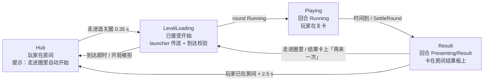

# 主房间与关卡闭环（HUB_ROOM）：走进圈里开始，结算后回房看板，再开一局

> 状态：`SOURCE_WRITTEN_NOT_COMPILED`（运行时与编辑器脚本、房间数据、文档；**没有 Unity 编译、没有 UdonSharp 编译、没有 Play Mode、没有 ClientSim、没有 Build & Test**）；数据侧 `Docs/Design/Levels/hub/placement.json` 已通过 `Tools/levelbuild/levelbuild.py check --level hub`（PASS，0 error / 0 warning）。
> 范围：把“进场景就在关卡里、找不到怎么开始、结算卡钉在关卡里、房间只存在计划里”改成“主房间 → 走进选关圈 → 关卡 → 自动回房 → 墙上的结果板 → 再来一局 / 回房间”。单人、本地、单场景。
> 非目标：第二关之后的内容、联机同步、国王美术/动画、存档、跨世界数据、房间美术精修。
> 相关：[HUB_LOOP_PLAN](<HUB_LOOP_PLAN.md>)（平台约束与传送/回房设计的出处）、[StoryMode README](<README.md>)（回合、输入双闸门、结果卡）、[PICNIC_CORNER_LEVEL_ONE](<PICNIC_CORNER_LEVEL_ONE.md>)（关卡场地）、[LEVEL_AUTHORING](../Tools/LEVEL_AUTHORING.md)（`placement.json` 与导入器）。

## 0. 先给结论

| # | 问题 | 结论 |
|---|---|---|
| 1 | 闭环长什么样 | 房间中央一块**选关圈**（野餐垫）：走进去 0.35 s 自动开始 → 传送到关卡入口 → 回合自己跑 → 到点**自动退座 + 传送回房** → 结果卡挂在房间北墙的**结果板**上 → 再走进圈里就是“再来一局”，按关卡里的「回房」按钮或等 2.5 s 就回到 Hub 提示（§2、§3）。 |
| 2 | 交互怎么选 | **走进圈里自动开始**，不是“按 E”。Udon 的 `InputUse` 是全局事件，不是“看着这个物体按 E”；桌面交互在本项目里是**准星对着 Collider 按左键**（`BallRideExitButton` 同形）。圈只用 `GetPosition()`，ClientSim 和真机都答得上来，也不需要 VRC_Station（§4）。 |
| 3 | 场景怎么切 | **方案 b：一张场景、两个岛、玩家传送**。房间在 `(1200, 0, 0)`，关卡仍在原点；不叠加加载、不换场景、没有加载屏。**不做**“整块 LevelContent 启用/禁用”，原因不是做不到，而是会破坏道具复位与没有收益（§7）。 |
| 4 | 谁拥有什么 | 回合仍归 `StoryRoundController`，传送/退座仍归 `HubLevelLauncher`，星级/评语/卡面仍归 `StoryResultPresenter`；新代码只拥有**房间导航相位 + 圈 + 一行提示**。**`StoryRoundController.cs` 一行没改**：它已有的 `GetState()` / `BeginRound()` / `RequestRetry()` / 冻结值 getter 就是全部接缝（§6）。 |
| 5 | 数据与导入 | `Docs/Design/Levels/hub/placement.json`，`level.id = hub`，8×8 m 房间、5 件现有道具、2 个 box 结构 + 1 地面 + 4 面墙；用现有 `PlacementImporter` 以 **arena cell** 形式导入到 `LevelContent/hub`（不是第二套机制，理由见 §7.2）。 |
| 6 | 验收状态 | 26 个 EditMode 规则测试已写（纯逻辑，不碰场景）；Unity 侧全部 `NOT_RUN`。仓库的 Python 门：`validate_plan.py` PASS；`Docs/tests` 744 条里 1 条**先前就存在**的失败（C14 v2 行比较），与本文文件无关（§12）。 |

## 1. 为什么做这个

- 2026-11-15 用户实玩：进关卡后**找不到怎么开始**（当时唯一入口是坐上球，而球上的 VRC_Station 在 ClientSim 里不可靠）；同时主房间只存在于 [HUB_LOOP_PLAN](<HUB_LOOP_PLAN.md>) 的计划里，从没建过。
- 本次把闭环的**代码 + 房间数据 + 操作步骤**补齐；场景里的物件摆放与接线仍必须由 Unity 操作员做（分工见 §9）。另一位 agent 正在修“坐上球”的即时问题；本闭环**不依赖坐球就能开始/重试/回房**（§4、§8）。

## 2. 闭环



一次完整一局的时序（与 [HUB_LOOP_PLAN](<HUB_LOOP_PLAN.md>) §5 相同，只是“按开始”换成了“走进圈里”）：

1. 进世界 → 出生在房间（`HubSpawn`，圈外 4 m）→ `StoryRoundController.Start()` 进 `Idle`：回合闸门关、收集关；`HubRoomHost.Start()` 打 `[hub-room] ready zones=1 …`；提示行空（离圈远）。
2. 玩家在房间里就能看到提示“走进房间中央的野餐垫自动开始”；走进圈里 → 站 0.35 s → `HubRoomHost` 调 `HubLevelLauncher.TryStartLevel(0)`。**所有合法性仍由 launcher 判**（状态、在飞传送、冷却、索引）。
3. launcher 把玩家 `TeleportTo` 到关卡入口 + 0.1 m，2 帧后测距；到了才调 `StoryRoundController.BeginRound()`（`Idle`）或 `RequestRetry()`（`Result`）。房间相位 `Hub → LevelLoading → Playing`。
4. 玩家在关卡里走到球边，坐上去（Station 归另一位 agent；不坐也能计时，只是不能开球——见 §8）。
5. 到点 `SettleRound()` 冻结事实 → `Presenting`；launcher 在 0–1 帧后**先 `ExitStation`、等座位报空（或 10 帧超时）、再空一帧**，然后 `TeleportTo` 回 `HubSpawn`。玩家在 `Result` 前就回到房间。
6. `StoryResultPresenter` 把结果卡显示在**北墙的结果板**前：星级、直径/件数、评语。房间相位 `Playing → Result`。
7. `Result` 持续 2.5 s（`resultHoldSeconds`）且玩家在房间半径内 → 相位回 `Hub`，提示“上一局已结算，走进圈里再来一局”。**结果卡仍在**（presenter 拥有，Result 才隐藏）。
8. 再走进圈里 → `TryStartLevel` → `RequestRetry()`（复位球到捕获位姿 + 复位道具 + 重新计时）；连按/连走都不会重开（launcher 的传送去重 + 冷却）。

## 3. 房间布局与数据

房间中心 `(1200, 0, 0)`，8 × 8 m，层高 3 m（墙 3 m，跳不出去）。关卡岛仍在原点，两者相距约 1200 m，超过 Unity 默认远裁剪（约 1000 m），互相看不见。

| 物件 | 坐标 / 尺寸 | 来源 | 说明 |
|---|---|---|---|
| 地面 `hub_floor` | 中心 `(1200,0,0)`，8 × 0.04 × 8 | 结构 `role=ground` | 顶面 `y=0`；导入器给 `Visual` + 玩家 BoxCollider |
| 四面墙 `boundary_x0/x1/z0/z1` | `x=1196 / 1204`、`z=-4 / 4`，高 3 m、厚 0.04 | 结构 `role=boundary` | 只有平面给球（本房间没有球）；`Visual` 给玩家 |
| 选关垫 `select_picnic_corner` | 中心 `(1200,0.01,1.2)`，2.8 × 0.02 × 2.8 | 结构 `role=box`，`collision=none` | **没有 Collider**，玩家走上去不会被 2 cm 台阶挡住；`HubRoomHost.selectZones[0]` 直接指这个 Transform |
| 结果板 `result_board` | 中心 `(1200,1.45,3.95)`，2.6 × 1.5 × 0.06 | 结构 `role=box`，`collision=box` | 卡面（`StoryResultPresenter` 的 `resultCardRoot` / `resultText`）建议放在**面向房间的 World Space Canvas** 上、贴在板前（见 §9 步骤 10）；用现有 Screen Space Overlay 也能显示，只是看起来在屏幕上而不是墙上 |
| 出生点 `HubSpawn`（场景里新建的空物体） | `(1200, 0.1, -2.8)`，朝 +Z | 操作员 | 面朝选关垫与结果板；**必须在所有圈外**，否则回房会被“重新武装”规则要求先出圈（§4） |
| 5 件现有道具 | 长凳、野餐篮、收纳箱、洒水壶、书堆 | `placement.json` 的 `props[]` | 全是 `Art/Props/` 已有模型；纯装饰（房间没有 `PickupFieldHost`），数据里 `absorbable=false`、`ballDiameterMax=0.3` 只是让校验器的一组一致性规则成立 |

数据文件：[`Docs/Design/Levels/hub/placement.json`](../Levels/hub/placement.json)。要点：

- `level.id = "hub"`，`level.scene = "StoryMode"`，`level.arena.id = "hub"`（arena cell 形式，理由见 §7.2）；玩家/房间坐标全用世界坐标。
- 5 件道具 / 212 u / 7 个结构（1 地面 + 4 墙 + 2 box），没有斜面、没有可吸物。
- 校验：`python3 Tools/levelbuild/levelbuild.py check --level hub --report` → **PASS**（0 error / 0 warning；budget planes 4/8、boxes 2/8、static OBB 2/256）。第二次导入应为 `+0 ~0 -0`。
- **cell + 道具的契约**：一个声明了 `props[]` 的 arena cell 必须在自己子树里有一个 `PickupFieldHost`，否则导入器会拒绝同步（不是静默跳过）。房间因此需要一个**惰性**宿主（放在 `LevelContent/hub` 上；房间没有 motor、没有回合，它只负责让 5 件装饰道具的 collider/行数据成立）。操作步骤见 §9 步骤 3；漏了它，导入会红，说明文字会点名 `LevelContent/hub`。

## 4. 交互决定：走进圈里自动开始（不是“按 E”）

| 候选 | 为什么不用 |
|---|---|
| **按 E** | Udon 没有“看着这个物体按 E”的事件：`InputUse` 是**全局**的（桌面 E / VR Trigger），任何行为都能收到，和“准星指向”无关。要做成“靠近+按 E”就得自己做全局输入 + 距离门，等于**新造第三把输入闸门**，而且桌面/VR 文案不一致（VR 没有 E）。项目里“按 E 与物体交互”的先例也不存在；桌面交互是**准星对着 Collider 按鼠标左键**（`BallRideExitButton`、T04 实测）。 |
| **VRC_Station** | 正是这次实玩失败的入口（ClientSim 里坐不上去）。闭环的开始/重试/回房**刻意不经过 Station**；坐球只影响“能不能开球”，不影响“能不能开一局”。 |
| **实体按钮 + Interact** | 可用、也有先例（`HubStartButton` 仍在场景里作为“再来一次”的备用入口），但它需要 Collider + 准星 + 左键，VR 里还要低头找按钮；一个 2.8 m 的圈更容易被发现。按钮路径作为**第二入口**保留，不写第二套规则：它同样只调 `launcher.PressStart(0)`。 |

选**走进圈里自动开始**，并加三条防误触：

1. **dwell 0.35 s**：路过圈边不会立刻开局；`HubRoomHost.dwellSeconds` 可调。
2. **re-arm**：一次开局后圈**解除武装**；只有被测量到“在所有圈外”才重新武装（`HubRoomMath.NextArmed`）。所以回房后即使人正好落在圈里也不会自动再开一局，提示会说“先走出圈外，再走进来”。
3. **出生点在圈外**：`HubSpawn` 离圈心 4 m；这也让“回房 → 2.5 s 后提示”是干净的。

提示的可发现性单独说一句：**Hub 相位里提示全程可见**（“走进房间中央的野餐垫自动开始”），不是只在圈边 2.7 m 内出现。用户这次的问题就是“找不到怎么开始”，再让提示只在近处出现等于没修；`PromptFor` 的远/近分支只保留给 Result（卡在墙上时，远处提示“上一局已结算”，近处提示“再来一局”）。

**没有新增输入闸门**：`HubRoomHost` 不读任何移动轴、不调 `DesktopMoveInput`；生效输入仍然是“骑乘闸门 × 回合闸门”两把，所有者仍是 `BallRideStation` 与 `StoryRoundController`。圈是**导航触发器**，不是驾驶输入。

“再来一局”和“回房”也是同一套：

- **再来一局**：`Result` 相位里走进同一个圈即可（`launcher.TryStartLevel` 在 `Result` 下走 `RequestRetry()`）；结果卡上的「再来一次」如果接了 `HubStartButton`，也是同一个入口。
- **回房**：正常路径是 `SettleRound` 后 launcher 自动退座 + 传送；失败兜底是关卡里那颗 **`HubReturnButton`**（现有脚本，按下 → `launcher.PressReturnToRoom()`）。`Running` 中按「回房」仍被 launcher 拒绝（`reason=5`）：控制器没有公开的“立即结束本局”，硬传送会把运行中的回合丢在空关卡里。

## 5. 相位状态机（房间侧）

四个相位（`HubRoomMath.Phase*`）是**房间在显示什么**，不是第二套回合状态机。它只从两个事实推导：`StoryRoundController.GetState()`（回合）与 launcher 的传送进度（通过 `TryStartLevel` 的返回 + 帧预算观察），并且**从不写回合**。

| 相位 | 触发 | 玩家在哪 | 房间提示 | 回合状态 |
|---|---|---|---|---|
| `Hub` | 初始；或 `Result` 显示够 2.5 s 且玩家在房间 | 房间 | 全程“走进房间中央的野餐垫自动开始”（近圈/远圈同一句；远圈不再沉默） | `Idle`（第一局前）/ `Result`（已结算） |
| `LevelLoading` | `TryStartLevel` 接受了一次开始 | 传送中 | “正在进入关卡…” | `Idle` / `Result`（还没 `BeginRound`） |
| `Playing` | `GetState() == Running` | 关卡 | “关卡进行中” | `Running` |
| `Result` | `GetState() == Presenting` 或 `Result` | 房间（自动回房后） | 近圈“走进野餐垫再来一局”；远离垫子“上一局已结算，走进野餐垫再来一局”；不在房间“按回房按钮返回” | `Presenting` / `Result` |

转移表（`HubRoomMath.TryAdvance`，全部有 EditMode 测试）：

| 当前 | 条件 | 下一个 |
|---|---|---|
| Hub | 开始被接受 | LevelLoading |
| Hub | 回合自己变成 Running（有人直接坐球开始） | Playing |
| Hub | 回合已是 Presenting/Result（例如场景按手重置） | Result |
| LevelLoading | 回合 Running | Playing |
| LevelLoading | 回合 Presenting/Result | Result |
| LevelLoading | 超过 `loadingTimeoutFrames` 还没 Running | Hub（房间只是停止说 loading；launcher 自己的到达超时会拒绝开局） |
| Playing | 回合 Presenting/Result | Result |
| Playing | 回合回到 Idle（异常） | Hub |
| Result | 又接受了一次开始（重试） | LevelLoading |
| Result | 玩家在房间半径内 + `resultHoldSeconds` 到点 | Hub |

“玩家在房间”用 `hubCenter` + `hubRadiusMeters`（默认 12 m）判定；**回房传送失败**时相位停在 `Result`，提示改成“按关卡里的「回房」按钮返回”，不会假装人已经回来了。

## 6. 归属：一份逻辑一个所有者

| 逻辑 | 所有者 | 本闭环怎么用它 |
|---|---|---|
| 回合状态、计时、到点冻结、重试复位、冻结事实 getter | `StoryRoundController`（**未改**） | 只调 `GetState()`、`BeginRound()`、`RequestRetry()`；只读 `GetLevelId()` / `GetAttemptNumber()` / `GetResultDiameterM()` / `GetResultCount()` |
| 传送、到达校验、退座、回房、Running 中留在关卡 | `HubLevelLauncher`（**未改**） | `TryStartLevel(index, out reason)` / `TryReturnToRoom(out reason)`；不自己 `TeleportTo`，不自己碰 Station |
| 星级、评语、结果卡显隐与文字 | `StoryResultPresenter`（**未改**） | 卡面搬到房间北墙就是“结果板”；房间**不重复**打印直径/星级 |
| 房间相位、选关圈、提示行 | `HubRoomHost`（新） | 只写自己的 `promptText`，只调 launcher 的公开入口 |
| 选关圈的位置与半径 | 场景数据（`selectZones[]`） + `HubRoomHost.selectRadiusMeters` | 圈心就是 `select_picnic_corner` 的 Transform |
| 房间几何 / 道具 | `PlacementImporter` + `placement.json` | 与第一关同一套导入器，只换 level id |

**`StoryRoundController.cs` 没有任何改动**：闭环需要的接缝（开始、重试、状态、冻结值）都已经是公开的；加一个“结束本局”反而会破坏“Running 时玩家必在关卡”的不变式，[HUB_LOOP_PLAN](<HUB_LOOP_PLAN.md>) §12.4 已把它列为“没有加、留给 Lead 协调”的接口，本文沿用。

唯一缺的接缝是**`StoryResultPresenter` 没有公开的星级 getter**。本闭环因此把**结果卡本身**当作结果板（卡面在房间墙上），不另写一块“板”去读星级——那会是同一事实的第二份显示，也是 [HUB_LOOP_PLAN](<HUB_LOOP_PLAN.md>) §6 明令禁止的。如果以后要一块独立的结果板（例如大厅里长期显示上一局），正确的最小改动是给 presenter 加只读 getter（`GetStars()` / `GetSettledDiameterM()`，它本来就有这两个字段），而不是在房间侧重算星级表。**这是给 Lead 的请求，本次没做**（`StoryResultPresenter.cs` 不在本次写范围）。

## 7. 单场景方案 b：为什么，以及什么被挡住了

### 7.1 选 b

- **一张场景**（`StoryMode`）：房间岛 `(1200,0,0)`，关卡岛原点。切换 = `TeleportTo` + 状态，没有 additive 加载、没有加载屏、ClientSim 与真机同一条路径。
- 不做“整块启用/禁用”的版本，原因逐条：
  1. **导入器一个场景只有一个受管根 `LevelContent`**：第二个 whole-level 文档会用 `ApplyProps` / `ApplyStructures` 把第一个的 props/structures 当成 stale 删掉。这是 `PlacementImporter` 的硬约束（本次不改它）。
  2. **`PickupFieldHost.RecordOriginalPoses()` 在 `Start` 里**：如果在场景加载时把 `LevelContent` 关掉，宿主的 `Start` 不会跑，`ResetField()` 就没有“原始位姿”可复位——重试会把道具留在地上。关掉再打开也拿不回那次记录。
  3. **`LevelArenaHost` 一次性注册障碍**（地面 1 + 平面 4 + 盒 4 + 斜面 2），没有“按岛切换”的接口；给房间再挂一个 arena host 会和关卡抢同一张 8 平面 / 8 盒的表。
  4. **关掉没有收益**：同一张场景已经全部加载，1200 m 外的东西不渲染（远裁剪），禁用只省一点 `Update`，却引入上面三条风险。
- 因此 b 的落地是“**同场景 + 传送**”，不是“同场景 + 整块禁用”。这不是被 arena host 挡住，而是被**导入器的单受管根 + 道具宿主的 Start 捕获**挡住；如果 Lead 以后要真正的按岛禁用，最小改法是给 `PickupFieldHost` 一个显式的 `CaptureOriginalPoses()` 公开接缝并在启用后调用，而不是在房间侧绕。

### 7.2 房间数据为什么是 arena cell

`PlacementImporter` 只认 `LevelContent` 这一个受管根；但它对 **arena cell**（`level.arena.id`）会改用 `LevelContent/<id>` 作为自己的子树。房间借这个已有机制拿到 `LevelContent/hub`，于是：

- 第一关的 `Import("story_01_bench_size")` 只清 `LevelContent/Props` 与 `LevelContent/Structures`，不碰 `LevelContent/hub`；
- 房间的导入只清 `LevelContent/hub/...`，不碰第一关。

代价（必须知道）：

1. **通用菜单会拒绝**：“Import Placement (LevelContent)”在发现同一场景既有 whole level 又有 arena cell 时会报错并要求按 id 调用。为此新增两个菜单项：`VRC Katamari/Level/Import StoryMode Hub Room (hub)` 与 `.../Import StoryMode Level 1 (story_01_bench_size)`（`Editor/Story/StoryModeImportMenus.cs`）。
2. 房间没有 `LevelArenaHost`，导入报告会有一行 note：“no LevelArenaHost on LevelContent/hub … arena arrays were not filled”。**这是预期的**：房间没有球，不需要把墙/地面注册进 motor。
3. 房间的 5 件道具落在 `LevelContent/hub/Props`，没有玩法宿主读它们，纯装饰；但 cell 导入器要求“cell 有道具就必须有自己的 `PickupFieldHost`”，所以房间要挂一个**惰性**的 `PickupFieldHost`（§9 步骤 3）。它没有 `motor`，`Update` 在第一行就返回，不扫描、不吸附，只让导入与 5 行 collider 数据成立。
4. 加了房间宿主之后，第一关的 whole-level 导入会在场景里找到两个 `PickupFieldHost`，按层级序同步 `LevelContent`（第一个）并打一行 note。第一关的宿主选择不变；这行 note 是预期的。

## 8. 传送与座位：复用，不复制

- **开始**：`HubLevelLauncher.TryStartLevel` → 若玩家已在入口容差内则直接开局；否则 `TeleportTo(entry + 0.1 m, entry.rotation, AlignPlayerWithSpawnPoint, false)`，2 帧后测距，到了才开回合。玩家在房间里，**不可能正坐在球上**，所以开始路径不需要 `ExitStation`。
- **回房**：`SettleRound` 进入 `Presenting` 后，launcher 先 `rideStation.ExitStation(player)`，等 `BallRideStation.IsLocalPlayerSeated()` 变 false（最多 `exitStationTimeoutFrames=10`），**再空一帧**，然后 `TeleportTo(roomSpawn + 0.1 m)`。三条分支各自打日志（正常 / 超时仍传 / 座位状态未知），第一次实跑看日志就知道走哪条。
- **坐姿视点补偿**：`BallRideStation` + `SeatEyeCompensation`（`BeginSeated`/`EndSeated`）原样保留，房间侧**没有**再写一次眼高。回房时 `OnStationExited` 会调 `EndSeated()`，座位回到原位。
- **仍然依赖 Station 的只有“开球”**：站着的人不能驱球（骑乘闸门关）。开始/重试/回房都不需要 Station；坐球由另一位 agent 修。验收时如果坐不上，闭环仍应完整走完（只是球不动、HUD 在倒计时）。

## 9. Unity 操作员步骤（本 agent 不是 Unity 操作者，以下一步都没跑过）

> 铁律：只有一名 agent 动 Unity；每批改动后看 `state` + `read_console`；导入器不 `SaveScene`，保存由人决定；不要动 `ProjectSettings/ProjectSettings.asset` 的既有改动；新 `.cs` 的 `.meta` 与 UdonSharp `.asset` 由 Unity 生成，不要手写。

1. **刷新/编译**：让 Unity 导入新脚本（`Runtime/Story/Hub/HubRoomMath.cs`、`HubRoomHost.cs`、`Editor/Story/*.cs`、`Tests/EditMode/Story/HubRoomMathTests.cs`），Console 无错；`Tests` 窗口能看到 `HubRoomMathTests`（26 条）。
2. **打开场景**：`StoryMode`（若还在 `Labs/StoryLevel`，按 [HUB_LOOP_PLAN](<HUB_LOOP_PLAN.md>) §7 先转正；房间数据不关心用哪张场景，只关心关卡岛的坐标）。
3. **房间的惰性宿主（先做）**：菜单 `VRC Katamari/Level/Import StoryMode Hub Room (hub)` 第一次只建出缺失的 `LevelContent` / `LevelContent/hub` 文件夹，然后停下并报一行：`add a PickupFieldHost component to 'hub' …`。在 Inspector 里给 `LevelContent/hub`（或其子物体）**Add Component → PickupFieldHost**，不要接 `motor`（房间没有球）。再跑同一个菜单。这样第一次正式导入就是绿的；如果漏了这一步，cell 导入器会因为“有 props 却没有宿主”报错并拒绝本次运行（几何仍会建出来，但报告是红的）。
4. **导入房间**：再跑 `...Hub Room (hub)`。期望：
   ```text
   [level] cell=hub +5 ~0 -0 props=5 other=7 errors=0
   ```
   并带两条 note：没有 `LevelArenaHost`（预期）、`level.ballDiameterStart=0.2997`（房间没有球，忽略）。再跑一次应为 `[level] cell=hub +0 ~0 -0 props=5 other=0 errors=0`。场景里出现 `LevelContent/hub/Structures/{hub_floor,boundary_*,select_picnic_corner,result_board}`、`LevelContent/hub/Props/*`，以及导入器建的 `PickupField`/`Props` 层级。运行时应看到 `[PickupFieldHost] ready props=5 …`（惰性宿主，无害）。
5. **导入第一关**（如果还没导入）：菜单 `.../Import StoryMode Level 1 (story_01_bench_size)`。它只写 `LevelContent/Props` 与 `LevelContent/Structures`，不会碰 `hub/`。**不要**再用通用菜单（会因 mixed docs 报错，这是预期的）。它可能打一行 “found 2 PickupFieldHost … syncing LevelContent (the first in hierarchy order)”，这是预期的，第一关的宿主仍是 `LevelContent`。
6. **房间根**：新建空物体 `HubRoom`（场景根，**永远不要 SetActive(false)**），挂 `HubRoomHost`；再建一个子物体 `HubPrompt` 挂一个 uGUI `Text`（现有 HUD Canvas 下即可，Screen Space Overlay 在 VR 下未验证，见 §11）。**不要**给 `HubRoom` 挂 `LevelArenaHost`。
7. **接线 HubRoomHost**：
   - `launcher` → 场景里的 `HubLevelLauncher`；
   - `controller` → 场景里的 `StoryRoundController`；
   - `hubCenter` → 新建空物体 `HubCenter` 放在 `(1200, 0, 0)`；
   - `selectZones[0]` → `LevelContent/hub/Structures/select_picnic_corner`；
   - `selectRadiusMeters = 1.2`、`dwellSeconds = 0.35`、`resultHoldSeconds = 2.5`、`hubRadiusMeters = 12`；
   - `promptText` → 上一步的 `Text`。
8. **接线 HubLevelLauncher**（现有对象）：
   - `controller` → 同一个 `StoryRoundController`；
   - `levelEntries[0]` → 关卡入口（**新建空物体 `LevelEntry`，放在球起点旁约 2 m、朝向球**）；
   - `levelNames[0] = "野餐一角"`；
   - `roomSpawn` → 新建空物体 `HubSpawn`，位置 `(1200, 0.1, -2.8)`、旋转 `(0,0,0)`（朝 +Z）；
   - `rideStation` / `rideSeat` → 球上的 `VRCStation` / `BallRideStation`；
   - **`statusText` 留空**：launcher 的那行写的是“按开始进入…”，与走圈文案冲突；房间的唯一提示行是 `HubRoomHost.promptText`。
9. **出生点**：`VRCSceneDescriptor.spawns` 只放一项，指向 `HubSpawn`；`ReferenceCamera` 补上（见第一关的 C8）。
10. **结果板**：把现有的 `resultCardRoot` / `resultText` / `retryButtonRoot` 移到房间。要让“板”真的在墙上，就给它们一个 **World Space Canvas**（`Render Mode = World Space`，位置约 `(1200, 1.45, 3.88)`、面向 −Z、`scale ≈ 0.002`，宽约 2.4 m），卡片底板贴 `result_board`；如果直接把三个对象留在现有 Screen Space Overlay HUD 下，它们会显示在屏幕上（能用，但不是墙上的板）。`StoryResultPresenter` 的 `controller` / `resultCardRoot` / `resultText` 接好；`retryButtonRoot` 的最外层 Canvas 变化不影响控制器对它的 `SetActive`。`retryButtonRoot` 若保留 uGUI `Button`，按旧文档接 `SendCustomEvent("OnRetryPressed")` 或改成 `HubStartButton`（`levelIndex=0`）——**两种都只是第二入口**，主入口是圈。注意：uGUI 按钮要能按，场景里需要有 `EventSystem`（本场景现在没有），World Space 还要 `GraphicRaycaster`；没有它们时按钮只显示、不响应，圈仍然是完整的重试路径。
11. **关卡侧的回房按钮**：在关卡里球旁边放一个 `HubReturnButton`（独立物体 + Collider + 该行为，`launcher` 指向同一个 launcher），作为“自动回房失败”的手动兜底。
12. **保持**：`StoryRoundController.startOnLoad = false`；`BallRideStation.roundController` 仍接控制器（无房间场景的旧路径不受影响；房间里 `Running` 中的 `NotifyRiderSeated` 会被忽略）。
13. **自检菜单**：`VRC Katamari/Hub/Check Room Wiring`（只读，不改场景）。它检查 host/launcher/controller/centre/圈/入口/出生点/结果 presenter 的存在与数量、圈数 = 关卡入口数、房间与关卡岛距离、出生点是否在圈内、`launcher.statusText` 是否误接。**所有行都以 `[hub-check]` 开头**；有 `problem(s)` 就先修再 Play。

## 10. Play 验收清单

进 Play Mode（ClientSim 或真机），按顺序看 Console：

| # | 期望 | 失败时先看 |
|---|---|---|
| 1 | `[hub-room] ready zones=1 radius=1.2 … state=0` | 没有这行 → host 没挂/没启用；`zones=0` → `selectZones` 没接 |
| 2 | 出生在房间，离圈 > 1.2 m；`HubPrompt` 就显示“走进房间中央的野餐垫自动开始”（提示不只在圈边出现） | 提示不动 → `promptText` 没接/被别的脚本覆盖 |
| 3 | 走进圈里约 0.35 s：`[hub-room] auto-start levelIndex=0 …` → `[hub] teleport cause=enter-level …` → 1–2 帧后 `[hub] round started cause=arrived …` | `[hub] start refused reason=10` = 传送没到入口；`reason=13` = launcher 没接控制器；`reason=14` = `roomSpawn` 没接 |
| 4 | `[hub-room] phase hub -> loading` → `… loading -> playing`；HUD 目标/当前/剩余开始动 | 相位不推进 → `controller` 没接或回合没进 Running |
| 5 | 走到球边坐下（另一位 agent 的修复）；坐着 WASD 能开球 | 坐不上 → 闭环不受影响，但球不动（§8） |
| 6 | 到点：`[hub] round state=2 …` → `[hub] return exit-station …`（坐着时）→ `[hub] return: left the station after N frames` → `[hub] teleport cause=return-to-room …` → `[hub] return arrived frames=… distance=…`；人在房间 | 走的是 `still seated … moving anyway` → 离座时序未成立；`distance` 大 → 传送没生效，按「回房」再试 |
| 7 | 结果卡在房间：星、直径、评语（World Space Canvas 时贴在 `result_board` 上）；`[hub-room] phase playing -> result` | 卡不出现 → `StoryResultPresenter` 没接/卡面对象没搬 |
| 8 | 2.5 s 后 `[hub-room] phase result -> hub`；提示变“上一局已结算，走进野餐垫再来一局” | 相位不动 → `hubCenter` 没接（`inHub=false`） |
| 9 | 走出圈再走进 → `[hub-room] auto-start …` → `[hub] round started … mode=2`；球回 0.30 m、道具复位、计时重开、结果卡消失；`GetAttemptNumber() == 1` | `mode` 不是 2 / 球没复位 → 回合没走 `RequestRetry()`（检查 `state` 是否真的是 Result） |
| 10 | 连走 3 次不炸；Console 无 `Missing Script`、无 `outdated behaviour version` | —— |

反面检查（必须成立）：

- 不坐球也能开局、到点、回房、看卡；坐球只影响“能不能开球”。
- 结果卡上的数字与房间提示不重复（提示不提星级/直径）。
- `Running` 中按「回房」被拒绝（`reason=5`），人不动。
- 回到房间后，**结果卡仍在**（Result 相位），2.5 s 后提示才变“再来一局”。
- 把 `resultHoldSeconds` 临时设为 0，行为应退化成“Result 当帧回 Hub 提示”，卡仍在。

## 11. 未做 / 未验证（不要当成已验证）

1. **Unity 编译、UdonSharp 编译、Play Mode、ClientSim、Build & Test：全部 `NOT_RUN`。** 本 agent 不是 Unity 操作者；`HubRoomHost` / `HubRoomMath` 的 U# 编译结果、`Text` 写入、`Vector3[]` 参数、`GetPosition()` 在 ClientSim 的帧率都没观察过。
2. **场景接线没有做**：§9 的 13 步全部是给操作员的；房间几何只有数据，场景里还没有。
3. **坐球仍是 Station 路径**：另一位 agent 的修复不在本文范围；本文只保证“开始/重试/回房”不依赖它。
4. **VR 舒适度**：进/出关卡各一次瞬移，没有淡入淡出；HUD/提示用 Screen Space Overlay（现有 HUD 的形态），VR 下是否清晰可读未验证。
5. **`Running` 中途回房仍被拒绝**：控制器没有公开的“立即结束本局”；要做“放弃本局回房”需要那个接缝，且必须自己保证冻结与闸门顺序。
6. **结果板没有独立的星级显示**：结果板 = `StoryResultPresenter` 的卡；要独立板需要给 presenter 加只读 getter（§6）。
7. **多人**：`BehaviourSyncMode.None`，最后一位按圈的人各自开各自的局；房间与实际位置可能在不同客户端不一致，不在本文范围（[HUB_LOOP_PLAN](<HUB_LOOP_PLAN.md>) §6.4 已判单人）。
8. **音频/渲染串扰**：1200 m 只是“看不见”的暂定值，不是性能测量；房间与关卡同在一个 bundle。
9. **导入器 cell 形式是借用**：`level.arena` 本来是为物理测试场设计的；本文借它拿到 `LevelContent/hub` 子树。若 Lead 给 `PlacementImporter` 增加“per-level managed root”字段，房间数据应改回普通 whole-level 文档（一个字段 + 一处文档）。
10. **`HubRoomWiringCheck` 只读检查**：它按序列化字段名读，字段改名会报 problem；它不验证 teleport、Station 或 Udon 资产。

## 12. 验证命令与本次结果

```bash
python3 Tools/levelbuild/levelbuild.py check --level hub --report
# PASS Docs/Design/Levels/hub/placement.json (0 error(s), 0 warning(s))
# props=5 units=212 structures=7；budget planes 4/8、boxes 2/8、static OBB 2/256

python3 Docs/tools/validate_plan.py
# PASS: 61 tasks; both release DAGs acyclic; source hashes verified.
# NOT_RUN: Unity/Udon compilation, VR comfort, multiplayer, performance, commerce.

python3 -m unittest discover -s Docs/tests
# Ran 744 tests ... FAILED (failures=1)
# 失败是先前就存在的 levelbuild.test_physics_test_field_cells.CriteriaModels
# .test_v1_rows_are_byte_identical_to_git_head：它把 HEAD 里带 v2 的 check 与工作区
# 去掉 v2 的 check 逐字比较。Docs/Design/BallMotor/physics_test_field.json 与 HEAD
# 逐字节相同（sha256 8fd6a39c…），所以与本文的文件无关；本次没有改它（不在写范围）。
```

EditMode（NUnit）：`VRCKatamari.Tests.HubRoomMathTests`，26 条，**`NOT_RUN`**（要 Unity 跑）。覆盖：相位全链路（Hub→Loading→Playing→Result→重试→Playing→回 Hub）、加载失败回 Hub、未知相位/状态 fail-closed、圈的最多一个/最近优先/越界与非法值、re-arm、dwell、提示 gating（远/近/圈内未武装/待机/开始/加载/进行中/结算近圈/结算不在房间）。**需要场景才能测的**：`HubRoomHost` 的 Update 顺序、`Text` 实际显示、`GetPosition()`、`TeleportTo`、`ExitStation` 时序、结果卡显隐。

## 13. 文件清单（本次新增/修改）

**新增运行时（U#，未编译）**

- `Runtime/Story/Hub/HubRoomMath.cs` — 房间相位、圈选择、re-arm/dwell、提示 gating（纯静态规则）。
- `Runtime/Story/Hub/HubRoomHost.cs` — 房间宿主：读玩家位置、调 launcher、写一行提示；不传送、不碰回合、不碰卡。

**新增编辑器（未编译）**

- `Editor/Story/StoryModeImportMenus.cs` — 两个按 id 导入的菜单（通用菜单在 mixed docs 下会拒绝）。
- `Editor/Story/HubRoomWiringCheck.cs` — `[hub-check]` 只读接线报告。

**新增测试（未跑）**

- `Tests/EditMode/Story/HubRoomMathTests.cs` — 26 条纯规则测试。

**新增数据**

- `Docs/Design/Levels/hub/placement.json` — 房间（8×8 m、5 道具、7 结构、arena cell `hub`）。

**新增文档**

- `Docs/Design/StoryMode/HUB_ROOM.md`（本文）。

**修改**

- `Docs/Design/StoryMode/README.md` — 末尾追加一节指向本文（§“主房间闭环”）。
- 没有改 `StoryRoundController.cs`、`KatamariBallMotor.cs`、`PickupFieldHost.cs`、`LevelArenaHost.cs`、`PlacementImporter.cs`、`Labs/**`、`Editor/PhysicsTestField/**`、`Tools/levelbuild/**`、`Tools/leveleditor/**`、`Docs/Art/**`、场景、prefab、`tasks.json`。
- 没有写任何 `.meta`；新 `.cs` 的 `.meta`、UdonSharp `.asset` 由 Unity 在操作员打开工程时生成。
