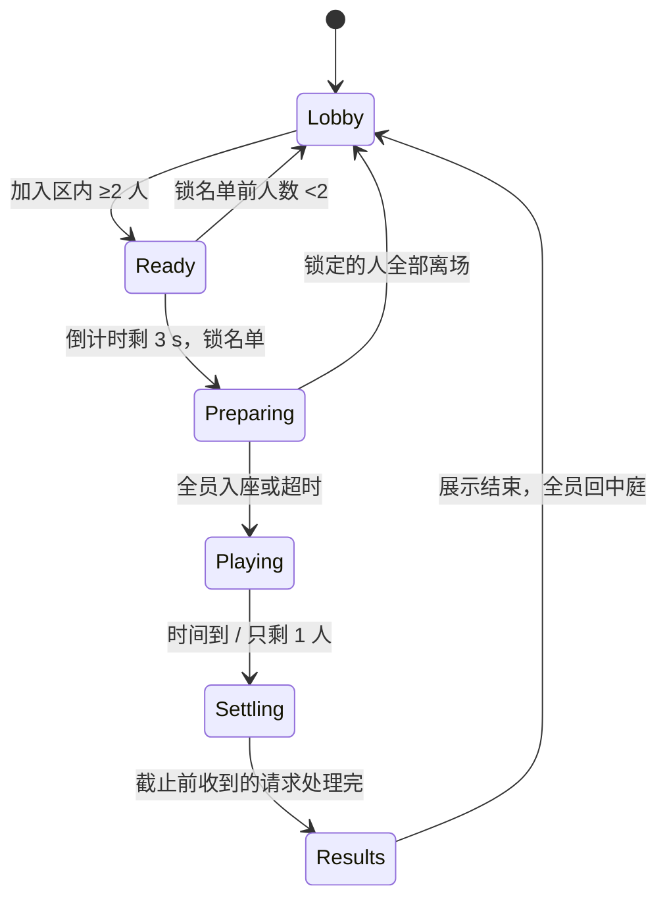

# 对战模式（第一版）设计

## 0. 本文范围与依据

本文写的是多人对战（KatamariBall）第一版怎么做：一局的流程、谁说了算、同步什么、观战，以及分几批做。还没有代码，也没有在 Unity 里验证过。

已定的规则（不在本文重新讨论）：
- 玩法是 2025 作「スポーツ塊」式交分：最多 8 人（owner 2026-11-23，每张图另配推荐人数，见 §2.7）；场景里有交分区，球站在激活的区里每 0.5 s 结算一跳，每跳直径减少本图开局直径的 10%、加固定分（单价 15，PROVISIONAL），减完会小于开局直径时停；交分区同时 1 处、每 60 s 换一处；被更大的球吞掉后保分保径、在别处重生；结算时另有 3 档奖励各第一名 +50 pt。见 [OPEN_DECISIONS](<../../OPEN_DECISIONS.md>)「交分与回合规则」(a)–(d)（2026-11-26 按原作实测改写）和「Owner decisions 2026-11-21」。
- 走进方形加入区就算准备，用 Player Join Zones 的做法；倒计时剩 3 s 时锁定名单。一局结束后所有人回中庭。
- 观战可开关，有鸟瞰（正交俯视加玩家标记）和跟随某个玩家两种视角，第一版两种都做。
- 第一版地图是 WLK REROLL+ 的 vs_2：场地 `03_C_VS`，整局只用这一个场地。初始球径 1.5 m（原作 `ssCoreInit_vs_2` 的 8 个槽都是 1500 mm）。局时默认 180 s（原作スポーツ塊 3 分钟）。以后两作的 8 张对战图都要做进来，由玩家选图。
- 球上粘附物件的显示数量有上限，远端球必须限（规则见 [OPEN_DECISIONS](<../../OPEN_DECISIONS.md>)「Owner decisions 2026-11-23」「球上粘附物件限显示数量」条；本文不展开实现）。

数值口径：交分按 OPEN_DECISIONS (a)–(d) 的原作实测规则：开局直径按图配置（vs_2 是 1.5 m），每跳缩径自动取开局直径的 10%；没有最小兑换门槛，下限就是开局直径。

原作依据：[KatamariBallRules](<../../Research/KatamariBallRules/README.md>) C1–C22。两作原版的对战（本地 2 人分屏）与这里的规则不同，取证是本地分析（未入库），结论：初代 VS_00–04 每局 180 s 比直径，WLK 400 s 比目标物件，都是本地 2 人分屏（OPEN_DECISIONS 2026-11-21 对战条已摘录），只作对照。

## 1. 现状盘点：仓库里能复用什么

盘点时间 2026-11-21。范围：`VRChatKatamariDanacyUnity/Assets/VRC_Katamari/` 下的运行时、测试、实验场景，以及 `Docs/Design/` 下的模型。查法：用 grep 在 `Assets/VRC_Katamari` 里搜 `UdonSynced|RequestSerialization|SetOwner|OnPlayerTrigger|OnPlayerLeft|OnPlayerJoined|SendCustomNetworkEvent|BehaviourSyncMode`，共 48 处命中；再用 CodeGraph 查账本、交分和远端代理相关的符号。

**总的结论：仓库里还没有任何联网代码。** 命中的 48 处全是 `[UdonBehaviourSyncMode(BehaviourSyncMode.None)]` 或注释，没有一个 `[UdonSynced]` 字段，也没有 `RequestSerialization`、`SetOwner` 或网络事件。唯一的玩家事件是 `BallRideStation.OnPlayerJoined`（`Runtime/Riding/BallRideStation.cs:231`）。tasks.json 里 T17（大厅加入区与回合状态机）、T18（交分、吞噬、KO 及重生事务）、T26（一图两人纵切片）、T33（结果板、领奖台）、T56（远端代理重建）、T60（单机对战 vs CPU）的状态都是 TODO。

| 东西 | 位置 | 现在是什么 | 能否直接用 |
|---|---|---|---|
| 回合账本（纯算法） | `Runtime/Economy/GrowthLedgerMath.cs:159`；阶段枚举 `LedgerPhase` 在 :12（Lobby/Ready/Preparing/Playing/Settling/Results），生命周期 `PlayerLifecycle` 在 :31（Active/KnockedOut/RespawnPending/Disconnected）；`TryJoin` :376、`TrySubmitClaim` :613、`TryResolveClaims` :751、`TryApplyCommit` :843、`TryBank` :909、`TryKo` :963、`TryRespawn` :1025、`TryDisconnect` :1064、`TryInstallSnapshot` :1112 | 移植自 `Docs/Design/Ledger/ledger.py`（DRAFT）：未交存体积与已交存积分分开记账；吸收走「请求 → 裁决 → 提交」，同一 (物件, 世代) 只提交一次；交分按 requestId 去重；KO 时清空受害者未交存部分、已交存保留；支持快照安装。全部是无状态静态方法，数据放在调用方持有的并行数组里 | **算法层可直接用**：多人账本的规则已经写好并有测试（`Tests/EditMode/Economy/`）。缺的是「谁持有这些数组、怎么同步」，即权威行为与网络层。注释 :155–156 写明权威选举、重连 epoch、结算策略尚未决定，没有替它猜 |
| 球电机里的账本 | `Runtime/BallMotor/KatamariBallMotor.cs:307–312`：`PlayerCapacity = 1`、`CommitCapacity = 256`、`ClaimCapacity = 8`、`BankRequestCapacity = 8` | 每个球的电机自带一份只有 1 名玩家的账本，吸收在本地「自己提交、自己裁决」（`Pickup/PickupAbsorbStepMath.cs:125–141` 的 `TryCommitAbsorb`） | **不能直接当多人账本**：多人时裁决方必须是一个共享的权威端，不能每个球自己说了算。电机这一份可以保留为「本地预测 + 显示」，确认值改由权威端下发（§2.4） |
| 交分 + 缩球 | `KatamariBallMotor.TryBank` :5645 / `TryBankWithReason` :5666（返回 0–8 的拒绝原因）、`ApplyBankShrink` :5745；公式在 `Runtime/BallMotor/BankShrinkMath.cs:53`（`TryPostBankDiameter`）、:82、:99；旧参数 `bankResidualFraction`、`minConversionDiameterWorldM`（`KatamariBallMotor.cs:226–227`）随逐跳规则改写；Python 模型 `Docs/Design/Gameplay/round_model.py:474` | 现状是一次性事务（门槛检查 → 账本事务 → 缩球 → 重建径向代理）；对战要改成逐跳（见 §2.5） | **单机可直接用**。多人时交分判定要搬到权威端，缩球要用权威端下发的结果；电机里这一份逻辑可以原样作为「执行确认结果」的那一半。调用方目前只有 CPU 驾驶 `Runtime/Ai/CpuBallPilot.cs:88`，场景里还没有交分区触发器 |
| CPU 四球对练 | `Runtime/Ai/CpuSkirmishBootstrap.cs:21`、`CpuBallPilot.cs`，实验场景 `Labs/CpuSkirmish/` | 一个场景里 4 个球、4 个电机，CPU 会去交分区交分（T60 原型） | 能复用的是「一个场景放多个电机」的装配方式（8 人局要放 8 个）和交分区的位置参数；CPU 本身不进第一版对战 |
| 远端代理（纯算法） | `Runtime/BallLayers/RemoteProxy/RemoteProxyMath.cs:112`；文档 `Docs/Design/BallLayers/RemoteProxy/README.md` | 远端球上已确认吸附物的外观缓存：去重、按世代/修订号排序、按渲染预算挑选；明确不进入碰撞、计分和 PvP | **算法可用**。README 写明「拥有数组的 Behaviour 与 Renderer 池留待后续」，组件没有写（T56） |
| 切关 / 岛开关 | `Runtime/Hub/LevelSwitchHost.cs:42`，`TryActivate` :257，`ParkActiveIsland` :169；规则 `IslandActivationMath`；文档 [ALL_MAPS_HUB §3.1](<../StoryMode/ALL_MAPS_HUB.md>) | 一个场景、多座岛，同一时刻最多一座岛开着；切关时给**唯一一个**电机换障碍表、地形、起始球径 | **单机可用，多人要改**：它假设场景里只有一个电机，而且 `SetActive` 只影响本机（§4.3）。对战场地要作为单独一座岛，本局所有参赛者和观战者都打开它 |
| 单人开局 / 回大厅 | `Runtime/Hub/HubLevelLauncher.cs:114`（`TryStartLevel` :549、`TryReturnToRoom` :737、传送 :1287）；`Runtime/Story/StoryRoundController.cs:120` | 单人、只在本地运行（注释 :101–106：`TeleportTo` 只能移动本地玩家，两个客户端各跑各的循环） | 「传送入场 → 入座 → 比赛 → 回大厅」的本地流程和传送写法可以照抄。回合控制器是单人的，不能当对战回合用 |
| 大厅显示 | `Runtime/Story/Hub/HubRoomHost.cs:13`（只读的提示显示）、`HubPanelDisplay.cs`；大厅重做设计见本地分析（未入库），结论：对战区有报名板、观战屏、领奖台 | 单人大厅的面板与提示 | 面板组件可复用。还没有方形加入区、没有对战报名板 |
| 骑球座位 | `Runtime/Riding/BallRideStation.cs:113`（本地座位状态，`OnPlayerJoined` :231） | 每个球一个座位，由本地玩家坐 | 每个参赛者坐自己的球，座位代码可复用；8 个球就要 8 个座位 |
| 观战相关 | `Runtime/Diagnostics/BallFollowCamera.cs:10–19`：第二台 Camera 渲染进 RenderTexture，再用 RawImage 显示（调试用）；文档 `Docs/Design/BallPresentation/DEBUG_CAMERA.md:16` 写「ClientSim 与真实客户端都成立」，:59 写「实际显示未实测」 | 调试用的画中画追球相机 | 是现成的「相机 + RenderTexture + RawImage」写法，观战屏可以照这个做；在真实客户端里的显示效果还没测过 |
| 对战地图 vs_2 | `Docs/Design/Levels/_ref_wlk_vs2/`（被 git 忽略），由仓库外的适配脚本生成；换算口径与地形来源见 [ORIGINAL_PLACEMENT_FORMATS §3](<../../Research/KatamariBallRules/ORIGINAL_PLACEMENT_FORMATS.md>)；离线校验 `levelbuild.py check` 0 错误；地形 3,087 面，props 798 件（795 件可吸），33 个障碍固体（见 [ORIGINAL_PLACEMENT_FORMATS §3](<../../Research/KatamariBallRules/ORIGINAL_PLACEMENT_FORMATS.md>)、[PARITY_AUDIT](<../Parity/PARITY_AUDIT.md>) Divergences 表末尾的对战参考图各行） | 已转成我们的 v2 格式。出生点是临时选的场地中心附近平整点，**不是原作出生点**；53 个随机槽没有处理；`Loc/03K*` 的 302 面局部地面没有并入 | 离线数据可用，进 Unity 的导入另由 Unity 操作员做；原作 8 个出生点已查到，组 0、组 2 要修碰撞（§2.3） |
| 离线规则模型 | `Docs/Design/Gameplay/round_model.py`（交分、吞噬、重生、CPU 策略的模拟） | 模拟用 | 做参数推算用，不进运行时 |

小结：
- **可以直接用的**：账本算法（交分、KO、重生、快照）、交分缩球公式和电机里的执行代码、远端代理算法、本地传送与入座写法、调试相机的 RenderTexture 写法、vs_2 的离线数据。
- **必须新写的**：
  - 联网层：同步变量、ownership、网络事件。
  - 对战权威行为：谁持有共享账本、谁裁决吸收/交分/吞噬。
  - 方形加入区和锁名单的逻辑。
  - 多电机的场地开关（替代「单电机」的 LevelSwitchHost 用法）。
  - 交分区触发器、逐跳结算与 60 s 轮换。
  - 玩家吞玩家的判定。
  - 观战相机与玩家标记。
  - 远端球的显示组件（含粘附物显示上限，规则见 [OPEN_DECISIONS](<../../OPEN_DECISIONS.md>)「Owner decisions 2026-11-23」）。

## 2. 一局的状态机

### 2.0 角色与对象

- **对战裁决**（一个场景对象，Manual 同步）：持有本局的共享账本数组，即 `GrowthLedgerMath` 的那一套列，但名单容量是 8：名单、确认体积、积分、生命状态、重生时刻、结算各列都开到 8。它的 owner 就是本局的权威端。
- **方形加入区**（一个场景对象，Manual 同步）：用 Player Join Zones 的做法维护「区内有谁」。它的 owner 与对战裁决的 owner 是同一个人：开局前由裁决在 `Lobby` 阶段持有。
- **玩家球**（8 个场景对象，每个 Manual 同步；本局没用到的槽位不激活）：位置、速度、显示直径、朝向由坐在这个球上的玩家写，即该球对象的 owner。这些是**表现数据**，不参与判定。
- **本地电机**：每台机器上最多 8 个电机。自己的那个由本地输入驱动；远端的最多 7 个只用同步来的位置插值显示，不跑吸收和计分（规则见 [02](<../../02_TECHNICAL_CONTRACTS.md>) 开头的玩法不变量：「avatars and remote decorations never decide gameplay collision」）。

阶段沿用账本已有的 `LedgerPhase`（`GrowthLedgerMath.cs:12`）：Lobby → Ready → Preparing → Playing → Settling → Results，再回 Lobby。下面每一步写清对应哪个阶段。

### 2.1 大厅等待（Lobby）

- **权威**：对战裁决的 owner。实例里第一个人默认是所有对象的 owner；之后谁持有，就沿用谁。
- **同步**：阶段、上一局结果（名单、积分、名次），供大厅屏显示。
- **玩家做什么**：走进方形加入区。区内成员在方形加入区 owner 那边按 Player Join Zones 维护：`OnPlayerTriggerStay` 加入、`OnPlayerTriggerExit` 移除、`OnPlayerLeft` 移除。owner 把成员以玩家 id 数组同步出去。
- **漏触发**：[01 §6](<../../01_GAME_DESIGN.md>) 要求高速移动或传送可能漏掉触发事件，所以 owner 每 0.5 s 用 `VRCPlayerApi.GetPosition()` 对名单里的人做一次点在方形区内检查。
- **加入区是一块方形区域**：不设站位标记、不做圆形；进名单只看是否在区内，判定用官方的玩家进出触发区接口（Player Join Zones 的做法），不自写判定。
- **满员**：名单上限取「本局所选地图的推荐人数」和 8 中较小的一个（§2.7）；超过上限的人不进名单，在圈旁提示「已满」。

### 2.2 方形加入区倒计时（Ready → 锁名单）

- **触发**：区内 ≥ 2 人时（最少 2 人，§6 Q7），owner 写入「倒计时开始时刻」并同步。用的是服务器时间（`GetServerTimeInSeconds`），各端自己算剩余秒数；官方示例的做法就是只同步开始时刻，不逐秒广播。
- **倒计时长度**：[01 §6](<../../01_GAME_DESIGN.md>) 的原型值是 8 s，按 owner 决定在剩 3 s 时锁名单。8 s 只是项目值，列为可配置。
- **剩 3 s 前**：有人走出圈 → 从名单移除；人数掉到 < 2 → 取消倒计时，回 Lobby。
- **剩 3 s 时**：owner 冻结名单（最多 8 个玩家 id），分配槽位 0–7，阶段进 Preparing，同步。**锁定后**有人走出圈也不影响，仍在名单里。
- **锁定后才来的人**：进下一局。他可以站进圈里，但不进本局名单。

### 2.3 传送入场（Preparing）

- **权威**：裁决 owner 决定每个槽位的出生点和本局 `roundId`。**传送由每个玩家在本地执行**，因为 `TeleportTo` 只能移动本地玩家（`HubLevelLauncher.cs:101–106` 已写明）。
- **场地开关**：名单里的玩家和选择观战的人在本地打开对战场地岛，其他人不开（§4.3）。
- **出生点（vs_2，owner 2026-11-23：用满原作 8 个槽）**：
  - 原作数据：WLK `ssCoreInit_vs_2` 有 8 个槽，初始直径都是 1500 mm。位置来自同一张静态表；场景里没有出生 Transform，`MapData.warpData` 为空（[PARITY_AUDIT](<../Parity/PARITY_AUDIT.md>) Divergences 表「对战参考图的出生点」行）。8 个槽分成 4 组，每组 2 个点，同组两人面对面。读取链在 WLK `Game_Core.sInitStatus`：VS 模式按「有效槽数 ÷ 2」和开局点编号选组（本地分析（未入库），结论如此）。
  - 4 组的状态与要做的修正：组 1（槽 2/3）、组 3（槽 6/7）球底正好贴地，可以直接用；**组 0**（槽 0/1）的点在便利店 `CONVENI03_F` 屋顶上，要给它补碰撞，否则球会掉到地面；**组 2**（槽 4/5）与 `VSGREEN01_E` 的盒子相交，而原作里这件 `u8NoCrash=1`，要按原作改成不碰撞。
  - 分配：8 人局 8 个槽全用；人少时照原作做法**随机抽组**，按组整对使用，凑够人数为止。具体抽法（几组、怎么随机）照原作读取链实现，不另立规则。
  - 朝向：用原作 `s32Dir`；换算到我们坐标时要整体加 180°（`−p/100` 等于绕 y 轴转了 180°），这样同组两人才是面对面。
  - 这些点用关卡数据的 marker 表示。字段怎么写，等「多出生点」这一格式问题研究完再定（§6.2）。
  - 其他图：初代 V_00–V_04 每张只有 2 个原作出生点，3 人以上时要补点，补点方案另行决定（§6.2）。
- **重生点**：被吞后的重生沿用同一组出生点（§2.4）。
- **入座**：本地传送到自己槽位的球后，直接入座（沿用 [HUB_LOOP_PLAN](<../StoryMode/HUB_LOOP_PLAN.md>) 的「选关 → 开始 → 传送并直接入座」）。
- **进 Playing 的条件**：
  1. owner 收到全员「已入座」请求，或者 Preparing 超时（暂定 10 s）。
  2. 写入「比赛开始时刻 = 当前服务器时间 + 3 s」，阶段进 Playing。
- **掉线**：Preparing 期间名单里有人离开实例，`OnPlayerLeft` 把他标为 `Disconnected`、槽位空出。剩 < 2 人时取消本局，回 Lobby，并让其他人回中庭。

### 2.4 比赛中（Playing）

**计时**：`比赛开始时刻 + 局时`，默认 180 s。各端自己算剩余时间。圆环中间显示剩余分钟数（向上取整），**最后 60 s 进入隐藏阶段**：计时变红、显示秒数；HUD 只显示自己的分和所有人的名次；结算前他人的分显示为「?????」（最后一分钟少发他人分，对网络也有利）。

**吸收（物件归属）**
1. 玩家本地照常跑吸收判定，**先在本地显示吸附**（预测）。确认之前，这次收益不能交分、不能用于吞噬判定（[02](<../../02_TECHNICAL_CONTRACTS.md>) §5）。
2. 本地把「物件序号 + 世代」攒成一批，每 0.25 s 发一次请求给 owner，即 `NetworkEventTarget.Owner`，参数是数组。
3. owner 用 `GrowthLedgerMath.TrySubmitClaim` 和 `TryResolveClaims` 裁决：同一 (物件, 世代) 先到先得，并检查名单、生命状态、尺寸门槛和合理距离（02 §5）。然后把增量提交写进同步变量，`commitSequence` 单调增。
4. 各端在 `OnDeserialization` 里应用提交。自己的预测被确认就保留；被别人抢走就撤销本地吸附（视觉回收）。别人的确认吸附交给远端代理（`RemoteProxyMath`）去显示。

**交分区**
- **位置**：vs_2 原作没有交分区（两作的对战没有这个机制），所以交分区是**项目放置**的。第一版取 4 个锚点：在场地缓坡平台上选 4 个离出生点足够远、地面平整的位置，并保证两两之间有通路，不做独木桥（[01 §2](<../../01_GAME_DESIGN.md>)）。锚点用关卡 marker 表示，字段名不在本文定。
- **轮换**：同时只有 1 处激活，开局即有；每 60 s 换一处，到 0 立刻在别处刷新，没有空档；一局（180 s）3 处，与整分钟对齐。区上的 UFO 图标显示该处剩余秒数（60→0）。激活的是哪个，由 owner 按「开始时刻 + 编号」算出来，只同步起始编号。
- **交分（逐跳）**：
  1. 玩家的球在激活的交分区里，每 0.5 s 本地发一次「交分跳请求 (requestId)」给 owner，每跳一个 requestId。
  2. owner 检查：确认直径 − 0.1·D0 ≥ D0（D0 为本图开局直径）、玩家是 Active、不在重生保护期、requestId 没用过。通过后积分 += 单价（15，PROVISIONAL），同步新的确认直径和积分。账本里「可交跳数 = floor((D − D0) / (0.1·D0))」，不再按未交存体积计分。
  3. 玩家收到后，本地电机把直径减 0.1·D0。缩球是确认后才做，不预测。
  4. 重复的 requestId 不计第二次。

**缩球规则**：每跳直径 `D ← D − 0.1·D0`，`D0` 取本局开局直径（按图配置）；`D − 0.1·D0 < D0` 时不再跳。没有 0.55 m 之类的绝对门槛。另有两条实测但原因不明的现象，不实现：最后一分钟那处每跳 +10，本局首跳 +45。

**玩家吞玩家**
- **判定只用确认值**：A 的确认直径 ≥ B 的确认直径 × 比例阈值（[01 §3](<../../01_GAME_DESIGN.md>) 的原型值 1.35，PROVISIONAL），两球接触，B 不在重生保护期内，两人都是 Active。
- **接触怎么判**：由 owner 用两球最近一次同步的位置和确认半径来判。接触距离加一个容差，用来吸收延迟。容差的具体值等实测后再定，这里不给数。接触本身由攻击方提出请求，owner 核对；被吞方提出「我被吞了」也可以，但同一对玩家只出一份裁决（02 §7：「相撞双方不能各自宣布对方被吞」）。
- **比例不够**：互相弹开，只做本地表现，不进裁决。
- **被吞的事务**：调 `GrowthLedgerMath.TryKo`。已交存积分保留，**球径不重置、不清空未交部分**；攻击方拿多少仍是开放项（§6 Q4），份额参数现在是 0（`ledger.py` 的占位值）。受害者状态变为 `RespawnPending`，镜头跟吞人方约 6 s 后在别处重生（PROVISIONAL）。
- **重生**：到时间由 owner 调 `TryRespawn`，并选一个出生点：离所有敌球最远，并且附近还有资源（01 §3）。受害者本地把球（保持原直径）传送过去。之后有约 3 s 保护期（PROVISIONAL）：期间不能被吞、不能攻击、不能交分。
- **摄像机**：被吞者的摄像机不挂到敌球上；短暂显示 KO 提示或淡出，再复位（01 §3）。

**掉线**
- **普通玩家离开**：`OnPlayerLeft` → owner 调 `TryDisconnect`。他的球变成不可交互；已交存积分保留，但不参与排名，第一版按「退出」显示。剩 1 人时提前结束，标注「对手离场」（01 §6）。
- **owner 离开**：VRChat 自动指派新 owner。新 owner 在 `OnOwnershipTransferred` 里：
  1. 以最近同步的状态为准，epoch 加 1。
  2. 继续计时，因为终点是服务器时间，不受影响。
  3. 玩家看到 epoch 变化后，重发没被确认的吸收批和交分请求。
  4. 如果新 owner 发现同步状态不完整（例如增量序号断档），取消本局，所有人回中庭，**不宣布赢家**（[01 §6](<../../01_GAME_DESIGN.md>)、[02 §8](<../../02_TECHNICAL_CONTRACTS.md>)）。

**迟到加入**：VRChat 会把同步变量发给迟到者（官方：同步变量会补发，事件不会）。迟到者在大厅里看到「比赛进行中」，可以选择观战（§4），不进本局名单（不补位，§6 Q8）。

### 2.5 结束结算（Settling → Results）

- **截止**：到时刻 owner 进入 Settling。只处理**截止前已经收到**的请求；截止之后才到的吸收和交分请求一律拒绝（[02](<../../02_TECHNICAL_CONTRACTS.md>) §7 的建议做法）。未交存的体积不自动兑换（01 §2）。
- **排名**：按已交存积分排序，再叠加奖励层：3 档，每档每局从奖项池随机抽一项（三档不重复），每档第一名 +50 pt，并列都发（OPEN_DECISIONS (d)）。第一版池：卷入物件数、卷入别人塊的次数，第三项待 owner 定；ブラザー和道具第一版不做，也不进池。同分并列，不按网络先到的毫秒定冠军。
- **同步**：最终名次和每人积分，写进对战裁决，大厅的领奖台和结果屏也读这一份。
- **Results**：在场地内展示约 10 s（暂定），然后全员回中庭。

### 2.6 回中庭

- 每个参赛者在本地离座，`TeleportTo` 到中庭，关闭场地岛（观战者同理）。这里沿用 `HubLevelLauncher.TryReturnToRoom` 的写法，但目的地改为中庭。
- owner 重置场地：所有物件世代 +1、恢复原位；阶段回 Lobby。交分区下一局从头 3 处重新开始。
- 有人在 Results 阶段离开实例，不影响已经写好的结果。

### 2.7 每张图的推荐人数

owner 2026-11-23 决定：人数上限 8，每张图另配推荐人数；超过推荐人数的图，在选图时置灰或给出提示（见 [OPEN_DECISIONS](<../../OPEN_DECISIONS.md>)「Owner decisions 2026-11-23」）。

| 图 | 推荐人数上限 | 依据 |
|---|---|---|
| WLK vs_2（`03_C_VS`） | 8 | owner 2026-11-23；原作 8 个出生槽，场地约 107 × 66 m |
| WLK vs_3（`05_E`） | 8 | owner 2026-11-23；原作 8 个出生槽，开局球径 30 m |
| WLK vs_1（`16_ROOM`） | ≤ 4 | owner 2026-11-23；主碰撞外包约 8.0 × 3.8 m |
| 初代 V_00–V_04 | ≤ 4 | owner 2026-11-23；A 区墙脚半径约 3.3 m，原作只有 2 个出生点 |

- **选图时**：加入区里的人数已经超过某张图的推荐人数时，这张图在选图面板上置灰或带提示。置灰还是只提示，以 owner 的「置灰或提示」为准，交给面板设计决定。
- **名单上限**：取所选地图的推荐人数与 8 中较小的一个（§2.1）。
- 推荐人数是地图数据的一部分，字段名等格式研究后再定（§6.2）。

## 3. VRChat / Udon 约束

本节只摘官方文档的原句（2026-11-21 抓取），引号里是原文。社区库 `VRChat-Agent-Creator-Library` 只用来找页面；它和官方或 SDK 有出入的地方，以官方/SDK 为准（见 §4.1）。

### 3.1 同步预算（官方原文）

- [Networking Specs & Tricks](https://creators.vrchat.com/worlds/udon/networking/network-details/)：
  - 「Udon scripts can send out about **11 kilobytes** per second.」
  - 「Udon scripts with manual sync are limited to roughly **280,496 bytes** per serialization.」
  - 「Udon scripts with continuous sync are limited to roughly **200 bytes** per serialization.」
  - 「Each manually-synced object is rate limited as a factor of the data size. The more it sends, the more its send rate is limited.」
  - 超限时：「Manual behaviours will cache the event and try again … the data will not be sent nor received」。
  - 「make sure to always initialize those arrays … If any of the synced arrays are left uninitialized - the behaviour will not sync!」
  - 「Udon's networking prioritizes synchronized game objects that are currently visible to the local user.」
- [Network Events](https://creators.vrchat.com/worlds/udon/networking/events/)：
  - 「Network events are not repeated for late joiners … Don't use network events for important logic or state changes that are relevant for late joiners.」
  - 最多「**eight** parameters」。
  - 默认「**5 events per second**」，可配置到「**100 events per second**」。
  - 「Total outgoing data is hard-capped at approximately 18 KB/s … in practice it is unlikely you will see more than 8-10 KB/s.」
  - 「the _receiving_ UdonBehaviour **must not** use sync mode `None`」。
  - 发送者可以取到：`NetworkCalling.CallingPlayer`。
- [Late Joiners](https://creators.vrchat.com/worlds/udon/networking/late-joiners/)：迟到者会收到同步变量的最新值（`OnDeserialization`）；「Events are **not** replayed.」
- [Network Components](https://creators.vrchat.com/worlds/udon/networking/network-components/)：
  - `GetServerTimeInSeconds()`：「Every client in the instance sees approximately the same value」。
  - 「Server time wraps around … Use `CalculateServerDeltaTime`」。
  - 官方示例：「you can sync a countdown by syncing only its start time rather than the remaining seconds」。
  - `IsClogged`、`OnPostSerialization` 的 `byteCount` 可以用来量实际发了多少字节。
- 每秒同步次数：官方没有给出 Manual 同步的固定频率，只说按数据量限速；Continuous 的发送频率官方页面里**未查到**。所以本文的频率是设计目标，要在真机上用 `OnPostSerialization.byteCount` 和 Debug Menu 6 实测。

### 3.2 ownership（官方原文）与本设计的规则

- [Object Ownership](https://creators.vrchat.com/worlds/udon/networking/ownership/)：
  - 「Only the **owner** of a networked object can modify its synchronized Udon variables.」
  - 「If the owner leaves the instance, VRChat **automatically assigns** a new owner.」
  - 「When the current master leaves, a new master is chosen from the other players in the instance before `OnPlayerLeft` is called.」
  - 「You must not rely on any particular player becoming master.」
  - 「Don't rely on master if you can avoid it!」
- [Network Components](https://creators.vrchat.com/worlds/udon/networking/network-components/) 关于 `OnOwnershipRequest`：「This logic runs locally on both the requester and the owner, so be aware that disagreements in logic between the two will cause a desync.」

本设计因此规定：
1. **一局只有一个裁决对象**（下称「对战裁决」，名字待定）。它的 owner 就是本局的权威端。开局时由按下开始的那一方（或倒计时结束时的 owner）持有，整局不主动转移。
2. **玩家不 SetOwner 裁决对象**：玩家的请求（吸收、交分、吞噬、离场）一律用 `SendCustomNetworkEvent(NetworkEventTarget.Owner, …)` 发给 owner，由 owner 用 `NetworkCalling.CallingPlayer` 核对发送者。这样就避开了「抢 owner」的竞态。
3. **每个玩家球有一个自己 owner 的对象**（球位置、朝向、显示尺寸），只由该玩家写。权威数值（确认体积、积分、生命状态）不放在这里，放在裁决对象上。
4. owner 掉线时 VRChat 会自动指派新 owner，但未同步出去的状态（还在请求队列里的吸收）会丢失。新 owner 在 `OnOwnershipTransferred` 里从最近一次同步的快照继续，并把 `authorityEpoch` 加 1。玩家在 epoch 变了之后，重发还没被确认的请求，靠幂等键去重。这与 [02 技术契约](<../../02_TECHNICAL_CONTRACTS.md>) §8 一致。
5. 不用 master 作为权威，只用 owner。

### 3.3 8 人带宽估算（估算，未实测）

**以下全部是估算，没有实测。** 每次序列化的协议开销官方没有给数（未查到），表里按每次约 30 B 估算。B3 要用 `OnPostSerialization.byteCount` 实测后回填（§6.2）。

| 数据 | 谁写 | 同步方式 | 每次大小（估） | 频率（目标） | 8 人时（估） |
|---|---|---|---|---|---|
| 球的位置、速度、显示直径、朝向（每个球一个对象） | 该玩家 | Manual，按距离/速度变化发 | 位置 3×float、速度 3×half、直径与朝向各 2–4 B，共约 24 B，加开销约 54 B | 10 次/s | 每人出站约 0.55 KB/s；每台机器收 7 个远端球，入站约 3.8 KB/s |
| 裁决状态（阶段、开局时刻、名单 8 个玩家 id、每人确认体积 long、积分 long、生命状态 byte、重生时刻 int；交分区编号；commitSequence、epoch） | 裁决 owner | Manual，有变化才发 | 8 × (4 + 8 + 8 + 1 + 4) + 32 ≈ 230 B，加开销约 260 B | 峰值 ≤ 5 次/s | owner 出站 ≤ 1.3 KB/s |
| 物件归属增量（本批新提交的 物件序号 ushort、世代 byte、胜者槽 byte） | 裁决 owner | Manual，增量对象 | 每件 4 B；8 人吸收高峰估 40 件/s，按 4 批/s 发，每批约 40 B，加开销约 70 B | 4 次/s | owner 出站约 0.3 KB/s |
| 物件归属全量快照（vs_2 共 798 件的位图 ≈ 100 B，加上世代表） | 裁决 owner | Manual，另一个对象 | 约 100–900 B（含不含世代表） | 低频：每 5 s 一次，或迟到者加入时一次 | owner 出站 ≤ 0.2 KB/s |
| 玩家请求（吸收批、交分、吞噬） | 各玩家 → owner | 网络事件，每批 ≤ 8 个参数 | 吸收批：物件序号数组 + 世代数组 + 请求序号，约 50 B | 每人 ≤ 4 批/s | 每人出站 ≤ 0.2 KB/s；owner 入站约 7 × 0.2 = 1.4 KB/s |

合计（估算）：
- **权威端出站**：自己的球 0.55 + 裁决 1.3 + 增量 0.3 + 快照 0.2 + 自己的请求 0.2 ≈ **2.6 KB/s**，约为官方「about **11 kilobytes** per second」的 24%。
- **普通玩家出站**：0.55 + 0.2 ≈ **0.8 KB/s**。
- **每台机器入站**：7 个远端球 3.8 + 裁决 1.3 + 增量与快照 0.5 ≈ **5.6 KB/s**（权威端另加请求 1.4）。官方页面只给出站上限，**入站上限未查到**。
- **网络事件**：每人每秒 ≤ 4 个吸收批，在默认「**5 events per second**」以内；总出站远低于「approximately 18 KB/s … in practice … 8-10 KB/s」。

风险：
- Manual 是「按数据量限速」（官方原文见 §3.1）。所以继续用**「小增量 + 低频全量快照」**：裁决对象**不能**每次都发 798 件的完整归属表；增量、快照、裁决状态分成三个对象，8 个球各是独立对象。
- 8 个远端球的粘附物显示要限数量，否则远端代理的渲染和数据量会随件数增长。规则见 [OPEN_DECISIONS](<../../OPEN_DECISIONS.md>)「Owner decisions 2026-11-23」「球上粘附物件限显示数量」条；本文不展开实现。
- 估算里每次序列化 30 B 的开销、10 次/s 的球位置频率，都要在 B3 用 8 个客户端实测。

### 3.4 ownership 转移的坑（本设计要绕开的）

1. **双写**：两个人同时 `SetOwner` 同一个对象，后到的会把先到的写覆盖。所以玩家不对裁决对象 SetOwner（§3.2-2）。
2. **转移瞬间的空窗**：`SetOwner` 之后、`OnOwnershipTransferred` 之前，新 owner 写的变量不保证会发出去。规则：新 owner 先等到 `OnOwnershipTransferred`，再改状态、调 `RequestSerialization`。
3. **owner 离开时丢队列**：owner 本地还没同步的请求和提交会丢失。规则：提交以同步变量为准，网络事件只当作「请求」；玩家对没被确认的请求超时重发（§2.4）。
4. **`OnOwnershipRequest` 两端各算一遍**：两端判断不一致就会失同步。规则：裁决对象的 `OnOwnershipRequest` 只在「当前 owner 已不在名单里」或「本局已结束」时返回 true，判断只依赖已同步的变量。
5. **未初始化的同步数组让整个行为不同步**（官方原文见 §3.1）：所有同步数组在 `Start` 前就要定长分配。
6. **接收网络事件的行为不能是 `BehaviourSyncMode.None`**：仓库里现有的所有行为都是 None（§1），新写的裁决和球同步行为必须用 Manual。

## 4. 观战

owner 已定：观战可开关；等待时在多人面板上显示；有两种视角，鸟瞰和跟随，第一版都做。

### 4.1 能不能用：官方与 SDK 证据

- **Camera 是允许的组件**。[Allowlisted World Components](https://creators.vrchat.com/worlds/whitelisted-world-components/) 的「Unity Components」里列了 `Camera`，「Unity UI」里列了 `RawImage`（原文：「The following is the complete list of scripts usable within worlds. Components that are not in this list will not work.」）。
- **俯视相机 + RenderTexture + 叠加玩家点，就是官方示例的做法**。[Minimap 示例](https://creators.vrchat.com/worlds/examples/minimap)：「A camera, which is a part of a prefab, captures your scene from above」；「The position of the local player is taken and passed through to a special shader (`MiniMap Blit`)」；「You can also control the update rate by simply calling `Graphics.Blit` more or less often.」
- **Udon 里调用 `Camera.Render()` 和设置 `targetTexture`**：本项目装的 SDK 3.10.5 自带示例 `Packages/com.vrchat.worlds/Samples/GraphicsBlitExampleScene/Graphs/MiniMap.asset` 里有 4 处 `UnityEngineCamera.__Render__SystemVoid` 和 `__set_targetTexture__`（2026-11-21 在 Windows 上 findstr 查到）。所以这两个 API 在 Udon 里是开放的。社区库有一页写「`Camera.Render()` 禁止」，与 SDK 示例矛盾，**以 SDK 示例为准**；实际能否编译，最后以 U# 编译为准。
- **正交相机**：`orthographic` 的 setter 在 SDK Samples 里没有用到。做法是在 Inspector 里预先设好正交和 `orthographicSize`，运行时只开关这台相机，不用在 Udon 里改投影方式。
- **仓库已有写法**：`Runtime/Diagnostics/BallFollowCamera.cs:10–19` 是「第二台 Camera → RenderTexture → RawImage」的调试画中画，[DEBUG_CAMERA](<../BallPresentation/DEBUG_CAMERA.md>) 写明它在 ClientSim 和真实客户端都能工作，但实际显示效果「未实测」。
- **性能代价**：官方页面里没有查到具体数字（**未查到**）。能确定的只有：每多一台激活的相机，就多渲染一遍它看见的场景。所以设计上：观战相机只在有人打开观战时启用；RenderTexture 用小尺寸（暂定 512×512）；鸟瞰相机可以不逐帧 `Render()`，改为按固定频率手动渲染（暂定 10 次/s，做法同官方 Minimap 用调用频率控制刷新率）。真实开销等 T38 多人性能测试时实测。

### 4.2 两种视角怎么做

- **鸟瞰**：
  - 一台挂在场地上方的正交相机，只拍场地层，渲染进一张 RenderTexture，在观战屏（RawImage 或材质）上显示。
  - **玩家标记**不是 3D 物体，而是在 RawImage 上叠加 UI 图标：位置用同步来的球位置，换算到相机视口坐标；大小随确认直径变；颜色区分 8 个槽位。另外显示当前激活的交分区和下一个交分区。
  - 这样标记不用进 3D 场景，鸟瞰相机也不会拍到别的东西。
- **跟随**：
  - 第二台透视相机，跟在观战者选中的那个玩家的球后上方，取景规则复用跟随架（`BallFollowCamera` 的「按半径缩放」取景）。也渲染进 RenderTexture，在同一块屏上显示。
  - 在观战面板上可以切换跟随对象。
  - 被跟随者的球是远端球：位置来自同步插值，吸附物来自远端代理。所以跟随画面的精细度取决于远端代理（T56）做到哪一步。第一版至少显示球体和尺寸；粘附物按远端球的显示上限显示（[OPEN_DECISIONS](<../../OPEN_DECISIONS.md>)「Owner decisions 2026-11-23」「球上粘附物件限显示数量」条）。
- **在哪看**：大厅对战区的观战屏，以及等待时的多人面板，都是世界空间的屏。观战不传送玩家，玩家可以站在大厅里看。

### 4.3 与 ALL_MAPS_HUB §3.1「岛只在本地打开」的冲突

[ALL_MAPS_HUB §3.1](<../StoryMode/ALL_MAPS_HUB.md>) 的规则是：同一时刻最多开一座岛，就是当前关的岛；`SetActive` 只影响本机；关掉的岛不渲染，岛里所有宿主的 `Update` 都不跑；「别的玩家所在关的岛在本机是关着的，看不到对方的球和场景」。这和对战有两处冲突：
1. 最多 8 个参赛者必须看到同一个场地；
2. 站在大厅里的观战者也要拍到场地。

解法（owner 2026-11-22 已定，§6 Q6：观战者也加载对战岛）：
- **对战场地单独算一座「对战岛」**，不走单人选关的「当前关」规则。它的开关条件是：本局在 Preparing、Playing、Settling 或 Results 阶段，并且本机玩家是参赛者或者打开了观战。这个条件只依赖已同步的阶段和名单，所以每台机器自己判断，结果一致。
- **对战岛打开时，本机不开单人岛**。对战岛里的物件和地形宿主只登记到「本局最多 8 个电机」上，不经过 `LevelSwitchHost` 的单电机切换。参赛者在本局期间不能同时玩单人关；这件事在方形加入区的提示里写明。
- **只看鸟瞰的观战者**：也要打开对战岛（否则相机拍不到）。但观战者本机不跑吸收和电机，只要求渲染和物件位置正确。物件被吃后在观战者机器上隐藏，依据是同步的物件归属位图。
- **单人玩家不受影响**：没有选观战的人，本机不开对战岛，所以不付这份渲染开销。
- **不能同时观战和玩单人关**：单人关运行时，观战按钮显示为不可用并给出原因，沿用「拒绝并给原因码」的做法（`HubLevelLauncher.cs` 注释）。

## 5. 分批实施计划

每批交付前按 AGENTS.md 跑一遍 C# 闸门（`remote_gate.py`），然后在 Unity 里验证一轮。多客户端测试用 Build & Test 开多个本地客户端（`Number of Clients` 设成 2–8）；ClientSim 只能测单机逻辑。工作量按「一个执行子代理 + 一轮 Unity 操作员」计。

| 批 | 内容 | 依赖 | 验收（能测什么） | 工作量 |
|---|---|---|---|---|
| **B1 vs_2 进 Unity，单人能滚** | 按 [ORIGINAL_PLACEMENT_FORMATS §3](<../../Research/KatamariBallRules/ORIGINAL_PLACEMENT_FORMATS.md>) 的换算口径与已知坑把 vs_2 导入成一座「对战岛」；放原作 8 个出生点（组 0 便利店 `CONVENI03_F` 补碰撞、组 2 `VSGREEN01_E` 改为不碰撞）、4 个交分锚点 marker（只做位置和标记，不做逻辑）；本地一个球能从出生点出发，在场地里吸物、在锚点上用现有 `TryBank` 交分并缩球（B4 起改为逐跳） | vs_2 离线数据（已有），Unity 操作员 | 单机：从 8 个出生点各出发一次，球都落在地面或屋顶上、不掉落、不嵌进盒子；球在 1.5 m 起始直径下能滚动、能吸物，地形不穿模；在锚点交分后，球径按 (a) 公式缩小（拿 `TryBankWithReason` 返回 0 和缩球前后直径来核）；局时 180 s 能到时结束 | 中（地图导入是主要工作量；随机槽 53 个仍跳过） |
| **B2 方形加入区 + 回合骨架（联网）** | 对战裁决对象（Manual），只做阶段、名单、时刻；方形加入区（Player Join Zones 做法，加 0.5 s 位置复查）；8 s 倒计时、剩 3 s 锁名单；传送入场、入座；到时回中庭。此批不做计分 | B1 | 2–4 个 Build & Test 客户端：进出方形加入区后名单正确；剩 3 s 前离开会被移出、之后离开不影响。**8 个客户端**：8 人全部进名单、各分到不同槽位和原作出生点；第 9 人进不了名单；所选图推荐 ≤4 人时第 5 人进不了名单，选图面板对该图置灰或提示；人少时（例如 2、3、5 人）出生组按随机抽组分配、不重叠；各端倒计时显示的差 < 0.5 s；时间到后全员回中庭；中途关掉 owner 客户端后，新 owner 继续计时、不卡死 | 中 |
| **B3 球位置同步 + 远端球显示** | 每个玩家球对象（Manual，按距离/速度变化发）；远端球插值显示、显示直径；远端代理组件（T56 的 Behaviour + Renderer 池）显示已确认的吸附物；本地互撞只做弹开表现 | B2 | 4 个客户端：看到其他 3 个球的位置和大小，插值不抖。**8 个客户端**：每台看到其他 7 个球；用 `OnPostSerialization.byteCount` 实测每球与裁决对象的出站字节和频率，回填 §3.3 的 8 人估算；整局 `IsClogged` 始终为 false；远端球粘附物显示数量不超过 [OPEN_DECISIONS](<../../OPEN_DECISIONS.md>)「Owner decisions 2026-11-23」 的上限 | 中–大（远端代理组件是新写的） |
| **B4 共享账本：吸收裁决 + 交分** | owner 持有 8 人账本（`GrowthLedgerMath` 列，容量 8）；吸收批请求（网络事件）→ 裁决 → 增量提交同步；物件归属位图（给迟到者和观战者）；本地预测与撤销；交分区 60 s 轮换和逐跳交分事务；电机改为「执行确认结果」 | B3 | 多客户端：两人同时撞同一件，只有一人得到，另一人本地吸附被撤销；在非激活锚点交分被拒绝；每 0.5 s 一跳、每跳直径减开局直径的 10%、减到不足一跳就停、每跳 +15；同一 requestId 重发不双计；分数只来自确认值（在本地故意不发请求，分数不应变化）；owner 掉线后重发未确认请求，不丢分、不双计。**8 个客户端**：8 人同时在一片物件密集区吸物，归属不冲突、各端最终一致；全量快照与增量合并结果与 owner 一致；迟到者打开观战时物件隐藏状态正确；`IsClogged` 始终为 false | 大（多人逻辑的核心） |
| **B5 吞噬、重生与结算** | 吞噬判定（确认直径比 + 接触 + 保护期）、`TryKo` / `TryRespawn`；重生点选择；KO 提示；最后 60 s 隐藏他人分数；结算排名 + 3 档随机奖励（每档第一名 +50 pt，并列都发）；结果屏与领奖台读裁决数据 | B4 | 多客户端：大球吞小球后小球约 6 s 后在远离敌人的点重生，已交存积分保留、球径不变，重生后约 3 s 保护；比例不够只弹开；同一对玩家只出一次裁决；结算名次与积分在各端一致；平局并列。**8 个客户端**：多对玩家同时互吞时，每对只出一份裁决；重生点不与其他 7 个球重叠；8 人名次与 3 档 +50 pt 在各端一致 | 中 |
| **B6 观战** | 鸟瞰正交相机 + RenderTexture + UI 玩家标记 + 交分区标记；跟随相机与切换目标；观战开关；对战岛按「参赛或观战」打开 | B3（显示要用球位置），B5（要显示分数时） | 多客户端：大厅里的非参赛者打开观战后能看到鸟瞰图，参赛者的每个标记位置都正确（8 人局 8 个）；能切换跟随对象；关掉观战后本机不再渲染对战岛（在 profiler 里核对相机数）；单人关运行中观战按钮给出原因并拒绝。**8 个客户端**（另加 1 个观战客户端）：鸟瞰 8 个标记跟随正确，可以在 8 人之间切换跟随对象 | 中 |

真人 2 人、4 人与 8 人的手感与公平测试放在 T27、T38、T39，不属于上面任何一批。VR 实测按 owner 的口径后置。

## 6. 开放问题

### 6.1 需要 owner 定的

以下 8 条已由 owner 决定，「状态」列是现行口径（Q1/Q2/Q5 于 2026-11-26 按原作实测关闭，Q4 仍开放，Q3 调研中）。

| # | 问题 | 选项 | 起草者推荐 | 状态 |
|---|---|---|---|---|
| Q1 | 最小交分直径 | 原作实测：没有单独门槛，下限＝本图开局直径，每跳缩径＝开局 × 10% | 已按原作实测 | owner 2026-11-26：已关闭（见 (b)） |
| Q2 | 交分区轮换 | 原作实测：同时 1 处、每 60 s 换一处、一局 3 处 | 已按原作实测 | owner 2026-11-26：已关闭 |
| Q3 | 出生点：原作 8 槽只有直径和朝向、没有位置 | A. 临时 4 个等距点，等找到原作位置再换；B. 继续逆向找原作位置后再做 B1；C. 直接用 8 个等距点，4 人局只用其中 4 个 | **A**，不阻塞 B1；原作位置另立调研项 | owner 2026-11-23：vs_2 用满原作 8 个槽，组 0、组 2 修碰撞，人少时随机抽组（§2.3） |
| Q4 | 吞掉对手时攻击方拿多少（01 §3「受限份额」，现为 0） | A. 0（只拿走对方，不给攻击方）；B. 对方未交存体积的 25%；C. 对方未交存体积的 50% 但封顶 | 等 B5 试玩再定；第一版先用 **A**，最安全，不会出现刷分 | owner 2026-11-22：按原作数值，调研进行中 |
| Q5 | 局时 | 原作实测：3 分钟 | 默认 180 s | owner 2026-11-26：已关闭 |
| Q6 | 观战者是否打开对战岛（§4.3 方案的代价：观战者本机多渲染一个场地） | A. 打开（鸟瞰和跟随都能做）；B. 不打开，鸟瞰只用一张静态顶视图 + 标记（跟随做不了）；C. 只有跟随时才打开 | **A**；owner 要求两种都做，B 做不了跟随 | owner 2026-11-22：观战者也加载对战岛（渲染有视锥剔除，开销主要在内存和脚本） |
| Q7 | 2 人局也开吗（01 写 2–4 人；方形加入区 ≥2 人开始） | A. 2 人可开；B. 至少 3 人 | **A**，与 01 一致，测试也需要 | owner 2026-11-22：2 人即可开局 |
| Q8 | 迟到者能否在 Playing 中补位 | A. 不能，只能观战、排下局；B. 有空槽就补 | **A**（01 §6 已是这个口径） | owner 2026-11-22：中途加入者不补位，只能观战或排下一局 |

### 6.2 需要再调研的

1. **其他对战图的出生点**：vs_2 已查到原作 8 个槽（§2.3）。vs_1、vs_3 用同一张表，要按同样方法核对脚下地面；初代 V_00–V_04 每张只有 2 个原作出生点，3–4 人时的补点方案要另行决定。
2. **vs_2 地面缺项**：`Loc/03K*` 的 302 面局部地面是什么；53 个随机槽最终会变成什么物件（[PARITY_AUDIT](<../Parity/PARITY_AUDIT.md>) Divergences 表「对战参考图的随机槽」行）。不查清的话，场地里会有空洞或缺物件。
3. **多个电机（最多 8 个）怎么登记场地**：`KatamariBallMotor.cs` 里没有 C# `static` 的共享表。在该文件里 grep `static ` 并排除常量和静态方法，命中的只有注释，所以障碍表、地形表都是每个电机的实例字段。`LevelSwitchHost` 只给一个电机登记，CPU 四球场景有 4 个电机，但没走切关流程。待定的是：远端球的电机要不要也登记场地（只用来显示的话不需要），还是只给本地电机登记。B1 前要定。
4. **Manual 同步的实际频率与字节**：官方没有给出数字，要在 B3 用 `OnPostSerialization.byteCount` 和 Debug Menu 6 实测，回填 §3.3。
5. **观战相机的性能开销**：官方没有数字。在 B6 做实测，对比「每帧 `Render`」和「10 次/s 手动 `Render`」，看帧时间差多少。
6. **吞噬接触的延迟容差**：owner 端用的是同步来的位置，至少落后一个同步间隔。容差取多大既不误判也不漏判，要在 B5 用多客户端测。
7. **数据格式**（按 AGENTS.md，研究完之前不定字段名）：要表达的东西有多出生点、交分锚点组、轮换顺序、对战岛标识、本局参数（起始直径、局时、门槛）。要先看 [LEVEL_FORMAT_V2](<../Levels/LEVEL_FORMAT_V2.md>) 现有的 marker 和 meta 能不能容纳，再提方案。
7. **粘附物显示上限的实现**：规则已由 owner 定（[OPEN_DECISIONS](<../../OPEN_DECISIONS.md>)「Owner decisions 2026-11-23」「球上粘附物件限显示数量」条），怎么实现由另一项工作研究；本文只引用。
8. **推荐人数与出生点的格式**：每张图的推荐人数、出生组都要进地图数据；字段名等格式研究后再定。
