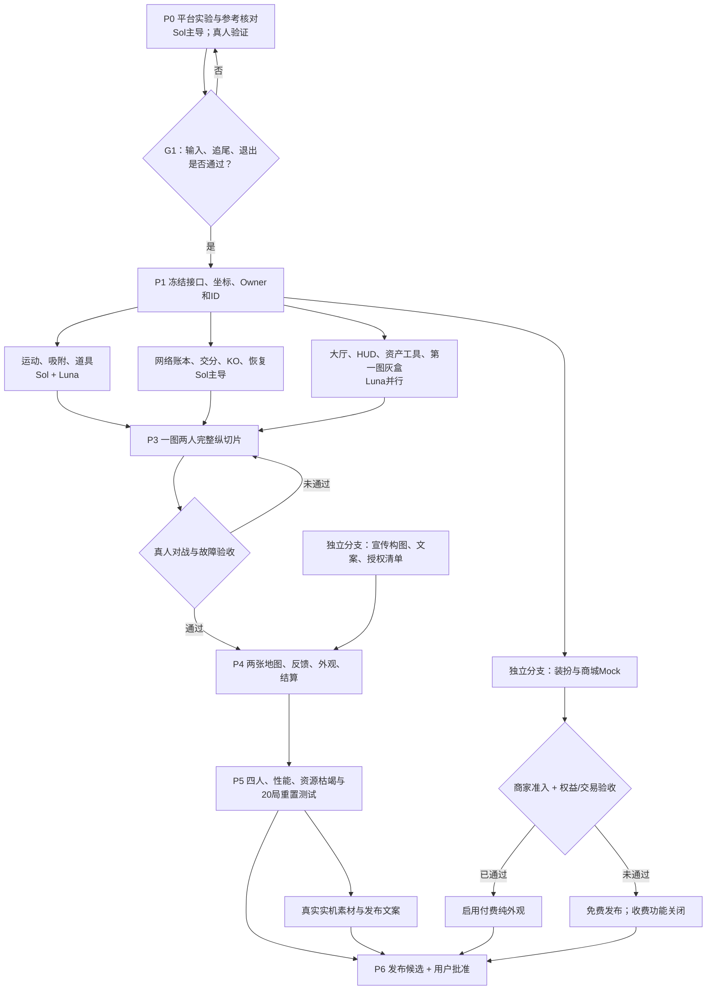
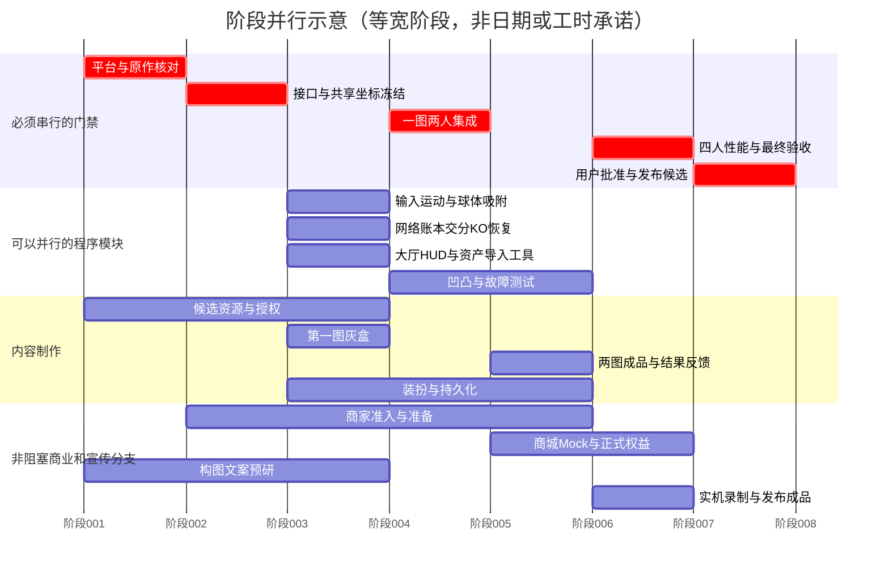

# VRC塊魂 /《我是屎壳郎》：整体方案与多Agent执行计划 v0.3

研究日期：2026-10-10。此文档是建议及开发契约，不是已完成的实现或测试报告。

# VRC塊魂：执行设计包 v0.3
研究日期：2026-10-10。内部名 VRC塊魂；公开名未最终确定，《我是屎壳郎》为主题方向。

这是设计、接口、任务和验收包，不是已实现的Unity工程。
没有运行Unity、VRChat真机、多人联机或实际商品购买测试；没有下载候选第三方资源。
所有速度、距离、时间、数量、价格方案都是可调原型值，不是原作数值或性能实测。

## 给总控 Agent 的第一条指令
先读 `docs/00_SCOPE_DECISIONS.md`、`docs/02_TECHNICAL_CONTRACTS.md`、
`docs/07_AGENT_OPERATING_RULES.md` 和 `tasks.json`。
只启动依赖满足的任务。先完成平台验证和接口冻结，再扩展模块。
旧聊天仅作背景；遇到冲突以本包的明确决策为准，未定项不能自行伪装成既定结论。
没有用户提供的Unity项目路径、账号授权或测试设备时，完成可独立的文件任务并标记外部阻塞，
不得编造测试成功、公开上传世界、花钱、修改正式商品或向他人发消息。

## 交付入口
- `docs/00_SCOPE_DECISIONS.md`：边界、纠正、未决项。
- `docs/01_GAME_DESIGN.md`：玩法、输入、大厅、道具、反馈。
- `docs/02_TECHNICAL_CONTRACTS.md`：球体、物件、网络、身份、缩放。
- `docs/03_MAPS_ASSETS.md`：两张首发图及第三张候选、资产加工。
- `docs/04_EXECUTION_PLAN.md`：阶段、依赖和逐任务说明。
- `docs/05_ACCEPTANCE_TESTS.md`：自动测试与真机门禁。
- `docs/06_MONETIZATION_LAUNCH.md`：装扮、内购、宣传。
- `docs/07_AGENT_OPERATING_RULES.md`：Sol/Luna调度和并行写入规则。
- `docs/08_SOURCES_AND_OPEN_QUESTIONS.md`：研究来源及事实边界。
- `tasks.json`：可供调度器读取的任务DAG。
- `diagrams/`：纵向依赖图、阶段甘特图，均为Mermaid源码。
- `config/prototype_defaults.json`：原型配置，不是经过平衡的正式值。
- `templates/`：资源清单、实验记录、Agent交接模板。
- `tools/validate_plan.py`：仅验证设计包的任务依赖/字段；不验证游戏实现。

## 首版范围
PCVR + Desktop，2–4人休闲PVP，单人练习。
两种VR控制；PC采用普通移动与观察输入。只有球参与玩法碰撞。
磁铁和火箭两种道具、单槽、跳跃动作键使用。
先做好一张完整图，首发目标两张；第三主题不阻塞上线。
普通玩家私人Avatar保留；不强制更换王子或昆虫Avatar。
免费完整玩法，少量纯外观永久商品；没有付费战力、抽奖或现金奖励。

## 硬门禁
1. VR Station追尾、InputJump不退座、A/B两种输入和一键退出必须真机通过。
2. 共享世界坐标固定，不允许每位玩家各自缩放公共竞技地图。
3. 一件物品一个世代只能成功归属一次；所有积分来自已确认账本。
4. 断线迁移、迟到加入、回合重置必须通过多人测试。
5. API权益验证和资源商业授权通过后才启用付费商品。
6. 舒适性必须由真人体验；代码通过不能代替佩戴头显验收。


---


# 00 范围、决策与事实边界

## 用户已明确的选择
- 内部称“VRC塊魂”；对外建立独立屎壳郎/滚球主题，不复用王子、国王、原作角色音乐。
- 以2025年《Once Upon A KATAMARI》的多人方向为参考，不再套用初代双人规则。
- 目标PVP；先PCVR与Desktop，Quest不在首版范围。
- VR A：胸前左右各一个固定轮廓归中件和可抓取活动件，水平限位/有限行程。
- VR B：摇杆控制球的路径，玩家稳定追尾；PC用相似方式。
- 玩家可以浮空，Avatar不作为玩法碰撞主体；只让球参与。
- 不识别站姿/坐姿/FBT分类；提供用户调节归中位置、间距、行程。
- 本地球精确显示吸附，远端球可少量、近似、确定性重建装饰。
- 自定义先做到确实可以切换并预留插槽；计划接入廉价纯装饰内购。
- 需要明确的任务依赖、可并行分支及GPT-6 Luna / GPT-6.1 Sol分工。

## 本包新增的建议，尚未由实际测试定案
- 对局2–4人，180秒；到交分区交存未结算资源；被吞后短暂出局再重生。
- 道具单槽，仅磁铁与火箭；InputJump使用。无额外经典冲刺按键。
- 同一实例同时进行一场正式对局；其他人大厅/观战/排队。
- 第一个纵切片一图两人；首发目标两图；第三图后置。
- 首发不设外部全球排名或现金化奖励，不宣称电竞级反作弊。
- 物理先球形扫掠，凹凸采样先用于本地滚动表现；物理影响通过专项门禁后才启用。
- 大物件/可拾取物使用手工游戏尺寸与成长量；不直接把Mesh包围盒当收益。

## 需要纠正的旧讨论
1. “球体模拟已经设计完”不成立：方向已定，接触求解、采样增减、穿透处理与网络一致性尚未验收。
2. 历史专利说明一种实现，不是2025版源码；不能声称最新版必然照此实现。[S05]
3. Station是首选验证对象，不是已证明万能方案。InputJump、原生转向设置、任意Avatar适配都有门禁。[S06][S07]
4. 世界公共坐标必须一致。不能每名玩家独立把地图缩小、仍直接沿用原始球坐标裁决PVP。
5. “Owner自动迁移”等于网络对象接管，不等于完整恢复已确认的业务事务。
6. 原作并非只有两种道具；官方还列出计时器。本项目主动只选磁铁与火箭。[S02][S03]
7. 旧稿将Space列为刹车，此处废止：比赛内Space/原生Jump动作只用于道具。
8. “只同步位置尺寸就够”只适用于远端球外观。比赛还要同步回合、物品账本、积分、道具、KO/复活等。
9. 各玩家自己报告尺寸只能用于预测；交分和获胜计算以裁决账本为准。
10. 远端装饰可近似，但会影响碰撞结果的半径/状态不能靠随机装饰决定。
11. 不把VRChat账号、InstanceOwner、Master、游戏裁决Owner混为一体。[S14]
12. 原始聊天不是开发契约；主控不能从互相矛盾的旧稿中拼接接口。

## 范围排除
Quest、手机；多人合作剧情；原作所有地图和NPC；
全球排行榜；完整可破坏建筑；每个小物件联网刚体；
独立商城网站/第三方付款绕行；抽卡、赛季通行证；
强迫所有玩家使用昆虫Avatar；无限尺度跨星球成长。

## 新版参考规则的精度
已确认：新版存在KatamariBall、最多4人、成长后兑换积分。[S01][S02][S03]
被吞、重生作为当前项目玩法方向保留。
吞噬尺寸比、复活等待、交分方式、道具在PVP中的具体投放、击落比例、交分区是否移动及其周期：
都必须在参考实机任务中记录视频时间点后，才能标成“原作规则”。
在此之前使用本包明确标注的项目原型参数，不杜撰。


---


# 01 玩法与玩家体验

以下为本项目建议。参数用于第一次可玩实验，未做舒适性或平衡验证。

## 1. 一句话体验与设定
玩家加入“滚球大赛”，用黏性土团卷走日常小物，长大、抢资源、追逐对手，
再把积累送到移动或轮换的回收点交分。语气滑稽，但美术不写实恶心。
“屎壳郎”是比赛身份/吉祥物，不要求私人Avatar长六条腿。
球芯可用土团、叶团、花纹团；磁铁替换为吸力花冠，火箭替换为喷气芽荚。
主题名称改变不影响玩法判定。公开名称另做检索，不视为已完成商标排查。

## 2. 对局核心
正式局2–4人，原型180秒；1人时提供独立练习，不自动生成复杂机器人。
所有人初始相同。采集产生未交存资源，交分后变为本局安全积分。
时间结束按已交存积分排序；原型不自动兑换未交存资源，最后15秒明确提示。
同分并列；不凭网络先到毫秒决定冠军。
交分时只能转换本次实际赚到的资源，初始免费球芯不能反复交分刷分。
交分后球回到初始体积，Avatar高度与镜头偏移平滑重置。
交分区采用若干预制锚点轮换，先预告再切换；原型允许多人同时交分，避免单人占坑锁死。
通道外另有绕行路径；把“交分”做成路线风险，不做一个不可穿越的独木桥。

## 3. PVP、淘汰与重生
默认互撞有推开表现但不强制转头。吞噬以确认后的球径比、接触与保护状态判定。
原型尺寸比1.35只是假设；通过reference与多人实验调整。
被吞者已交存积分保留，未交存资源损失，经过约3秒重新出生。
攻击者获得受限的未交存资源份额，不获得对手已交存积分、不获得免费初始球芯。
重生保护约2秒；保护期间不能攻击、交分或抢占中心道具，避免保护套利。
从多个重生点选远离敌球且仍有小资源的点；没有安全点时延迟释放保护或改选点。
玩家摄像机不挂到敌球的旋转树。短暂显示KO提示、稳定观战或淡出转场，再复位。
连续碰撞有成对冷却；同一目标的重复攻击事件不得重复扣资源。
首版只做局内积分，不做可兑换真钱的输赢或付费竞技增益。

## 4. 两种VR与PC输入
### A：双虚拟推杆
固定参考件低亮轮廓；活动件可虚拟抓住。两者初始重合。
手靠近+InputGrab进入抓取，记录抓取偏移；活动件投影到局部水平面并限制半径。
松手回中；松开双手停止驱动力并减速。最大行程外用短连线表示手与杆的偏离。
操作架跟FollowRig的水平参考朝向，不随HMD抬头或扭头转动。
前后差速决定前进和转向；共同横向分量用于侧滚。
先使用水平圆盘限位，固定支点球面杆是后续可选表现。
设置：上下/前后位置、左右间距、行程、死区、灵敏度、左右手互换、回中速度。
不根据Avatar胸骨/FBT重建真实身体，手部追踪使用本地TrackingData。

### B与PC
左摇杆/WASD提供二维移动意图；右摇杆/鼠标提供观察/控制架水平朝向。
自由看向敌人不自动改变A模式动力方向；B的视线与移动参考规则须通过教学统一说明。
Station下原生Comfort Turning和InputLookHorizontal兼容性为平台验证门禁，
不能假定所有控制器、所有转向设置都给出相同轴事件。[S06]
PC不照搬原作WASD+IJKL；无额外必需字母键。

### 共用道具键
比赛中：InputJump上升沿=使用当前道具。Desktop为Space；VR沿用用户当前绑定的Jump动作。[S06]
不得写死“某型号A键”；教学优先写“跳跃键 / Jump”。
A不占Grip，B不占摇杆，PC不增加O键。
只带一个道具，无切换键；槽满不会悄悄覆盖已有道具。
无道具时给一次轻提示；长按不反复触发；打开菜单、退出、KO时清除输入状态。
道具按钮图标与剩余时间在球后上缘或手柄附近，不遮挡正前方。

### 防退座与退出
比赛时保存原JumpImpulse等设置，将实际跳跃禁用；使用Station的Disable Station Exit处理正常退出冲突。
监听InputJump不等于拦截默认动作，必须真机验证。[S07][S08]
始终提供明显的“退出比赛”世界UI；OnPlayerRespawn也清理座位和比赛状态。
退出、回合结束、异常复位均恢复身高/移动/跳跃等设置，不把人锁死。
若特定设备平台组合无法可靠复用Jump，报告门禁失败，不偷偷换特殊键。
可提供原生InputUse触发器作为用户自选后备映射，但不得强迫改键。

## 5. 两个道具
### 磁铁
原型持续4秒，只吸可采集且未被占用的地图物件。
不吸玩家，不越级吸过大物件；遮挡规则必须一致，默认不穿实体墙。
每次吸引先走同一拾取裁决，不能绕过物品账本。
为有“拉过来”的表现，可播放本地装饰飞行；收益在确认后结算。
附近目标按距离、可见性、稳定ID排序并限制每次候选数，不全图扫描。
不能让被另一玩家赢走的物品仍给自己增加真实体积。

### 火箭
原型持续2.5秒，速度上限约1.5倍，平滑起停；仍可转向、刹车。
增强球体速度与尾迹，不改变HMD FOV，不抖屏、不强制摄像机俯仰。
这是首版唯一额外加速能力，不再叠加另一个复杂双手冲刺指令。
两模式和PC使用相同动力曲线，不因挥手快或键盘满轴产生额外优势。

### 共同生命周期
Empty -> Held -> ActivationPending -> Active -> Empty。
同一activationId仅处理一次；KO/退局取消效果，交分取消加速并清理状态。
首版不可叠加，不通过付费购买。
道具刷新点避开出生点，绑定权威刷新世代，告知下一次刷新，不在球内突然生成。

## 6. 大厅与回合状态机
大厅包含出生/说明、独立练习角、加入区、观战位、结果与领奖台、装扮预览/商店。
重要功能一眼可见；商店放侧边，不挡加入游戏。

加入区用Trigger Collider及OnPlayerTriggerEnter/Exit；同时定期检查区域人数，
因为高速/传送可能漏触发事件。[S09][S10]
本地检测本地玩家进入，提交Ready请求；裁决对象维护去重名单。
原型2人启动8秒倒计时；掉到2人以下取消；满员不允许第五人挤入正式名单。
倒计时锁名单；在准备/比赛阶段新来者进下局队列。
时间使用网络时间终点，同步状态和终点，不逐秒广播数字。

状态：
Lobby -> Countdown -> Preparing -> Playing -> Settling -> Results -> Resetting -> Lobby。
任意关键故障可进入Recovery；恢复快照失败则取消本局，不随便宣布赢家。
Preparing验证地图、资源世代与玩家就绪；Settling停止新收益并按明确截止时间结算。
比赛中只剩1人时提前结束，标注“对手离场”；不用于竞争性战绩刷奖励。
所有参赛者离开立即Resetting。
结束后释放Station，回到大厅安全出生点；不强制把私人Avatar绑在领奖台。
领奖台显示前3名名字、球体缩略模型、分数；同分显示并列。
提供自愿合照点；关闭镜子/昂贵屏幕作为性能默认。
胜利特效仅在领奖区，小范围、短时长。

## 7. 声音、视效和触觉
这里是本项目分层设计，不声称获得原作音频工程。

| 层 | 声音 | 视觉/触觉 | 约束 |
|---|---|---|---|
| 滚动底层 | 随速度/地表变化的轻循环 | 接触阴影、轻扬尘 | 一颗球不启用几十路音源 |
| 材质拾取 | 木/金属/塑料/玻璃/软物/有机物短音 | 吸附短弧、局部闪点 | 高频拾取合并，不逐件全声播放 |
| 大物拾取 | 少数低频重音 | 较强短震动、球体姿态变化 | 不推动摄像机 |
| 成长门槛 | 短阶梯音型 | 尺寸文字、清晰目标解锁 | 不每厘米庆祝 |
| 道具 | 获得/启用/循环/结束四态 | 磁场或尾迹 | 状态可被对手识别 |
| PVP | 接近威胁、命中、KO、重生 | 方向标记、保护环 | 警告优先于装饰，颜色以外还有形状 |
| 交分/回合 | 存入音、末段提醒、结算短曲 | 分数飞入、领奖台 | 不频繁强制播报 |
| 氛围/BGM | 大厅、比赛、末段、结果 | 环境小动效 | 留出玩家语音空间 |

本地拾取最详细，敌球只播近处显著事件；远处小拾取直接省略。
音源按优先级抢占池：危险/规则提示 > 大物 > 小物 > 环境装饰。
每帧多次拾取按短时间窗合成音簇，避免音量叠爆。
背景音乐、SFX、提示、振动强度独立调；不把付费音效变成全世界喊话。
位置音效用VRC Spatial Audio Source；空间化参数变化应符合组件限制。[S31]
不默认改写玩家语音增益；必要时降低游戏音量让语音保持清楚。[S32]

## 8. 必须保留的舒适性与可访问性
摄像机绝不随球滚转；A/B随时在安全状态切换。
有低特效/弱震动/减弱自动旋转选项；不能付费解锁舒适功能。
长物件穿过球后上方“头部安全区”时可本地渐隐，只影响视觉。
球贴墙时不强制把玩家推入墙内；使用追尾避障、外层透视/渐隐候选方案并真机验收。
玩家实际房间内探头不被每帧硬拉回；Station根节点与HMD跟踪区分处理。
标签及HUD支持日文、英文、简体中文；文字+图形+颜色共同表达规则。


---


# 02 技术契约与实现边界

此处是设计契约，不是已经通过Udon编译的运行时代码。
代码Agent须在目标Unity/SDK版本编译；编辑器C#、UdonSharp、Blender Python互不混用。

## 1. 坐标与尺寸：先消除架构矛盾
同一局只有一个共享地图坐标系。碰撞、拾取、吞噬、交分均在此坐标系计算。
可以把整张地图在制作时统一缩放；不能每个客户端按自己的成长独立缩地图。
Avatar眼高、追尾偏移、球的语义名称是表现层，不改变公共地图的物品坐标。
首版生长范围有上限，通过交分重置，避免无限体积。
0.2–5米是用户选择的表现工作区间，不当成VRChat绝对技术上限。
选择眼高应主要保证能看见球和前路；不要求脚踩地。
如果将来采用私人微缩视图，必须明确整套世界到视图变换；该复杂模式不在首版。

命名严格区分：
- coreRadiusWorldM：共享坐标中的核心半径。
- collisionRadiusWorldM：PVP与环境简化判定半径。
- semanticDiameter：UI叙事尺寸，可与物理米不同。
- avatarEyeHeightM：玩家眼高。
- earnedVolumeUnits / bankedScore：游戏价值账本，不从渲染Mesh反推。
所有接口禁止一个字段同时表示半径和直径。

## 2. 本地球分层
BallPhysicsRoot：位置、平面朝向、速度、统一碰撞。
BallVisualRollRoot：只有可视滚动旋转，localScale保持1。
CoreMesh：单独缩放球芯。
AttachmentRoot：真实吸附物，记录局部位姿，不因为球芯长大而整体放大所有物件。
FollowRig：独立Station、操作参考架、HUD；绝不成为滚动Mesh的孩子。
RemoteBallProxy：位置/尺寸/状态/少量外观摘要重建。
不要让动态MeshCollider成为所有附着物的真实刚体外壳。

## 3. 成长、吸附与凹凸滚动
### 3.1 三种不同的问题
价值/体积累加决定可拾取门槛与基础体积。
视觉树保留吸到什么、吸在哪。
滚动代理决定可视凹凸和后续受控接触效果。
历史专利存在显示、碰撞和滚动模型分离及径向点思想；本项目下列公式为自己的工程近似。[S05]

### 3.2 建议算法
初期N=32个固定方向采样点，可加入最多4个长物件极值候选。均为待性能验证的原型值。
每个方向d_i和长度l_i表示球的稀疏外壳；长物件提供预烘焙端点，不实时扫描全部顶点。
吸附时：
1. 从物体简化代理取端点/包围点，转到BallVisualRollRoot局部坐标。
2. 更新附近采样方向的支持长度；新增长杆极值候选。
3. 核心半径由确认体积更新：r = cube_root(3V/(4π))，V是调校过的有效体积。
4. 重新压低已被球芯覆盖的突出量；相对突出量max(0,l_i-r)会随核心长大自然减小。
5. 旧视觉物件被球芯遮住后可以回收，但它的体积留在账本。
6. 物件掉落时移除该物体的贡献，并重算受影响采样。不能只持续max，否则杆永远不缩短。
7. 交分/KO导致大幅缩小时，按新账本重建代理/外观，不能把一切仅缩放一下。

接触近似：
对地面向上法线n，支持高度h(-n)=max(r,max_i dot(-n,Q*p_i))。
Q为球的视觉旋转，p_i为代理点。平面接触可据此估计球芯离地高度。
该公式只给出支持距离，不是完整动力学解法：扫掠、坡道、台阶、多接触、滚动角速度还需实现和测试。
最大突出量、单步抬升、速度扰动均设上限，避免长棍把球弹上天。

### 3.3 首版推进顺序
A. 球形扫掠/碰撞 + 可视正确滚动。
B. 径向代理驱动球的凹凸、音效、振动，镜头不跟着颠。
C. 如需要代理实际影响运动，固定上限并让可影响PVP的外形摘要也进入共享状态。
远端随机装饰不得决定物理。直到C通过一致性测试，PVP统一使用球形碰撞半径。

### 3.4 视觉吸附
用确认时物体世界位姿转换为球的局部位姿。
磁铁可额外插入短飞行动画，但最后局部姿态稳定。
大球增长不能把已附着杯子同步放大成楼。
物品ID区分定义与实例；远端Hash使用ballSeed+实例ID+世代+attachSequence，避免重复模型重叠。
保留本地最近显著物件；埋藏物件合入球芯视觉。不能无限保留每个Renderer。
拾取Collider在收走后退出地图判定；本地装饰不保留可争抢Collider。

## 4. 数据定义
### ItemDefinition：同一种东西
definitionId、visualPrefabRef、pickupDiameterWorldM、gainVolumeUnits、
collisionProxyType、surfaceClass、extremePoints、canWakePhysics、supportPolicy、
localVisualLOD、remoteProxyVariant、licenseManifestId。
不是网络实体；编辑器可使用JSON/ScriptableObject，构建时烘焙为Udon可用数组/引用。
不要让Udon运行时依赖编辑器API或随意读取磁盘JSON。

### ItemInstance：地图里具体某一个
spawnId、definitionId、initialPose、zoneId、sizeTier、supportParentId、
spawnGeneration、state、stateRevision、respawnAt。
稳定spawnId独立于数组顺序；改图后build/version与校验值一起改变。
状态可为Available、ClaimPending(仅本地)、Attached、Removed、
Falling、Settled、RespawnPending、Disabled。

### BallPublicState
slotId、roundId、sessionGeneration、position、velocity、moveHeading、
collisionRadiusWorldM、confirmedVolumeUnits、bankedScore、
heldPowerup、activePowerup、powerupEndsAt、lifeState、protectionEndsAt、
cosmeticId、proxySeed、recentAttachmentSummary、stateRevision。
不把本地预测收益写成已确认收益。

### MatchState / AuthorityState
protocolVersion、worldBuildId、roundId、authorityEpoch、commitSequence、
phase、phaseEndsAt、roster、mapId、mapSeed、rulesetId、
bankAnchorIndex、nextBankMoveAt、committedSnapshotRevision。
MatchAuthority状态与玩家球表现Owner分开。
玩法裁决由裁决对象Owner执行，但不视作可信服务器或完整反作弊。

## 5. 一件物品两人抢的协议
唯一对象键：(roundId,spawnId,spawnGeneration)。
每请求具有(playerSessionGeneration,requestSequence)幂等键。
客户端本地先展示暂定吸附；不能让暂定收益参加交分或吞噬。
按可调间隔批量提交itemId与必要的接触证据，不能每个粒子发事件。
裁决端验证名单、生命状态、有效尺寸、物品世代、合理距离/速度、道具效果与可用状态。
先到有效请求作为首版裁决；不信任客户端自报时间来推翻已提交归属。
更公平的延迟窗口/回溯是后续方案，要定义等待窗口和不可篡改证据才启用。
确认产生单调commitSequence及唯一winner；失败方撤销视觉预测和预测质量。

持久结果写同步状态/快照；网络事件只是请求、响应加速和临时特效，不作为唯一账本。[S11][S13]
若请求发送者可由SDK上下文获得，使用实际调用方；不只相信请求里传来的playerId。
否则通过绑定Owner的请求通道确认来源。准确API由编译验证任务决定，禁止编造API名称。

## 6. 物件重力、父子关系与再生
- 普通静态物件：不运行Rigidbody和逐帧Update。
- 可碰倒物：只在近处受有效事件后借用限额动态对象池；静止后睡眠/烘回静态。
- 悬挂/堆叠物：用supportParentId。支撑物被卷走时按策略一起收取、坠落或固定展示。
- 一起收取只允许全部子件也满足门槛，并明确是否计入父物价值；严禁重复收益。
- 坠落若改变可争抢的位置，必须由裁决方确定落点/运动摘要，或同步少量重要动态物；
  不能各客户端不同PhysX落点，却按不同坐标抢同一ID。
- 首版推荐支撑物移除后给子物体预计算合法落点+统一开始时间，客户端播放坠落。
- 气球/装饰等明确悬浮类型可以浮空；不是把缺失支撑逻辑当特效。
- 重生资源按zone/tier预算补充，近球/视野内可延后并给生成预告。
- 使用新spawnGeneration；旧重试不得领取新一代物品。
- 被撞掉的资源可用少数通用碎团表示；价值守恒，不逐个联网恢复历史一千个物品。
- 每局重置恢复初始世代/地图seed并清空所有临时状态；开始下局前完整性校验。

## 7. 成绩、交分与PVP事务
交分是一笔事务：减少未交存资源、增加安全积分、重置成长、更新状态。
同一bankRequestId只结算一次，超时重试不能双倍计分。
被吞是一笔事务：被吞者清理/KO，攻击者受限获得收益，双方生命/道具/保护状态更新。
相撞双方不能各自宣布对方被吞；裁决只产出一份结果。
回合截止以裁决时间规则为准；在截止后收到的过期请求如何处理必须固定。
建议截止进入Settling，仅处理已收到且有效的请求，不接受事后伪造“早已接触”。

## 8. 掉线接管与迟到加入
快照包含commitSequence、物件状态分块及版本、球确认账本、回合终点。
分块快照只有在完整同版本收到后才能切换为committed；不能把不同版本混拼。
Owner离开后进入Recovery，新Owner基于最近完整快照增加authorityEpoch。
玩家重发未确认请求；幂等键过滤重复；旧epoch包不得修改新状态。
无法可靠恢复就取消本局并返回大厅，不猜奖品或购买记录。
迟到玩家先读完整快照与名单，作为观众/排队者；不靠历史事件重放恢复世界。
持久外观解锁不受本局恢复影响。

## 9. 性能与网络
PC-only仍要限制CPU、Udon、Draw Call、音源、透明特效和网络开销。
网格/区域索引只扫描附近候选；静态ID/初始位姿离线烘焙。
使用固定数组、复用缓冲、事件驱动、分帧回收，避免每小物件独立Udon Update。[S16]
同步频率是实验参数，不能把RequestSerialization每帧调用等同真实网络60Hz。[S12]
记录OnPostSerialization byteCount、IsClogged、状态往返延迟及重试。
90Hz头显整帧预算约11.1ms；其中还包括VRChat与玩家Avatar，不能全给这个游戏。
性能报告必须列硬件、头显刷新率、分辨率、Avatar条件、4球同时高速吸附的P95帧时间。
本包不声称达到任何FPS或既定联网延迟。


---


# 03 地图、主题与资产

## 1. 制作数量与顺序
先一张灰盒验证路线与补货，再完成第一张美术图。
首发目标两张：野餐草坪、玩具房。第三张夜市摊位是候选扩展，不阻塞首发。
“有三张模型换皮图”不等于有三张好玩地图；每张图都要通过出生收益/交分路程/重生补给测试。

## 2. 主题一：野餐草坪（第一张）
核心感受：从碎屑和种子到杯盘、食物、篮子与花盆，卷起一整场野餐。
小档：种子、坚果、瓶盖、纸屑、小水果。
中档：苹果、面包、杯子、罐头、小玩具、盘子。
大档：野餐篮、花盆、保温壶、折叠凳。超大桌子先作为不可卷地标，后续再开放。
布局：四个等价出生小角落；外圈毛毯/小路形成安全循环；中圈餐盘群；
中央交分草坪有四个入口；高价值篮子区位于内圈相邻处。
地形大体平，最多缓坡与树根；不需要跳跃。桌布边缘用斜坡，不强迫上台阶。
磁铁点放资源密集但可被干扰处；火箭点放侧路，给落后者逃脱/抢交分用途。
候选资源：Kenney Food/Furniture/Nature，或Quaternius食物包。[S24][S25][S26][S28]

## 3. 主题二：玩具房（第二张）
核心感受：在房间地板上穿过积木、玩具车和书本，逐步卷走原来挡路的东西。
小档：无品牌积木、纽扣、橡皮、拼图片。
中档：小车、球、玩偶、文具盒。
大档：玩具箱、小凳、枕头、箱子。
布局：四块不同颜色/图案地毯作出生区；外圈床边/墙边安全路；
书本与轨道组成两条宽缓坡；中央玩具收纳点是交分热点；
大玩具作为成长门槛，能卷后打开侧通道。
不放只有小球能进、变大后永远出不来的狭窄死胡同。
书架与床的主体首版固定；只卷预设独立玩具，不做整间房的连锁倒塌。
候选资源：Kenney Toy Car/Furniture；积木和文具可用Blender批量自制。[S25][S27]
模型不要借用乐高Logo、知名动漫人物、真实玩具品牌。

## 4. 主题三：夜市摊位（延后）
与前两图复用食物、桌椅、箱子，但路径和氛围不同。
小档：筷子、杯盖、纸团、食材。
中档：纸盒、餐盘、蒸笼、饮料瓶。
大档：箱筐、小桌、招牌、推车。
布局：环形主街+两条穿摊横巷；交分点在不同路口轮换；
资源补货以摊位“上新”呈现，机制在设定上自然。
主要难点是遮挡、长物件、狭窄通道和灯光成本；所以最后做。
夜市可读性靠烘焙/简化灯光与亮色地标，不堆大量实时灯、透明烟雾或强闪烁。

## 5. 三图共用的空间设计原则
- 四个出生区比较“在初始尺寸可捡的总收益”及达到第二尺寸带的预计路程，不只比较物件数。
- 每一区域至少两条出路；大球占据中心仍留小球侧路。
- 窄路至少允许对应尺寸球通行；关键主路按最大球径+余量设计。
- 成长解锁的是收集与路径选择，不把落后玩家关进资源已清空的出生区。
- 大物件被卷后，地图依然有不被卷走的导航地标和边界。
- 支撑关系、可卷挡路物、交分锚点、出生点、危险区都进入地图数据。
- 没有跳跃：所有必经高差用斜坡，过坎高度属于球运动参数，不藏成移动漏洞。
- 磁铁附近不能隔薄墙吸走另一边全部资源。
- 交分区提前广播下一站；路径有竞争但不能被单球永久堵死。
- 正式游戏不要求重生玩家记住随机变化的所有道路；初版用固定布局、有限资源随机。
- 补货优先低阶枯竭区，显示轻量生成预告；不得在球内生出奖励或把人推出去。

## 6. 物件分层
| 类型 | 首版处理 | 是否需要网络运动 |
|---|---|---|
| 地形/墙/大地标 | 固定简化Collider | 否 |
| 普通可卷物 | 静态摆放+区域拾取查询 | 通常只同步存在/归属 |
| 可碰倒小物 | 受控动态池或预定落点动画 | 落点影响抢夺时需要共享结果 |
| 架子/桌上物 | 支撑关系表 | 同步支撑移除结果 |
| 场景悬浮物 | 明确标记为悬挂/装饰/奖励 | 周期可用seed和时间重建 |
| PVP掉落资源 | 少数通用碎团、价值守恒 | 是，简化状态 |
| 装饰碎屑 | 无收益、无碰撞 | 否 |
| NPC/行人 | 首版不做复杂AI，可少量定轨玩具 | 只在成为可争抢实体时需要 |

## 7. 资源选取与授权
候选优先CC0作者包，不“看见免费就全部下载”。
Kenney与Quaternius上述候选页标有CC0，但仍保存下载包内LICENSE和来源快照。[S24–S30]
CC0不替第三方商标、肖像或被盗素材作担保。[S30]
付费世界/内购会用到的第三方元素必须具备相应使用和分发权限。[S22]

每份资源记录：
sourceUrl、author、downloadDate、licenseId、licenseTextPath、sha256、
allowsCommercialUse、requiresAttribution、attributionText、
sourceFormat、triangles、materialSlots、textureDimensions、normalizedScale、
collisionProxyType、importedScripts、reviewStatus。
授权缺失或只写“personal use”的先隔离，不能进入正式资源目录。

Browser/Computer Use只用于正规下载与预览；不自动付费、绕过登录/授权或运行未知安装包。
下载目录与Unity项目隔离。优先原始FBX/GLB/OBJ/纹理；
含脚本的Unitypackage必须检查后导入，不能让下载资源自动修改项目设置。
Blender关闭未知文件脚本自动执行；MCP服务仅本地受控访问。[S35]

## 8. 加工流水线
1. 按需求清单选20–40种基础物件完成第一图，不用一开始凑满所有素材。
2. 检查单位、轴向、法线、UV、负缩放与材质，应用合适变换。
3. 每个可独立卷走的实体独立Prefab；杯/碟是否一起卷必须明确。
4. 不可卷静态背景可以合理合并；不要把所有可卷物合成一张无法独立隐藏的大Mesh。
5. 分离Render Mesh、简单Collider和形状采样代理。Collider优先盒/球/胶囊/少量组合。
6. 价值参数手工按玩法调校；长杆薄片不能使用AABB体积冒充真实成长量。
7. 生成远端低细节版本、统一色板/材质，限制每个小物件多材质。
8. 生成ItemDefinition和预览缩略图，注册固定ID。
9. 编辑器验证唯一ID、授权、丢失引用、过多材质、非单位父缩放、父子环。
10. 加入地图后再调出生公平与收益密度，不用随机撒物替代路线设计。

“模型拆分”要想清楚颗粒度，不需要一开始实现破碎系统。
一个由40个Mesh组成的椅子仍可作为一个可卷实体；不能被算成40次收益。
一个模型文件内有杯子和桌子时，需要按玩法拆分或明确为整体。


---


# 04 执行阶段与任务分工

所有阶段按依赖推进，不是工期承诺。甘特图以2000年日期作渲染占位，
每个等宽刻度代表一个抽象阶段；不能当作“某任务只需一天”的估算。

## 阶段总表
| 阶段 | 主要结果 | Sol工作 | Luna可并行工作 | 人工门禁 |
|---|---|---|---|---|
| P0 | 平台能工作、参考边界可证 | 最小Unity工程、Station/输入实验 | 原版规则核对、资源清单、宣传构图 | VR佩戴与安全退出 |
| P1 | 统一契约 | 坐标、状态、Owner、ID、协议 | 按契约准备模板 | 商家资格可同时办理 |
| P2 | 独立可测试模块 | 运动、形状、账本、事务 | B输入、UI、道具、资产工具、外观、地图灰盒 | 不用真人代替所有自动测试 |
| P3 | 一张图两人能完整玩 | 集成、故障恢复、规则修正 | 有边界的修复与测试工具 | 真正两客户端；决定凹凸物理范围 |
| P4 | 两图与内容成品 | 付费安全与关键审查 | 地图美术、反馈、结果板、持久化、商城Mock | 授权和平台准入 |
| P5 | 可发布候选 | 四人性能/耐久测试 | 真实宣传、剩余UI/本地化 | 四人体验、可选真实内购 |
| P6 | 批准上线 | 锁版本、回滚包 | 发布素材整理 | 用户明确批准 |
| P7 | 第三张夜市（可选） | 必要规则审查 | 复用流水线制作 | 重做地图/性能验收 |

## 真正关键路径
平台实测 → 契约 → 运动/资源/网络/交分 → 一图两人 → 故障与四人 → 发布。
资产候选、宣传草稿和商家申请可以早启动。
第二地图必须在首张纵切片验证后，才大规模做正式美术。
商城资格未通过时可免费发布；收费功能保持关闭，不让商家审批阻塞基本游戏。
参考原作未知值必须写成项目暂定值，不能因此假装“已还原”。

## 角色
SOL = GPT-6.1 Sol；LUNA = GPT-6 Luna；HUMAN = 用户/授权测试者。
每个任务都有写入边界、依赖、验收、来源和外部条件。
模型名称只是路由；实际调度应根据具体API/代理工具配置连接，不由本文件自动执行。

## 任务索引


| ID | 任务 | 阶段 | 执行 | 必须依赖 |
|---|---|---|---|---|
| T00 | 工程基线、版本锁定与最小测试场景 | P0 | SOL | 无 |
| T01 | 新版PVP参考规则与差异表 | P0 | LUNA | 无 |
| T02 | 资产候选、授权与风格清单 | P0 | LUNA | 无 |
| T03 | 主题风格与宣传前期分镜 | P0 | LUNA | 无 |
| T04 | Station、输入与缩放最小平台实验 | P0 | SOL | T00 |
| T05 | 真人VR平台与安全退出门禁G1 | P0 | HUMAN | T04 |
| T06 | 公共接口、世界尺度与数据版本冻结 | P1 | SOL | T01, T05 |
| T07 | VR A双控制器与校准 | P2 | SOL | T06 |
| T08 | VR B与Desktop输入适配 | P2 | LUNA | T06 |
| T09 | 球形运动、扫掠与追尾 | P2 | SOL | T06 |
| T10 | 成长与径向凹凸代理实验 | P2 | SOL | T09 |
| T11 | 静态物件注册与近邻拾取 | P2 | LUNA | T06 |
| T12 | 本地吸附与远端装饰重建 | P2 | LUNA | T09, T11 |
| T13 | 物件争抢与比赛权威账本 | P2 | SOL | T06 |
| T14 | 球核心状态同步与插值 | P2 | LUNA | T09, T13 |
| T15 | 快照、迟到加入与裁决迁移 | P2 | SOL | T13 |
| T16 | 磁铁与火箭单槽道具 | P2 | LUNA | T09, T11, T13 |
| T17 | 大厅加入区与回合状态机 | P2 | LUNA | T06, T13 |
| T18 | 交分、吞噬、KO及重生事务 | P2 | SOL | T09, T13 |
| T19 | HUD、设置及多语言 | P2 | LUNA | T06 |
| T20 | 资产导入与地图数据烘焙工具 | P2 | LUNA | T02, T06 |
| T21 | 第一图野餐灰盒与资源布置 | P2 | LUNA | T06, T20 |
| T22 | 支撑坠落、资源补货与掉落碎团 | P2 | LUNA | T11, T13, T21 |
| T23 | 分层音效、特效和振动 | P2 | LUNA | T06, T02 |
| T24 | 外观插槽、预览与免费切换 | P2 | LUNA | T06, T20 |
| T25 | 偏好和免费进度持久化 | P2 | LUNA | T06, T19 |
| T26 | 一图两人纵切片集成 | P3 | SOL | T07, T08, T09, T11, T12, T13, T14, T16, T17, T18, T19, T21 |
| T27 | 真人两人核心玩法门禁G3 | P3 | HUMAN | T26 |
| T28 | 断线/延迟/补货集成强化 | P3 | SOL | T15, T22, T27 |
| T29 | 凹凸代理是否参与物理的门禁 | P3 | HUMAN | T10, T27 |
| T30 | 野餐图美术完成 | P4 | LUNA | T20, T21, T27 |
| T31 | 玩具房灰盒与差异化路线 | P4 | LUNA | T20, T27 |
| T32 | 玩具房美术完成 | P4 | LUNA | T31, T20 |
| T33 | 结果板、领奖台和大厅成品 | P4 | LUNA | T17, T18, T24 |
| T34 | 商家准入与商品规划人工前置 | P1 | HUMAN | T00 |
| T35 | 商城mock与官方权益适配 | P4 | LUNA | T24, T25 |
| T36 | 正式权益绑定与安全审查 | P4 | SOL | T34, T35 |
| T37 | 最终资源授权与主题审核 | P4 | HUMAN | T02, T30, T32, T23 |
| T38 | 四人性能与回合耐久测试 | P5 | SOL | T28, T29, T30, T32, T33, T23, T25 |
| T39 | 四人地图公平与体验终验 | P5 | HUMAN | T38 |
| T40 | 真实宣传成品与多语言发布文案 | P5 | LUNA | T03, T30, T32, T39 |
| T41 | 内购真实交易与恢复人工验收 | P5 | HUMAN | T36, T37 |
| T42 | 发布候选集成、许可和回滚包 | P6 | SOL | T39, T40, T37；收费发布另需T41 |
| T43 | 用户批准公开发布 | P6 | HUMAN | T42 |
| T44 | 第三主题夜市（非首发阻塞） | P7-OPTIONAL | LUNA | T39, T20 |


## 逐任务执行卡


### T00 · 工程基线、版本锁定与最小测试场景
阶段：P0；执行：SOL；评审：Sol；优先级：P0。
依赖：无。
允许写入：`ProjectSettings/`, `Packages/`, `Assets/VRC_Katamari/Bootstrap/`。
步骤：
1. 读取本任务依赖的交付物与固定版本契约。
2. 检查官方Unity/SDK版本，在用户指定目录创建或使用隔离工程。
3. 锁定包版本与目录owner，创建空测试场景和版本记录。
4. 提交文件、实际测试证据及未测项，进入REVIEW；验收通过后才能DONE。
验收：
- 目标SDK编译成功。
- Build & Test可进入空场景；若无法运行必须标BLOCKED。
外部条件：用户提供工程目录；本地Unity/VRChat可用。
参考：[S17]。


### T01 · 新版PVP参考规则与差异表
阶段：P0；执行：LUNA；评审：Sol；优先级：P0。
依赖：无。
允许写入：`Research/ReferenceRules/`。
步骤：
1. 读取本任务依赖的交付物与固定版本契约。
2. 核对2025版正式玩法资料/获准实机记录。
3. 分别记录交分、吞噬、复活、道具、结束结算；每项附来源/时间点。
4. 未知项标unknown，建议规则另列，不补造原作数据。
5. 提交文件、实际测试证据及未测项，进入REVIEW；验收通过后才能DONE。
验收：
- 事实、未知、项目建议三列明确。
- 至少明确本项目如何处理所有unknown；由Sol批准。
参考：[S01] [S02] [S03] [S04]。


### T02 · 资产候选、授权与风格清单
阶段：P0；执行：LUNA；评审：Independent Luna; escalate to Sol；优先级：P1。
依赖：无。
允许写入：`AssetIntake/`, `Research/AssetManifest/`。
步骤：
1. 读取本任务依赖的交付物与固定版本契约。
2. 从作者候选包按第一图需求筛选，不批量无差别导入。
3. 保存页面和包内LICENSE、哈希及商业使用字段。
4. 隔离带脚本/授权不明资源，生成样例预览。
5. 提交文件、实际测试证据及未测项，进入REVIEW；验收通过后才能DONE。
验收：
- 20–40种首图基础物件有候选和用途。
- 无授权不明资源进入正式目录。
外部条件：下载仅使用获准账户与免费/已授权内容。
参考：[S24] [S25] [S26] [S27] [S28] [S29] [S30]。


### T03 · 主题风格与宣传前期分镜
阶段：P0；执行：LUNA；评审：Independent Luna; escalate to Sol；优先级：P1。
依赖：无。
允许写入：`Marketing/Preproduction/`。
步骤：
1. 读取本任务依赖的交付物与固定版本契约。
2. 拟独立滚球/甲虫主题与日英文案，不使用官方角色。
3. 设计封面构图和双手推球、交分、追逐四类镜头草图。
4. 标记哪些画面是概念图，哪些必须等待实机。
5. 提交文件、实际测试证据及未测项，进入REVIEW；验收通过后才能DONE。
验收：
- 可独立于程序推进。
- 没有未经实现的功能承诺或未授权品牌资产。
参考：[S36]。


### T04 · Station、输入与缩放最小平台实验
阶段：P0；执行：SOL；评审：Sol；优先级：P0。
依赖：T00。
允许写入：`Assets/VRC_Katamari/Prototypes/Platform/`。
步骤：
1. 读取本任务依赖的交付物与固定版本契约。
2. 做移动Station+独立FollowRig，排除Mesh滚动旋转。
3. 验证InputJump、Disable Station Exit、保存/恢复JumpImpulse及Respawn退出。
4. 记录A手追踪与B原生舒适转向设置的事件差异，测试眼高工作范围。
5. 提交文件、实际测试证据及未测项，进入REVIEW；验收通过后才能DONE。
验收：
- PC与VR实验步骤可复现。
- 能明确决定Station是否为主方案；未通过不扩正式模块。
参考：[S06] [S07] [S08] [S10]。


### T05 · 真人VR平台与安全退出门禁G1
阶段：P0；执行：HUMAN；评审：Human + Sol；优先级：P0。
依赖：T04。
允许写入：`Evidence/G1/`。
步骤：
1. 读取本任务依赖的交付物与固定版本契约。
2. 佩戴头显分别体验A/B候选，开关菜单和舒适转向。
3. 测试大/小Avatar、松手、退出、VRChat Respawn。
4. 批准方案或把失败退回T04，不把主观不适交给文本Agent判定。
5. 提交文件、实际测试证据及未测项，进入REVIEW；验收通过后才能DONE。
验收：
- Jump不退座且只触发一次。
- 能随时退出；头部不随球滚转。
- 实际舒适性、疲劳、未测控制器列清楚。
外部条件：实际头显、控制器和用户参与。


### T06 · 公共接口、世界尺度与数据版本冻结
阶段：P1；执行：SOL；评审：Sol；优先级：P0。
依赖：T01, T05。
允许写入：`Contracts/`, `Assets/VRC_Katamari/Core/Contracts/`。
步骤：
1. 读取本任务依赖的交付物与固定版本契约。
2. 冻结BallState、ItemDefinition/Instance、MatchState及资源价值单位。
3. 定义稳定ID、世代、请求幂等、Owner矩阵及事件边界。
4. 固定公共世界尺度，禁止私人独立地图缩放；发布contracts v1。
5. 提交文件、实际测试证据及未测项，进入REVIEW；验收通过后才能DONE。
验收：
- 所有跨模块字段有单位、写入者、读取者和默认值。
- 旧聊天矛盾在决策记录中被覆盖。
参考：[S11] [S12] [S13] [S14]。


### T07 · VR A双控制器与校准
阶段：P2；执行：SOL；评审：Sol；优先级：P0。
依赖：T06。
允许写入：`Assets/VRC_Katamari/Input/DualHand/`。
步骤：
1. 读取本任务依赖的交付物与固定版本契约。
2. 实现固定轮廓件、活动件、抓取偏移、平面投影、行程Clamp和回中。
3. 将位置归一化为forward/strafe/yaw，处理菜单释放与失去追踪。
4. 制作校准UI、输入诊断和专属测试Prefab。
5. 提交文件、实际测试证据及未测项，进入REVIEW；验收通过后才能DONE。
验收：
- 不依赖FBT/胸骨推断。
- 超出行程不增加速度；松手无残留驱动。
- 坐姿站姿都可手动调适而不分两套逻辑。
参考：[S06] [S10]。


### T08 · VR B与Desktop输入适配
阶段：P2；执行：LUNA；评审：Sol；优先级：P0。
依赖：T06。
允许写入：`Assets/VRC_Katamari/Input/Standard/`。
步骤：
1. 读取本任务依赖的交付物与固定版本契约。
2. 实现原生移动轴、观察参考和InputJump路由。
3. 输出与A相同ControlIntent，不在本模块直接移动玩家。
4. 提供模式切换和原生按键文字提示。
5. 提交文件、实际测试证据及未测项，进入REVIEW；验收通过后才能DONE。
验收：
- PC无必需特殊字母键。
- 与A相同限幅/速度能力；Jump只使用道具。
参考：[S06]。


### T09 · 球形运动、扫掠与追尾
阶段：P2；执行：SOL；评审：Sol；优先级：P0。
依赖：T06。
允许写入：`Assets/VRC_Katamari/Motion/`。
步骤：
1. 读取本任务依赖的交付物与固定版本契约。
2. 实现共享运动模型、加减速、转向、侧移和环境扫掠。
3. 实现独立FollowRig高度/方向过滤及卡住/出界恢复。
4. 把玩家胶囊排除玩法碰撞，分离姿态与球体自转。
5. 提交文件、实际测试证据及未测项，进入REVIEW；验收通过后才能DONE。
验收：
- 高速不穿薄墙，坡道/墙角/大球不卡死。
- A/B/Desktop输入进入同一运动代码。
- 镜头不继承球体roll/pitch。
参考：[S07] [S08]。


### T10 · 成长与径向凹凸代理实验
阶段：P2；执行：SOL；评审：Sol；优先级：P0。
依赖：T09。
允许写入：`Assets/VRC_Katamari/Shape/`, `Tests/Shape/`。
步骤：
1. 读取本任务依赖的交付物与固定版本契约。
2. 实现有效体积到半径和稀疏方向/长杆极值更新。
3. 测试同方向多物贡献、移除、核心吞没、交分重建。
4. 先只驱动视觉/音效；实际影响物理另设flag并记录比较。
5. 提交文件、实际测试证据及未测项，进入REVIEW；验收通过后才能DONE。
验收：
- 杆可以随贡献移除/核心长大回落。
- 没有无限突出、NaN或旧物件被一并放大。
- 明确可视代理与共享碰撞边界。
参考：[S05]。


### T11 · 静态物件注册与近邻拾取
阶段：P2；执行：LUNA；评审：Sol；优先级：P0。
依赖：T06。
允许写入：`Assets/VRC_Katamari/Collectibles/`。
步骤：
1. 读取本任务依赖的交付物与固定版本契约。
2. 实现定义/实例数组、区域索引、尺寸门槛和确认/预测分离。
3. 注册稳定spawnId与spawnGeneration。
4. 仅查询附近候选，提供批量申请队列接口。
5. 提交文件、实际测试证据及未测项，进入REVIEW；验收通过后才能DONE。
验收：
- 无全图每帧扫描。
- 同定义不同实例不混淆。
- 待确认物品不产生可交分收益。
参考：[S13] [S16]。


### T12 · 本地吸附与远端装饰重建
阶段：P2；执行：LUNA；评审：Independent Luna; escalate to Sol；优先级：P1。
依赖：T09, T11。
允许写入：`Assets/VRC_Katamari/Presentation/Ball/`。
步骤：
1. 读取本任务依赖的交付物与固定版本契约。
2. 实现世界位姿到局部吸附、池化和埋藏回收。
3. 远端按seed+实例/世代/序号生成少量装饰，不复制附着树。
4. 保留明确球界和头部安全区局部渐隐。
5. 提交文件、实际测试证据及未测项，进入REVIEW；验收通过后才能DONE。
验收：
- 球芯增长不放大已附着杯子。
- 同种物件多次收集不重叠在相同伪随机位置。
- 装饰不参与PVP判定。


### T13 · 物件争抢与比赛权威账本
阶段：P2；执行：SOL；评审：Sol；优先级：P0。
依赖：T06。
允许写入：`Assets/VRC_Katamari/Networking/Ledger/`。
步骤：
1. 读取本任务依赖的交付物与固定版本契约。
2. 实现Owner裁决、请求身份、批处理、幂等和唯一获胜者。
3. 有效尺寸来自确认账本，验证合理位置/速度/状态。
4. 持久确认写同步状态，事件只加速请求/展示。
5. 提交文件、实际测试证据及未测项，进入REVIEW；验收通过后才能DONE。
验收：
- 重复/乱序/竞争请求只确认一次。
- 旧世代请求不能抢新刷新物。
- 可输出可复现的裁决序列日志。
参考：[S11] [S12] [S13] [S14]。


### T14 · 球核心状态同步与插值
阶段：P2；执行：LUNA；评审：Sol；优先级：P0。
依赖：T09, T13。
允许写入：`Assets/VRC_Katamari/Networking/BallState/`。
步骤：
1. 读取本任务依赖的交付物与固定版本契约。
2. 同步位置、速度、判定半径、生命/道具/外观摘要。
3. 设计连续变换与手动业务状态分离，避免多写入者。
4. 记录实际更新频率、插值与拥塞，不假定固定60Hz。
5. 提交文件、实际测试证据及未测项，进入REVIEW；验收通过后才能DONE。
验收：
- 远端球体位置和判定半径可追溯。
- 不高频转移小物件Ownership。
- 网络拥塞时队列受限。
参考：[S12] [S13] [S14]。


### T15 · 快照、迟到加入与裁决迁移
阶段：P2；执行：SOL；评审：Sol；优先级：P0。
依赖：T13。
允许写入：`Assets/VRC_Katamari/Networking/Recovery/`。
步骤：
1. 读取本任务依赖的交付物与固定版本契约。
2. 建立完整版本快照及物件分块、commitSequence。
3. 实现新Owner接管epoch、未确认重试、迟到者加载。
4. 快照不完整时安全取消回合，禁止猜测比分。
5. 提交文件、实际测试证据及未测项，进入REVIEW；验收通过后才能DONE。
验收：
- 不同分块版本不混拼。
- Owner离场后恢复或明确取消。
- 迟到者不复活已被领取资源。
参考：[S11] [S12] [S13] [S14]。


### T16 · 磁铁与火箭单槽道具
阶段：P2；执行：LUNA；评审：Sol；优先级：P0。
依赖：T09, T11, T13。
允许写入：`Assets/VRC_Katamari/Powerups/`。
步骤：
1. 读取本任务依赖的交付物与固定版本契约。
2. 实现单槽及激活事务、公共速度曲线和结束清理。
3. 磁铁限定近邻/尺寸/遮挡并共用拾取裁决。
4. 实现Jump路由、KO/退出取消及可配置视觉回调。
5. 提交文件、实际测试证据及未测项，进入REVIEW；验收通过后才能DONE。
验收：
- 不穿墙吸、不越级吸。
- 长按/重复事件不能重复用。
- 火箭不改变HMD视角或玩家FOV。
参考：[S02] [S03] [S06]。


### T17 · 大厅加入区与回合状态机
阶段：P2；执行：LUNA；评审：Sol；优先级：P0。
依赖：T06, T13。
允许写入：`Assets/VRC_Katamari/MatchFlow/`。
步骤：
1. 读取本任务依赖的交付物与固定版本契约。
2. Trigger本地检测+名单去重+周期区域核验。
3. 实现倒计时终点、锁名单、迟到排队与人数不足处理。
4. 实现准备/比赛/结算/重置/恢复阶段，清理Station与输入。
5. 提交文件、实际测试证据及未测项，进入REVIEW；验收通过后才能DONE。
验收：
- 进出传送不造成幽灵报名。
- 同一时刻只有一个正式局和一致名单。
- 退出/Resetting恢复所有玩家设置。
参考：[S09] [S10]。


### T18 · 交分、吞噬、KO及重生事务
阶段：P2；执行：SOL；评审：Sol；优先级：P0。
依赖：T09, T13。
允许写入：`Assets/VRC_Katamari/PvP/`。
步骤：
1. 读取本任务依赖的交付物与固定版本契约。
2. 实现交分价值守恒和免费球芯不可反复交分。
3. 实现唯一吞噬裁决、受限收益、KO/保护与安全重生点。
4. 处理交分/被吞同帧、截止时刻和双向命中顺序。
5. 提交文件、实际测试证据及未测项，进入REVIEW；验收通过后才能DONE。
验收：
- 积分/体积不凭空复制。
- 已交存积分不被吞掉。
- 双向竞争只产出一组合法事务。


### T19 · HUD、设置及多语言
阶段：P2；执行：LUNA；评审：Independent Luna; escalate to Sol；优先级：P1。
依赖：T06。
允许写入：`Assets/VRC_Katamari/UI/`。
步骤：
1. 读取本任务依赖的交付物与固定版本契约。
2. 实现比分/未交存资源/道具/倒计时/威胁状态。
3. 提供A/B、校准、音量、舒适和退出UI。
4. 建立日/英/简中键值表，不写死按键型号。
5. 提交文件、实际测试证据及未测项，进入REVIEW；验收通过后才能DONE。
验收：
- HUD不遮球与前路。
- 含退出比赛入口。
- 威胁信息不只靠颜色。


### T20 · 资产导入与地图数据烘焙工具
阶段：P2；执行：LUNA；评审：Independent Luna; escalate to Sol；优先级：P1。
依赖：T02, T06。
允许写入：`Assets/VRC_Katamari/Editor/`, `Art/Processed/`。
步骤：
1. 读取本任务依赖的交付物与固定版本契约。
2. 自动检查单位、材质、ID、支撑关系与授权。
3. 生成Prefab、简化Collider、远端代理和定义数组。
4. 分开可卷物与不可卷静态背景，保留.meta和来源索引。
5. 提交文件、实际测试证据及未测项，进入REVIEW；验收通过后才能DONE。
验收：
- 测试输入可重复产出相同ID映射。
- 过多材质、坏引用、support环可报错。
- 不把Editor API带入Udon。
参考：[S16] [S24] [S25] [S26] [S27] [S30]。


### T21 · 第一图野餐灰盒与资源布置
阶段：P2；执行：LUNA；评审：Independent Luna; escalate to Sol；优先级：P1。
依赖：T06, T20。
允许写入：`Assets/VRC_Katamari/Maps/Picnic/`。
步骤：
1. 读取本任务依赖的交付物与固定版本契约。
2. 搭四出生区、环路、交分锚点和侧路。
3. 按尺寸带手工布置可达资源，计算初始可捡收益。
4. 添加关键地标、边界、重生点和道具点。
5. 提交文件、实际测试证据及未测项，进入REVIEW；验收通过后才能DONE。
验收：
- 所有必经路线无需跳跃。
- 出生资源量和路径差异可量化。
- 最大球主路有足够宽度。


### T22 · 支撑坠落、资源补货与掉落碎团
阶段：P2；执行：LUNA；评审：Sol；优先级：P0。
依赖：T11, T13, T21。
允许写入：`Assets/VRC_Katamari/WorldDynamics/`。
步骤：
1. 读取本任务依赖的交付物与固定版本契约。
2. 实现supportParent规则与共享坠落落点/开始时间。
3. 低阶资源按区补货、生成预告和新世代。
4. PVP损失用受限碎团表示，记录价值守恒与过期。
5. 提交文件、实际测试证据及未测项，进入REVIEW；验收通过后才能DONE。
验收：
- 无错误悬浮或各客户端不同可抢落点。
- 复活玩家有低阶资源。
- 有限动态池不无限生成刚体。
参考：[S13] [S16]。


### T23 · 分层音效、特效和振动
阶段：P2；执行：LUNA；评审：Independent Luna; escalate to Sol；优先级：P1。
依赖：T06, T02。
允许写入：`Assets/VRC_Katamari/Feedback/`。
步骤：
1. 读取本任务依赖的交付物与固定版本契约。
2. 建立材质短音与优先级池，合并高频小拾取。
3. 实现道具、成长、危险、交分和结果的事件反馈。
4. 本地细节/远端摘要和低特效模式分开。
5. 提交文件、实际测试证据及未测项，进入REVIEW；验收通过后才能DONE。
验收：
- 危险提示不被付费或装饰覆盖。
- 4球连续拾取音量不叠爆。
- 无强制抖屏和全场喊话。
参考：[S29] [S31] [S32]。


### T24 · 外观插槽、预览与免费切换
阶段：P2；执行：LUNA；评审：Independent Luna; escalate to Sol；优先级：P1。
依赖：T06, T20。
允许写入：`Assets/VRC_Katamari/Cosmetics/`。
步骤：
1. 读取本任务依赖的交付物与固定版本契约。
2. 定义skin/badge/podium等有限插槽。
3. 实现免费切换、尺寸不同的预览和默认回退。
4. 把威胁环/保护状态与外观材质隔离。
5. 提交文件、实际测试证据及未测项，进入REVIEW；验收通过后才能DONE。
验收：
- 切换不改玩法数据。
- 大球附着物遮挡后的效果如实可预览。
- 未接商城也可独立运行。


### T25 · 偏好和免费进度持久化
阶段：P2；执行：LUNA；评审：Independent Luna; escalate to Sol；优先级：P1。
依赖：T06, T19。
允许写入：`Assets/VRC_Katamari/Persistence/`。
步骤：
1. 读取本任务依赖的交付物与固定版本契约。
2. 等待恢复完成后加载校准/音量/外观偏好。
3. 实现schemaVersion、默认值迁移和去抖保存。
4. 本局奖励按matchId去重，不存假付费权限。
5. 提交文件、实际测试证据及未测项，进入REVIEW；验收通过后才能DONE。
验收：
- 重新进入偏好恢复。
- 恢复前不覆盖旧数据。
- 退款/未购买不被PlayerData绕过。
参考：[S15]。


### T26 · 一图两人纵切片集成
阶段：P3；执行：SOL；评审：Sol；优先级：P0。
依赖：T07, T08, T09, T11, T12, T13, T14, T16, T17, T18, T19, T21。
允许写入：`Assets/VRC_Katamari/Scenes/PlayableSlice.unity`, `Integration/`。
步骤：
1. 读取本任务依赖的交付物与固定版本契约。
2. 合并模块Prefab而非让模块Agent改同一主Scene。
3. 跑通大厅-比赛-交分-KO-结算-返回大厅全链。
4. 生成Build & Test版本及双客户端测试说明。
5. 提交文件、实际测试证据及未测项，进入REVIEW；验收通过后才能DONE。
验收：
- 一个完整回合无手工改变量救场。
- 无编译错误、重复Owner写入或缺失引用。


### T27 · 真人两人核心玩法门禁G3
阶段：P3；执行：HUMAN；评审：Human + Sol；优先级：P0。
依赖：T26。
允许写入：`Evidence/G3-Core/`。
步骤：
1. 读取本任务依赖的交付物与固定版本契约。
2. 实际两客户端，一VR一PC及双VR条件记录。
3. 争抢同物、交分、KO、重复按键和回合结束。
4. 判断A/B控制公平感与是否有继续玩下一局的意愿。
5. 提交文件、实际测试证据及未测项，进入REVIEW；验收通过后才能DONE。
验收：
- 同物唯一收益、正确赢家与稳定退出。
- 不同输入均能完成比赛。
- 未测环境明确。
外部条件：至少两客户端/测试账号及用户授权。


### T28 · 断线/延迟/补货集成强化
阶段：P3；执行：SOL；评审：Sol；优先级：P0。
依赖：T15, T22, T27。
允许写入：`Integration/NetworkFaults/`, `Tests/Network/`。
步骤：
1. 读取本任务依赖的交付物与固定版本契约。
2. 加入中途离场/恢复、延迟/重复/乱序与快照中断测试。
3. 核对补货世代、掉落碎团与资源账本。
4. 调限流、回滚和恢复回合取消逻辑。
5. 提交文件、实际测试证据及未测项，进入REVIEW；验收通过后才能DONE。
验收：
- 故障矩阵每项有真实日志。
- 不出现资源复制或幽灵物件。


### T29 · 凹凸代理是否参与物理的门禁
阶段：P3；执行：HUMAN；评审：Human + Sol；优先级：P0。
依赖：T10, T27。
允许写入：`Evidence/ShapeDecision/`。
步骤：
1. 读取本任务依赖的交付物与固定版本契约。
2. 比较平滑球、单长杆和多长杆，记录体感与公平。
3. 决定首发只保留视觉代理，或批准受限物理影响。
4. 需要影响物理时追加共享外形摘要任务，不直接把装饰当碰撞。
5. 提交文件、实际测试证据及未测项，进入REVIEW；验收通过后才能DONE。
验收：
- 决定与依据明确。
- 不同客户端PVP判定不靠不同随机外观。
外部条件：真人VR及至少一个远端观察者。


### T30 · 野餐图美术完成
阶段：P4；执行：LUNA；评审：Independent Luna; escalate to Sol；优先级：P1。
依赖：T20, T21, T27。
允许写入：`Art/Maps/Picnic/`, `Assets/VRC_Katamari/Maps/PicnicArt/`。
步骤：
1. 读取本任务依赖的交付物与固定版本契约。
2. 用通过授权的资产替换灰盒，保持路径与ID。
3. 统一材质色板、烘焙/简化灯光、布置音景。
4. 检查每个可卷实体的Render/Collider/支撑关系。
5. 提交文件、实际测试证据及未测项，进入REVIEW；验收通过后才能DONE。
验收：
- 美术替换不破坏已测路线。
- 资源清单和代理完整。


### T31 · 玩具房灰盒与差异化路线
阶段：P4；执行：LUNA；评审：Independent Luna; escalate to Sol；优先级：P1。
依赖：T20, T27。
允许写入：`Assets/VRC_Katamari/Maps/Toyroom/`。
步骤：
1. 读取本任务依赖的交付物与固定版本契约。
2. 设计地毯出生区、书本缓坡、中央交分和侧路。
3. 复用代码但建立独立布局/资源量表。
4. 用正式最大球检查门洞和成长后脱困。
5. 提交文件、实际测试证据及未测项，进入REVIEW；验收通过后才能DONE。
验收：
- 与野餐图路径不同。
- 不依赖复杂物理倒塌或跳跃。


### T32 · 玩具房美术完成
阶段：P4；执行：LUNA；评审：Independent Luna; escalate to Sol；优先级：P1。
依赖：T31, T20。
允许写入：`Art/Maps/Toyroom/`, `Assets/VRC_Katamari/Maps/ToyroomArt/`。
步骤：
1. 读取本任务依赖的交付物与固定版本契约。
2. 批量制作无品牌积木/文具，导入获准玩具资产。
3. 保持拾取颗粒度与视觉统一，制作地图预览。
4. 完成碰撞/资源/支撑清单。
5. 提交文件、实际测试证据及未测项，进入REVIEW；验收通过后才能DONE。
验收：
- 无未授权品牌角色。
- 地图版本校验与注册ID一致。


### T33 · 结果板、领奖台和大厅成品
阶段：P4；执行：LUNA；评审：Independent Luna; escalate to Sol；优先级：P1。
依赖：T17, T18, T24。
允许写入：`Assets/VRC_Katamari/LobbyPresentation/`。
步骤：
1. 读取本任务依赖的交付物与固定版本契约。
2. 显示排名、并列、比分及球体缩略模型。
3. 设置自愿合照位、侧边商店位和观战入口。
4. 生成结果短特效并限制音量/粒子范围。
5. 提交文件、实际测试证据及未测项，进入REVIEW；验收通过后才能DONE。
验收：
- 不强制移动私人Avatar到领奖台。
- 领奖与加入区互不遮挡。


### T34 · 商家准入与商品规划人工前置
阶段：P1；执行：HUMAN；评审：Human + Sol；优先级：P1。
依赖：T00。
允许写入：`Commerce/Approvals/`。
步骤：
1. 读取本任务依赖的交付物与固定版本契约。
2. 确认是否已经具备Creator Economy资格。
3. 由用户提交/批准申请、付款资料及商品目录。
4. 未获准时记录blocked，允许mock商城继续开发。
5. 提交文件、实际测试证据及未测项，进入REVIEW；验收通过后才能DONE。
验收：
- 资格状态可核实。
- 没有Agent自行提交敏感资料或消费。
外部条件：用户账号操作。
参考：[S18] [S23]。


### T35 · 商城mock与官方权益适配
阶段：P4；执行：LUNA；评审：Independent Luna; escalate to Sol；优先级：P1。
依赖：T24, T25。
允许写入：`Assets/VRC_Katamari/Commerce/`。
步骤：
1. 读取本任务依赖的交付物与固定版本契约。
2. 先用mock测未拥有/加载/拥有/失效/错误状态。
3. 按SDK接口适配Store查询和购买回调。
4. 封装Listing打开与商品描述，价格使用Credits。
5. 提交文件、实际测试证据及未测项，进入REVIEW；验收通过后才能DONE。
验收：
- 无真实商品也可测试UI。
- PlayerData不能伪造付费权益。
- 重复回调不重复奖励。
参考：[S19] [S20] [S21] [S22]。


### T36 · 正式权益绑定与安全审查
阶段：P4；执行：SOL；评审：Sol；优先级：P0。
依赖：T34, T35。
允许写入：`Commerce/LiveBindings/`。
步骤：
1. 读取本任务依赖的交付物与固定版本契约。
2. 绑定用户批准的Product/Listing ID。
3. 检查权益恢复、失效、退款回退与PC-only说明。
4. 确认不付费仍享完整玩法，不引入付费战力。
5. 提交文件、实际测试证据及未测项，进入REVIEW；验收通过后才能DONE。
验收：
- 正式权益只来自官方查询。
- 无客户端自报拥有或无限重试。
参考：[S20] [S21] [S22]。


### T37 · 最终资源授权与主题审核
阶段：P4；执行：HUMAN；评审：Human + Sol；优先级：P0。
依赖：T02, T30, T32, T23。
允许写入：`Evidence/LicenseApproval/`。
步骤：
1. 读取本任务依赖的交付物与固定版本契约。
2. 审阅实际使用模型、音效、字体、音乐、宣传资产授权。
3. 核对独立角色/名称、引用素材和署名。
4. 不明确的素材替换，不以CC0候选页担保整个网络来源。
5. 提交文件、实际测试证据及未测项，进入REVIEW；验收通过后才能DONE。
验收：
- 每项发布资产有对应manifest。
- 未知许可不进入release。
外部条件：用户最终授权审核。
参考：[S22] [S30] [S36]。


### T38 · 四人性能与回合耐久测试
阶段：P5；执行：SOL；评审：Sol；优先级：P0。
依赖：T28, T29, T30, T32, T33, T23, T25。
允许写入：`Evidence/Performance/`, `Integration/ReleaseCandidate/`。
步骤：
1. 读取本任务依赖的交付物与固定版本契约。
2. 建立四球高密度道具/掉落场景并记录P95/P99。
3. 执行20回合清理测试，测Renderer/音源/刚体/网络队列。
4. 按瓶颈优化，低特效不改变判定。
5. 提交文件、实际测试证据及未测项，进入REVIEW；验收通过后才能DONE。
验收：
- 无随回合累积的物件/Station/内存增长。
- 记录机器、头显和Avatar条件，不虚报FPS。
外部条件：四客户端真实条件或明确标注未测。
参考：[S12] [S16]。


### T39 · 四人地图公平与体验终验
阶段：P5；执行：HUMAN；评审：Human + Sol；优先级：P0。
依赖：T38。
允许写入：`Evidence/FinalPlaytest/`。
步骤：
1. 读取本任务依赖的交付物与固定版本契约。
2. 多局轮换出生点和A/B/PC，测试追逐、补货与交分。
3. 检查重生无物可吃、永远领先、交分点堵塞等软锁。
4. 批准首发两图或降为一图完整体验，不为数量强行上线。
5. 提交文件、实际测试证据及未测项，进入REVIEW；验收通过后才能DONE。
验收：
- 所有关键门禁有真人证据。
- 剩余缺陷分级，阻断级为零才放行。
外部条件：4名测试者或获准的等效测试条件。


### T40 · 真实宣传成品与多语言发布文案
阶段：P5；执行：LUNA；评审：Independent Luna; escalate to Sol；优先级：P1。
依赖：T03, T30, T32, T39。
允许写入：`Marketing/Release/`。
步骤：
1. 读取本任务依赖的交付物与固定版本契约。
2. 录获准实机素材，按前期分镜制作短片/截图。
3. Blender构图+可选AI润色仅用于标识清楚的插画。
4. 核对功能、人数、PC-only与日英文案，人工排版文字。
5. 提交文件、实际测试证据及未测项，进入REVIEW；验收通过后才能DONE。
验收：
- 至少有真实游戏画面。
- 无将概念插画冒充实机。
- 参与录制者同意。
外部条件：实际拍摄和素材授权。
参考：[S36]。


### T41 · 内购真实交易与恢复人工验收
阶段：P5；执行：HUMAN；评审：Human + Sol；优先级：P0。
依赖：T36, T37。
允许写入：`Evidence/Commerce/`。
步骤：
1. 读取本任务依赖的交付物与固定版本契约。
2. 由用户批准小额测试购买，不由Agent自行付款。
3. 测试重进世界、跨回合、默认回退和重复回调。
4. 记录商品ID和结果但不保存支付敏感信息。
5. 提交文件、实际测试证据及未测项，进入REVIEW；验收通过后才能DONE。
验收：
- 真实权益加载/恢复通过。
- 未测退款列清楚，不编造成功。
外部条件：获批商家资格与用户付款授权。
参考：[S21] [S22]。


### T42 · 发布候选集成、许可和回滚包
阶段：P6；执行：SOL；评审：Sol；优先级：P0。
依赖：T39, T40, T37。
允许写入：`Release/`。
步骤：
1. 读取本任务依赖的交付物与固定版本契约。
2. 固定提交和构建，生成已知问题、版本号及第三方清单。
3. 若Creator Economy未获批，采用free_launch关闭正式商城；paid_launch必须额外完成T41。
4. 复核首发范围、UI退出、商店、操作教学。
5. 建立上一可用版本/关闭商店feature flag回滚方案。
6. 提交文件、实际测试证据及未测项，进入REVIEW；验收通过后才能DONE。
验收：
- 所有P0依赖DONE且证据完整。
- 无未授权自动发布动作。
- 未过真实购买门禁时release feature flag关闭收费，不影响免费游戏发布。
收费发布附加依赖：T41；免费发布关闭收费功能。


### T43 · 用户批准公开发布
阶段：P6；执行：HUMAN；评审：Human + Sol；优先级：P0。
依赖：T42。
允许写入：`Release/Approval/`。
步骤：
1. 读取本任务依赖的交付物与固定版本契约。
2. 审核正式世界页面、商品描述、宣传素材。
3. 明确批准后才上传公开/发帖/启用正式Listing。
4. 记录发布版本和实际平台信息。
5. 提交文件、实际测试证据及未测项，进入REVIEW；验收通过后才能DONE。
验收：
- 用户明确批准可追溯。
- 发布后入口、购买与退出可访问。
外部条件：用户发布批准。
参考：[S22] [S36]。


### T44 · 第三主题夜市（非首发阻塞）
阶段：P7-OPTIONAL；执行：LUNA；评审：Independent Luna; escalate to Sol；优先级：P1。
依赖：T39, T20。
允许写入：`Assets/VRC_Katamari/Maps/NightMarket/`。
步骤：
1. 读取本任务依赖的交付物与固定版本契约。
2. 复用食物和箱筐，设计环路与穿摊通道。
3. 建立夜间可读性与简化灯光预算。
4. 重复地图/性能/授权门禁，不自动并入当前release。
5. 提交文件、实际测试证据及未测项，进入REVIEW；验收通过后才能DONE。
验收：
- 两图首发不因本任务被阻塞。
- 夜市存在路径差异和完整授权。


## 依赖图




## 阶段甘特图（非实际日期）




---


# 05 验收与证据

本包所有测试初始状态均为NOT_RUN。文本评审、纯数学测试、Unity编译、ClientSim、
单客户端Build & Test和真实多人测试是不同证据，不能相互替代。

## G0：版本与工具
锁定官方支持Unity版本、VRCSDK、UdonSharp和相关包的精确版本。[S17]
一个最小场景上传/本地启动无编译错误。
导入器、模型工具必须由编辑器运行，不进入Udon运行时。
硬件/VR手柄/头显模式记录在测试报告中。

## G1：操作与舒适性（真人）
PCVR A、PCVR B、Desktop分别测试。
Station随球移动、转向；按Jump只用一次道具，不跳、不退Station。
开关菜单、放开Grip、掉帧、控制方式切换后无残留加速。
已开启原生Comfort Turning与未开启时分别测试右摇杆，不假定事件相同。
自然扭头不把归中件拖离身体；短/长手臂用户可自行调到舒适位置。
玩家能随时主动退出、VRChat Respawn后恢复正常行走和原身高。
小型、大型、非典型Avatar测试；Station不支持的Avatar明确提示/退出，不死锁。
球颠簸、长棍转过头旁、撞击和KO均不强制视角翻转。
体验者出现不适可立即停止；不得以“稳定地平线”宣称保证不晕。
真人记录舒适度、疲劳、看前路遮挡、重复校准次数。

## G2：球体与物件
- 一件物件仅增加一次确认收益。
- 球芯扩大后旧杯子保持原尺寸；埋藏物件回收不减少质量。
- 同一长棍移除后突出采样能回落；多根棍子共享方向时去掉一根不误删另一根贡献。
- 空球、单长杆、扁板、最大球在坡道/墙角/门框不NaN、不无限加速、不永久卡死。
- 高速火箭不能穿过薄墙或跳过拾取检测。
- 桌子被卷走时上面杯子按指定规则落地或一起卷走；无无意悬空。
- 价值守恒：免费球芯不交分，掉落不能凭空增值。
- 背包满时不会吞掉场景道具而不给玩家。
- 磁铁只收可收物，受遮挡，不无限扫描所有地图对象。
- 帧率不同不改变收益，运动积分使用正确时间步。

## G3：两人到四人联网
同物件同帧争抢、请求重复、乱序、延迟、拒绝、道具批量吸取。
结果所有客户端只有一个winner，积分/尺寸最终一致。
同一对象刷新后旧世代请求无效。
双方同时尝试吞噬仅产出一个合法结果。
交分+被吞同时发生有稳定裁决顺序。
回合结束临界、倒计时取消、出入加入区、进度中迟到、Avatar切换、玩家离场。
裁决Owner在请求前、确认后、快照中途离开：完整恢复或清楚取消本局。
快照分块版本不混合；迟到者不会看到“已被卷走的物品重新出现”。
网络拥塞时请求限流/排队，不导致无限重试或长时间输入失控。
测试报告列实际序列化量、往返时间与重试数，不能只截一个正常画面。

## G4：地图可玩性
四出生区从初始尺寸到下一尺寸带收益相近；重生后附近有可吃的低阶资源。
每次交分轮换均有可达路线；没有必须跳跃的位置。
最大球可经过主路线；增长发生在狭窄处能安全脱困。
四球同时冲刺/磁铁时地图不瞬间清空且无法继续成长。
第二张图必须有路线差异，不只是材质换色。
至少完成多局真人对战，记录谁领先、为什么领先、是否有永远追不上的循环。

## G5：外观、声音、商品
切皮肤不改碰撞、半径、收益、速度、道具时长。
付费尾迹不可遮敌人/警告环；低特效模式不影响判断。
重复OnPurchaseConfirmed/进房恢复不重复赠送；加载中与未购买区分。
API返回未拥有、超时或退款/到期后正确退回免费默认款。[S21]
没有客户端PlayerData布尔值可直接冒充付费权益。
未获商家准入时开发用mock，不创建实际收费测试、不承诺能购买。
取得平台正式准入后，由用户明确批准低价真实交易验收，记录再加入/重登。
商品和世界写清PC-only；不显示未经核实的本地货币换算。[S22]

## G6：性能与上线
测试场景：4名玩家、最大球、同时道具、稠密小物和PVP掉落，外加大厅观众。
记录CPU/GPU帧时间P50/P95/P99、GC/分配、活跃Rigidbody、Renderer、材质、
音源、粒子、网络队列、build体积。
开局、交分、KO、Resetting不能一次重建几千物体造成长卡顿。
正常循环20局无残留Station、球、道具、持久分数或附着物泄漏。
操作提示英/日/中齐全；隐私和拍摄征求同意；第三方授权清单可追溯。
公开上传、商品发布、宣传发帖都需要用户人工批准。

## 自动测试优先项
growth单调性；半径/直径转换；控制输入限幅；
请求幂等；资源世代；交分价值守恒；KO事务；ID唯一；
supportParent无环；状态机非法跳转拒绝；
地图预设可达性；任务DAG无环；资产授权字段齐全。

## 证据模板
每份报告至少包含：任务ID、提交哈希、版本、环境、操作步骤、预期、实际、
截图/日志路径、失败次数、未测部分、复现方法。
没有硬件或第二客户端时标BLOCKED，不写PASS。


---


# 06 自定义、内购与宣传

## 1. 三种“钱”分开
- 本局积分：胜负依据，回合清零。
- 免费成长点（可选，例如叶片）：长期活动外观解锁，不兑现、不转让。
- VRChat Credits：平台付费货币，用于购买Udon商品。[S18][S20]
首版可省略第二种，避免为了卖几款皮肤再造复杂经济系统。
买皮肤使用平台永久Listing；不设计先买自制钻石再换皮肤的第二层付费货币。

## 2. 商品接入
申请Creator Economy，审批与身份/支付条件属于人工外部前置。[S18][S23]
本包不判断用户是否已获准卖货。
Editor准备CosmeticDefinition和UdonProduct引用；运行时通过官方Store权益查询与事件确认。[S20][S21]
PlayerData只保存“选了哪款”、校准和免费进度；不能当付费权限真相。
加载权益期间用中性“正在确认”与免费默认，不当作拒绝购买。
商品未获准上线时全部mock，仍可开发预览、换肤、回退与UI。
平台商品、Listing、商店上线和真实支付测试都由人工确认。
永久与限时商品必须明确；首版仅永久商品减少过期/补偿复杂度。

## 3. 售卖内容
优先：
1. 球芯花纹和材质风格；
2. 始终可见的小徽章/顶部小旗/低体积挂件；
3. 领奖台球体底座；
4. 少量局部拾取闪点/不遮挡短尾迹；
5. 私人本地音色包或结果卡片边框。

球芯后期可能被附着物遮住，所以购买预览应同时显示小球、大球、结果模型，
不能只卖一个在实际游玩中看不见的贴图。
外观插槽有体积边界、材质数、粒子数和音量上限。
威胁色环/无敌标识在单独语义层，付费皮肤不得伪装更小、隐形、同阵营或保护状态。
不得卖速度、碰撞优势、磁铁半径、道具概率、复活速度、更多分数。
不卖强制影响他人屏幕/声音的胜利特效。
免费默认外观本身完整，不惩罚不购买的人。[S22]

## 4. 低价方案（建议，不是已发布商品）
查阅时普通Listing起价100 Credits。[S19]
建议：单款100；3款小主题包250–300；含徽章/领奖台的支持包500。
最终受创建界面价格步长、平台规则和自身美术成本约束。
世界商店显示Credits；用户买入成本与创作者提现汇率不同，不用单一人民币/欧元价格误导。[S18][S22]
不设开箱、随机付费奖品或以真钱为筹码的PVP奖励。[S22]

## 5. 免费持久化
保存A/B偏好、手柄校准、音量、舒适设置、选中外观、教学完成状态。
等玩家数据恢复完成再应用默认值或写回；使用schemaVersion做迁移。[S15]
每次退出/回合结束做合适的去抖保存，别每帧写入。
每次正式成长奖励有matchId去重；恢复/取消比赛不产生双份奖励。
没有可信外部后端时不宣称全球竞技排名抗作弊。

## 6. 宣传分支
可提前并行：主题定位、名称候选、日/英文案、Logo草稿、关键画面分镜和模型摆景。
必须等可玩后：真实操作镜头、实际4人片段、真实功能列表、性能或设备兼容声明。
不得在灰盒时宣传“所有VR玩家都不晕”或“电竞级公平”。

Blender场景草稿 -> 固定构图与角色/球形 -> AI图像润色 -> 人工核对 -> 手动排版标题。
AI图仅作宣传插画，不能冒充实机截图；必须有真实游玩画面。
文字/Logo建议独立排版，避免生成图写错日文。
计划交付：世界封面、安全裁切版、3–5张真实截图、约15–30秒短片分镜、
一句话英/日介绍、玩法说明、PC-only声明、许可署名。
具体上传图尺寸由发布时官方界面复核，不在本包硬编码可能变化的规格。
宣传优先展示：双手真的在推、球卷走熟悉物件、交分后从大变小、追逐与被吞复活。
录制包含私人Avatar/语音时征得参与者同意，使用专门拍摄场次。[S36]
官方角色、Logo、音乐和音效不因“致敬”而自动可商用；所有正式资源走授权清单。[S22]

## 7. 屎壳郎主题与原作设定的兼容
滚球、黏附、成长、抢球天然适合这个独立游戏设定。
需要新解释的只是交分点、磁铁/火箭、重生和私人Avatar：
交分点是回收/献礼点，道具是奇怪园艺发明，KO是退场再参赛，Avatar是参赛者。
不必强迫科学写实，也不强迫球只由粪便组成。
宣传可以用可爱甲虫，但实际操作保留玩家自己的人形/私人Avatar。
公开名仍待检索，不认为本包已经做完商标/专利法律分析。


---


# 07 多Agent执行规则

## 1. 角色
S = GPT-6.1 Sol：架构、复杂状态、球体数学、网络裁决、接口冻结、风险审查与集成。
L = GPT-6 Luna：清晰接口下的实现、批量编辑器工具、UI、测试、资源清单、文案和固定流程。
H = Human：VR佩戴体验、账号授权、真实付款、发布、最终美术与授权批准。
S与L能力不按“能不能写代码”粗分；以错误代价、歧义和跨模块影响分。
模型标识由官方文档核实；分工是本项目策略。[S33][S34]
价格按实际账户、服务档、缓存和工具成本预算，不直接拿标准单价推算整个项目成本。

## 2. 先冻结契约，再平行开发
总控先产生：目录边界、状态枚举、数据字段及单位、事件名/参数、Owner归属、配置命名。
所有任务读取相同版本契约。更改公共接口提交RFC，由S批准，并标注受影响任务。
不能让运动、拾取、HUD各自发明自己的BallState。
更不能让每个Agent都从完整聊天重新“理解一次需求”。

## 3. 调度状态
TODO -> READY -> RUNNING -> REVIEW -> DONE。
任意任务可BLOCKED，必须写具体缺少的条件。
依赖全部DONE、所需人工门禁通过、资源锁可获得，才进入READY。
“参考研究未完成”不阻塞无关的图标/工具草稿，但阻塞写死原版规则。
每次启动少量独立工作者；价格低不代表可安全同时开几十个。
L任务优先自测+另一L交叉审查；碰撞、网络、付费和公共接口最终由S审查。
同一问题两次无进展修复、需要改变契约、发现SDK不支持，即升级S而不是无限重试。

## 4. 并行写入隔离
每个Agent独立git worktree或工程副本，明确文件owner。
公共场景、ProjectSettings、Packages、输入/层配置、核心Prefab仅集成者能改。
模块使用独立Prefab/测试Scene；最终由集成任务合并进正式场景。
.meta文件一起提交，不重建已有GUID，不把Library/Temp提交。
二进制.blend每份只允许一位写入者；材质/模型分资产输出。
一个Unity编辑器会话或Blender GUI/MCP会话只给一个写入Agent；
并发任务用各自headless进程/独立文件或排队锁。
不得用两个Agent同时操作同一桌面上的Unity按钮。
授权素材导入到隔离目录，清单通过后再进正式工程。
主干每次合并都保留可编译检查点；失败合并回退而非继续堆功能。

## 5. 技术执行分区
- UdonSharp运行时：输入、状态、网络、池、视觉触发，遵守SDK暴露类型/API。
- Unity Editor C#：资源导入、索引烘焙、验证、Prefab生成、报告。
- Blender Python/MCP：几何处理、变换、碰撞代理、LOD、摆景与宣传构图。
- 外部测试工具：JSON契约、任务DAG、纯算法验证。
UI能点开不代表逻辑正确；C#能编译不代表Udon可编译；ClientSim不代表真实网络成立。

## 6. 每任务交付
taskId、输入版本、修改文件、简短实现说明、可复现测试命令/步骤、
实际日志/截图、未测部分、已知风险、资源授权。
报告中的“通过”必须附证据；不得以截图代替掉线/竞争测试。
模板放在templates/task_handoff.md。

## 7. 人工与权限边界
账号登录、支付、下载付费内容、正式商品发布、世界公开上传、宣传发帖必须人工批准。
模型源文件与账号密钥分离；不把token写进代码、截图或报告。
不自动运行下载模型中捆绑的脚本/安装包。
用户没有明确授权时，不以“项目需要”为由购买资产、改变商店价格或发宣传。
真人VR体验有阻塞时，相关门禁停住，但允许无依赖的文案/资产清单/纯数学测试继续。

## 8. 调度器伪代码
```
ready = [t for t in tasks
         if t.status == TODO
         and all(dep.status == DONE for dep in t.dependencies)
         and external_requirements_met(t)
         and locks_available(t.write_scope)]

for task in highest_priority(ready):
    acquire(task.locks)
    launch(task.implementer, scoped_brief(task), fixed_contracts)
    require_evidence_and_review(task)
    mark_done_only_after_acceptance(task)
```
这里只定义调度策略；本包不假装已经连接或运行一个Agent集群。


---


# 08 来源与未决问题

研究日期：2026-10-10。以下均为实际检索到的网页；仅来源列表，不代表下载过素材或执行过测试。

## S01 · 新版官方产品页
来源：https://www.bandainamcoent.com/games/once-upon-a-katamari
用途与限制：确认参考作品及KatamariBall；不包含完整竞技数值。

## S02 · 新版官方玩法Q&A
来源：https://en.bandainamcoent.eu/katamari/news/what-do-you-need-know-about-once-upon-katamari
用途与限制：多人最多4人；道具有磁铁、计时器、火箭；原版PC道具键O。

## S03 · 新版官方公告
来源：https://en.bandainamcoent.eu/katamari/news/once-upon-katamari-new-story-begins-24-october-year
用途与限制：磁铁吸周围物件、火箭加速；长大并兑换积分。

## S04 · 制作人Ryo Ishida访谈
来源：https://www.pockettactics.com/once-upon-a-katamari/interview
用途与限制：第一手采访；吸收对手及重生细节仍须打开全文/实机核对，不据搜索摘要填写具体数值。

## S05 · 历史专利US7402104B2
来源：https://patents.google.com/patent/US7402104B2/en
用途与限制：显示、碰撞、滚动模型分离与径向采样思路；不证明2025版使用相同实现，不提供法律许可结论。

## S06 · VRChat Input Events
来源：https://creators.vrchat.com/worlds/udon/input-events/
用途与限制：InputJump/InputGrab/移动与观察轴；平台重映射；菜单输入行为。

## S07 · VRC Station
来源：https://creators.vrchat.com/worlds/components/vrc_station/
用途与限制：移动载具Station、Disable Station Exit、头像要求。

## S08 · Player Forces
来源：https://creators.vrchat.com/worlds/udon/players/player-forces/
用途与限制：本地玩家移动参数、JumpImpulse、Immobilize；须退出时恢复。

## S09 · Player Collisions
来源：https://creators.vrchat.com/worlds/udon/players/player-collisions/
用途与限制：OnPlayerTriggerEnter/Stay/Exit；高速/传送可能漏事件。

## S10 · UdonSharp Events
来源：https://udonsharp.docs.vrchat.com/events/
用途与限制：事件签名、OnPlayerRespawn、PostLateUpdate等。

## S11 · Network Events
来源：https://creators.vrchat.com/worlds/udon/networking/events/
用途与限制：事件参数、限流；事件不作为持久状态账本。

## S12 · Networking Specs & Tricks
来源：https://creators.vrchat.com/worlds/udon/networking/network-details/
用途与限制：约11KB/s文档量级、手动同步节流、初始化同步数组。

## S13 · Networking Performance
来源：https://creators.vrchat.com/worlds/udon/networking/performance/
用途与限制：持久数据用变量；减少所有权切换与刚体同步。

## S14 · Network Components
来源：https://creators.vrchat.com/worlds/udon/networking/network-components/
用途与限制：Owner、Master、InstanceOwner不同；SimulationTime、序列化字节数。

## S15 · PlayerData
来源：https://creators.vrchat.com/worlds/udon/persistence/player-data/
用途与限制：本地玩家持久偏好与进度；恢复完成后读写。

## S16 · UdonSharp Performance Tips
来源：https://creators.vrchat.com/worlds/udon/udonsharp/performance-tips/
用途与限制：避免每帧长数组循环；缓存、分帧、使用原生组件。

## S17 · Current Unity Version
来源：https://creators.vrchat.com/sdk/upgrade/current-unity-version/
用途与限制：查阅时官方要求Unity 2022.3.22f1；开工时再次确认并锁定。

## S18 · Creator Economy Overview
来源：https://creators.vrchat.com/economy/welcome-to-the-ce/
用途与限制：Credits、申请资格、Udon商品与店铺结构。

## S19 · Creator Economy Listings
来源：https://creators.vrchat.com/economy/listings/
用途与限制：查阅时普通商品最低100 Credits；永久/临时/即时商品。

## S20 · Creator Economy Udon Product
来源：https://creators.vrchat.com/economy/products/udon/
用途与限制：Udon产品权益接入。

## S21 · Creator Economy Udon SDK
来源：https://creators.vrchat.com/economy/sdk/udon-documentation/
用途与限制：DoesPlayerOwnProduct、OnPurchasesLoaded、OnPurchaseConfirmed等。

## S22 · Creator Economy Content Guidelines
来源：https://creators.vrchat.com/economy/guidelines/
用途与限制：授权、真实描述、Credits标价、禁止真钱赌博等规则。

## S23 · Creator Economy Program Rules
来源：https://hello.vrchat.com/legal/economy
用途与限制：销售资格、身份与支付合规等；不以本文替代平台审核。

## S24 · Kenney Food Kit
来源：https://kenney.nl/assets/food-kit
用途与限制：页面标示CC0；候选食物资产，未下载。

## S25 · Kenney Furniture Kit
来源：https://kenney.nl/assets/furniture-kit
用途与限制：页面标示CC0；候选家具资产，未下载。

## S26 · Kenney Nature Kit
来源：https://kenney.nl/assets/nature-kit
用途与限制：页面标示CC0；候选自然资产，未下载。

## S27 · Kenney Toy Car Kit
来源：https://kenney.nl/assets/toy-car-kit
用途与限制：页面标示CC0；候选玩具/赛道资产，未下载。

## S28 · Quaternius Ultimate Food Pack
来源：https://quaternius.com/packs/ultimatefood.html
用途与限制：作者页面标示CC0、允许商业使用；候选，未下载。

## S29 · Kenney Impact Sounds
来源：https://kenney.nl/assets/impact-sounds
用途与限制：页面标示CC0；候选碰撞音效，未下载。

## S30 · CC0正式法律文本
来源：https://creativecommons.org/publicdomain/zero/1.0/legalcode.en
用途与限制：CC0可商业使用，但不等于第三方权利担保。

## S31 · VRC Spatial Audio Source
来源：https://creators.vrchat.com/worlds/components/vrc_spatialaudiosource/
用途与限制：世界空间音源与衰减；动态空间化参数限制。

## S32 · Player Audio
来源：https://creators.vrchat.com/worlds/udon/players/player-audio/
用途与限制：语音与Avatar声音区别；保留玩家语音体验。

## S33 · GPT-6.1 Sol官方说明
来源：https://openai.com/index/introducing-gpt-6-1-sol/
用途与限制：核实模型与标准价格；任务分配为本项目建议，不是官方能力保证。

## S34 · GPT-6 Luna官方模型文档
来源：https://developers.openai.com/api/docs/models/gpt-6-luna
用途与限制：核实模型标识与工具接口。

## S35 · MCP for Blender项目
来源：https://github.com/ahujasid/mcp-for-blender
用途与限制：社区项目，非Blender官方；执行模型工具需隔离与人工审批。

## S36 · VRChat Creator Guidelines
来源：https://hello.vrchat.com/creator-guidelines
用途与限制：上架、世界内容、宣传和录制的一般规则。

## 事实/推测标签
用户明确选择：范围与交互偏好。官方可证：API/商品规则/作品基础信息。项目建议：本包参数、地图布局、分层算法、任务分工。
未证实：2025版确切内部算法、完整音频分层、所有PVP数值；代码Agent不得写成原作事实。

## 优先未决问题
Q1 原作新版PVP：道具在对局内的实际存在、吞噬阈值、复活方式、交分位置/动作和交分后保护？需实机/完整第一手资料。
Q2 当前SDK与手柄设置下，Station+原生Jump道具+原生Comfort Turning是否同时可用？需VR真机。
Q3 代理凹凸要不要进入物理，还是仅表现？须用单长棍测试给结论。
Q4 输入A与B在比赛中的到达时间、转弯、疲劳差异？需要玩家对照测试。
Q5 同物争抢先到裁决的延迟偏差能否接受？若不能再设计小回溯窗口。
Q6 玩家是否已获Creator Economy准入？不得据聊天猜测。
Q7 公开号名、商业授权和可能相关专利的法律状态？正式商业发布前核查；本包不作权利不侵权保证。
Q8 目标最低PC配置与头显刷新率？第一轮用实际测试机器报告，不先保证90FPS。
